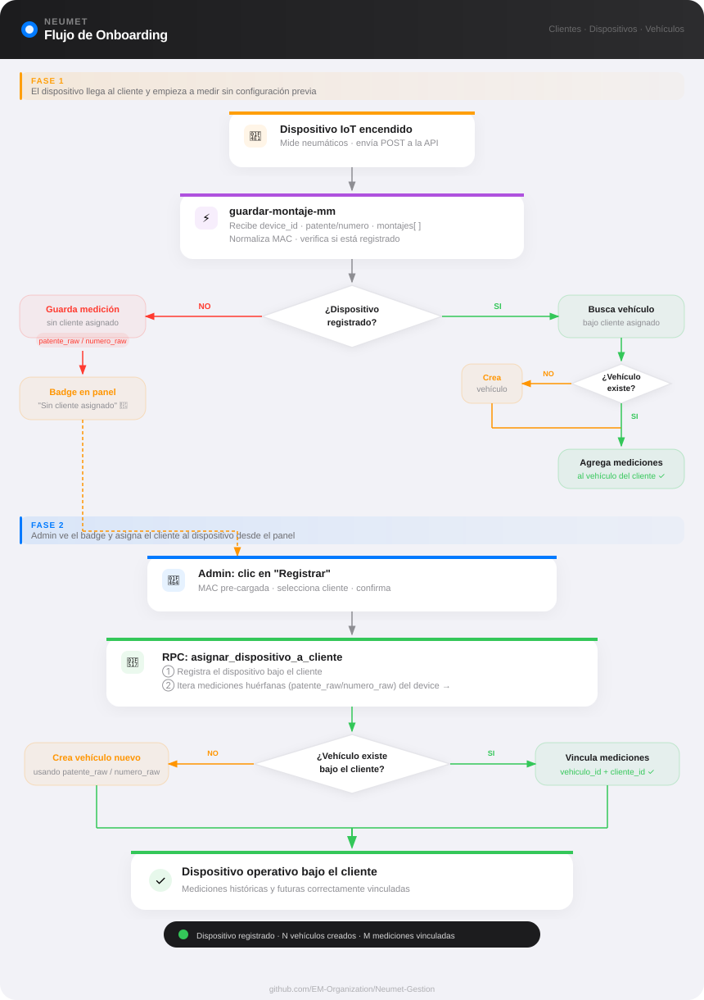

# NEUMET · Sistema de Gestión

Panel de administración web para la gestión de clientes, vehículos, dispositivos y mediciones de neumáticos.

---

> 📚 Revisión de arquitectura, auditoría de seguridad y plan de despliegue: ver [`docs/`](docs/README.md).

## Flujo de onboarding



El flujo está diseñado para que **el dispositivo llegue primero**: el cliente lo recibe y empieza a medir sin necesidad de configuración previa. El admin asigna el cliente desde el panel cuando ve llegar las primeras mediciones.

### Fase 1 — Dispositivo llega y empieza a medir

1. El dispositivo IoT se enciende y envía mediciones vía POST a `guardar-montaje-mm` con su MAC, patente/número del vehículo y las lecturas de mm.
2. La Edge Function busca el vehículo por patente o número:
   - Si el dispositivo **ya está registrado**: busca el vehículo **bajo el cliente asignado** a ese dispositivo.
   - Si el dispositivo **no está registrado**: busca el vehículo en cualquier cliente y almacena la medición igual. El dispositivo aparece con un badge en la sección **"Sin cliente asignado"** del panel admin.

### Fase 2 — Admin asigna el cliente

Cuando el admin ve el badge de dispositivos sin registrar:

1. Hace clic en **Registrar** junto al dispositivo (la MAC ya viene pre-cargada).
2. Selecciona el cliente al que pertenece ese dispositivo y confirma.
3. El panel llama al RPC **`asignar_dispositivo_a_cliente`** que en una sola transacción:
   - Registra el dispositivo bajo el cliente seleccionado.
   - Recorre todas las mediciones históricas del dispositivo y, por cada vehículo (patente/número) referenciado:
     - Si el cliente **ya tiene** ese vehículo → vincula las mediciones a él.
     - Si **no lo tiene** → crea el vehículo automáticamente bajo ese cliente y vincula las mediciones.
4. El toast confirma cuántos vehículos se crearon y cuántas mediciones se vincularon.

A partir de ese momento, las nuevas mediciones del dispositivo se enrutan directamente al cliente y sus vehículos.

---

## Arquitectura general

```
┌─────────────────────┐        POST /guardar-montaje-mm        ┌──────────────────────┐
│  Dispositivo físico │ ─────────────────────────────────────► │  Supabase Edge Fn    │
│  (medidor de mm)    │                                         │  guardar-montaje-mm  │
└─────────────────────┘                                         └──────────┬───────────┘
                                                                           │ INSERT
                                                                           ▼
┌─────────────────────┐         consulta bajo demanda          ┌──────────────────────┐
│  Panel Admin (web)  │ ◄────────────────────────────────────── │  Supabase (Postgres) │
│  neumet-admin       │         Supabase JS SDK                 │  Base de datos       │
└─────────────────────┘                                         └──────────────────────┘
```

---

## Flujo de datos

### 1. Dispositivo físico → Supabase

El dispositivo mide el desgaste de los neumáticos y envía los datos en un único POST al finalizar la sesión de medición.

**Endpoint:**
```
POST https://dqgrlflrjcarxlfetvoj.supabase.co/functions/v1/guardar-montaje-mm
Content-Type: application/json
```

**Body:**
```json
{
  "device_id": "AA:BB:CC:DD:EE:FF",
  "patente":   "MAJ2429",
  "numero":    "",
  "montajes": [
    { "posicion": 1, "mm1": 12, "mm2": 11, "mm3": 10 },
    { "posicion": 2, "mm1": 13, "mm2": 12, "mm3": 11 }
  ]
}
```

| Campo | Requerido | Descripción |
|---|---|---|
| `device_id` | ✓ | MAC address del dispositivo físico (ej: `AA:BB:CC:DD:EE:FF`) |
| `patente` | ✓ (o `numero`) | Matrícula del vehículo (se normaliza: mayúsculas, sin espacios) |
| `numero` | ✓ (o `patente`) | Número interno de 3 dígitos del vehículo (alternativa a patente) |
| `montajes` | ✓ | Array con una entrada por rueda medida |
| `posicion` | ✓ | Número de rueda (1 a 10 en camiones de 10 ruedas, 1 a 16 en los de 16) |
| `mm1`–`mm3` | ✓ | Las 3 lecturas de profundidad en milímetros (huellas interno, centro y externo, en ese orden: mm1=interno, mm2=centro, mm3=externo) |

> Se puede identificar el vehículo por `patente` **o** por `numero`. Si ambos vienen, se usa `patente`.

**Lo que hace la Edge Function:**
1. Valida que venga `patente` o `numero` y al menos un montaje
2. Busca el vehículo en la tabla `vehiculos` (por `patente_norm` o `numero`)
3. Obtiene el `vehiculo_id` y `cliente_id`
4. Calcula el `promedio` de las tres lecturas mm1–mm3 por rueda
5. Inserta todas las ruedas de una vez en la tabla `mediciones`
6. Responde `{ ok: true, vehiculo_id, ruedas_guardadas }` o un error descriptivo

---

### 2. Supabase → Panel Admin

El panel web se conecta directamente a Supabase mediante el SDK de JavaScript. Lee y escribe mediante consultas bajo demanda (sin suscripción Realtime) y sin servidor intermedio.

**Tablas utilizadas:**

| Tabla | Descripción |
|---|---|
| `clientes` | Empresas registradas. Tienen usuario de acceso (Supabase Auth) y precio mensual |
| `vehiculos` | Vehículos de cada cliente. Campos: `nombre`, `patente`, `numero`, `tipo_ruedas` (10 o 16), `activo` |
| `dispositivos` | Medidores físicos identificados por MAC Address, asignados a un cliente |
| `mediciones` | Lecturas de desgaste. Una fila por rueda por sesión. Campos: `vehiculo_id`, `cliente_id`, `device_id`, `posicion`, `mm1`–`mm3`, `promedio`, `created_at` |
| `gastos` | Gastos mensuales de la empresa (para el módulo de Balance) |

**Módulos del panel:**

- **Clientes** — Alta, edición y eliminación de clientes con credenciales de acceso (Supabase Auth)
- **Vehículos** — Gestión de vehículos por cliente. Se puede cargar patente y/o número de coche
- **Dispositivos** — Registro de medidores por MAC Address. Muestra dispositivos no registrados que ya enviaron mediciones
- **Balance** — Ingresos por cliente (precio mensual editable), gastos recurrentes y resultado neto mensual con gráfico de evolución
- **Mediciones** — Visualización del estado de neumáticos por vehículo o por dispositivo. Muestra el dibujo del camión con colores por estado (verde ≥ 8mm, naranja 5–7.9mm, rojo < 5mm)

---

## Estados de desgaste

| Color | Rango | Estado |
|---|---|---|
| 🟢 Verde | ≥ 8 mm | OK |
| 🟠 Naranja | 5 – 7.9 mm | Bajo |
| 🔴 Rojo | < 5 mm | Crítico |
| ⚫ Gris | Sin datos | — |

---

## Landing page (`/`)

Página pública para potenciales clientes con formulario de contacto.

- Archivo: `index.html` en la raíz — HTML/CSS/JS estático, sin dependencias de build
- Formulario de contacto con CAPTCHA local (canvas, sin dependencias externas)
- Al enviar, llama a la Edge Function `contacto` que despacha el email via **Resend**

### Edge Function: `contacto`

```
POST https://dqgrlflrjcarxlfetvoj.supabase.co/functions/v1/contacto
Content-Type: application/json
```

**Body:**
```json
{
  "nombre":   "Juan García",
  "empresa":  "Transportes S.A.",
  "email":    "juan@empresa.com",
  "telefono": "+598 99 123 456",
  "mensaje":  "Quiero más información."
}
```

---

## Dependencias externas

| Servicio | Rol | Dónde se configura |
|---|---|---|
| **Supabase** ([supabase.com](https://supabase.com)) | Base de datos PostgreSQL, autenticación, Edge Functions | [supabase.com/dashboard](https://supabase.com/dashboard) · Proyecto ID: `dqgrlflrjcarxlfetvoj` |
| **Vercel** ([vercel.com](https://vercel.com)) | Hosting del frontend (landing + panel admin) | [vercel.com/dashboard](https://vercel.com/dashboard) |
| **Resend** ([resend.com](https://resend.com)) | Envío de emails desde la Edge Function `contacto` | Secret `RESEND_API_KEY` en Supabase → Edge Functions → Secrets |

### Secrets requeridos en Supabase

Supabase Dashboard → Project Settings → Edge Functions → Secrets:

| Secret | Descripción |
|---|---|
| `RESEND_API_KEY` | API key de Resend. Necesaria para que la Edge Function `contacto` pueda enviar emails. |

> **Nota sobre Resend en free tier:** con el sender `onboarding@resend.dev` solo se puede enviar al email con el que se registró la cuenta. Para enviar a cualquier destinatario es necesario verificar un dominio propio en Resend → Domains y cambiar el sender a `contacto@tudominio.com`.

---

## Documentación

Revisión de arquitectura, auditoría de seguridad, observabilidad, despliegue e identidad visual: ver [`docs/`](docs/README.md).

## Identidad visual

Logos, isotipo, favicon y paleta viven en `assets/brand/`; guía de uso en [`assets/brand/README.md`](assets/brand/README.md) y criterios en [`docs/06-identidad-visual.md`](docs/06-identidad-visual.md).

## Estructura del proyecto

```
Neumet-Gestion/
├── index.html                        # Landing page pública (raíz)
├── app-demo.mp4                      # Video del dispositivo para la landing
├── adminpanel/
│   └── index.html                    # Panel admin (SPA)
├── assets/
│   ├── css/styles.css                # Estilos globales del panel
│   ├── config.js                     # window.NEUMET_CONFIG (URL y clave publishable de Supabase)
│   ├── js/                           # Panel en módulos ES: main.js, core/, domain/, views/ (ver assets/js/README.md)
│   ├── brand/                        # Identidad visual (logos, favicon, PNG)
│   └── img/                          # Diagrama de onboarding
├── supabase/
│   ├── migrations/                   # Esquema, API de proveedor, vistas y ciclo de vida
│   └── functions/
│       ├── api-proveedor/            # API de la app (login, obtener/guardar montaje)
│       ├── crear-cliente/            # Alta de clientes (solo admin)
│       └── contacto/                 # Formulario de la landing vía Resend
├── .gitignore
└── README.md
```

## Desarrollo local

No requiere dependencias ni servidor de build. Abrí `index.html` o `adminpanel/index.html` directamente en el navegador, o usá `npx serve` desde la raíz del proyecto.

> **Nota:** el panel admin usa el SDK de Supabase cargado como UMD desde CDN. Si abrís el archivo directamente como `file://` en Chrome/Edge puede haber restricciones de CORS. Recomendado: usar la extensión **Live Server** de VS Code o `npx serve`.
