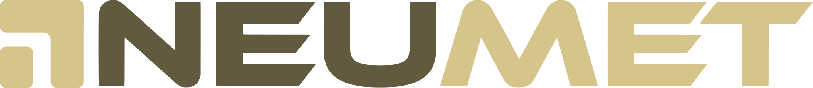

# assets/brand · Marca NEUMET

Fuente de verdad gráfica. Guía completa: [`docs/06-identidad-visual.md`](../../docs/06-identidad-visual.md).

## Paleta
`#FFFFFF` blanco · `#EBEBEB` gris · **`#D5C58A` dorado** · **`#615A3F` oliva** · `#383424` oliva oscuro · `#000000` negro

> El dorado no se usa como color de texto sobre fondos claros (contraste 1,72:1).

## Catálogo

| Carpeta | Archivo | Uso |
|---|---|---|
| `logo/` | `logo-horizontal-claro.svg` | **Principal** sobre fondos claros (isotipo dorado, NEU oliva, MET dorado) |
| | `logo-horizontal-oscuro.svg` | Sobre `#383424`/negro (NEU gris claro) |
| | `logo-horizontal-mono-{oscuro,negro,gris,dorado}.svg` | Un solo color |
| `isotipo/` | `isotipo-{dorado,oliva,oscuro,gris,negro}.svg` | Símbolo solo |
| | `isotipo-circulo.svg`, `isotipo-circulo-oscuro.svg` | Avatar / redes / favicon |
| `wordmark/` | `wordmark-{dorado,oliva,oscuro,gris,negro}.svg` | Solo texto, monocromo |
| | `wordmark-bicolor-{claro,oscuro}[-inv].svg` | Solo texto, bicolor (corte NEU \| MET) |
| `favicon/` | `favicon.svg`, `favicon-{32,192,512}.png`, `apple-touch-icon.png` | Navegadores y PWA |
| `png/` | Exportaciones de logos e isotipos (2000 px de ancho / 1024 px de alto) | Documentos, presentaciones, email |

## Ejemplo de uso (referencia, aún no aplicado en el sitio)
```html

<link rel="icon" type="image/svg+xml" href="/assets/brand/favicon/favicon.svg">
<link rel="apple-touch-icon" href="/assets/brand/favicon/apple-touch-icon.png">
```

## Advertencias
- **El wordmark está vectorizado por trazado** desde una imagen raster del PDF; usar solo en pantalla/documentos hasta recibir el vector original del estudio.
- Los SVG de wordmark y logo comparten `id` de `clipPath`; si se **incrustan inline** varios en la misma página, usar `` o renombrar los ids para evitar colisiones.
- No recolorear, estirar ni reescribir "NEUMET" con una fuente.
- Los SVG de `wordmark`/`logo` son trazados automáticos: no editarlos a mano; reemplazarlos por los vectores originales del estudio cuando lleguen.

## Fuente original
El `identidad.pdf` del estudio (Alegra Studio) **no se versiona** aquí: es un binario, y la licencia de la tipografía del wordmark está pendiente de confirmar. Solicitarlo al equipo; los vectores originales también se piden al estudio (ver `docs/06-identidad-visual.md` §8, B1).
