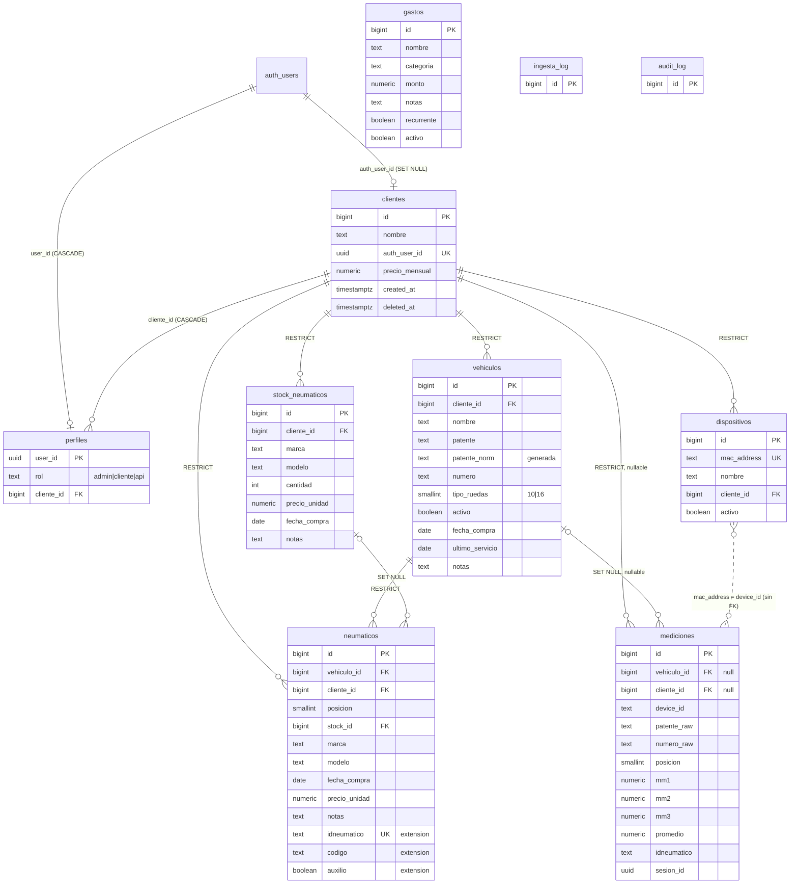

# 08 · Esquema de datos (deducido del código)

> Estado: **borrador sin aplicar** (2026-11-06). Migración: [`supabase/migrations/20261106000000_init_schema.sql`](../supabase/migrations/20261106000000_init_schema.sql).
> El esquema real de producción **no está en el repo**; este esquema se **deduce** de `assets/js/app.js`, `README.md`, `docs/02`, `04`, `07` y `tests/smoke/stub.js`. Lo que no tiene evidencia directa va marcado **[ASUNCIÓN]**. No se ha ejecutado contra ningún proyecto de Supabase.
> Validación realizada: se aplicó dos veces (idempotencia) en un PostgreSQL local desechable con un `auth` simulado y se probaron RLS por rol, RPCs, CHECKs y auditoría (ver §6). **No** se probó en Supabase real.

## 1. Diagrama ER

`ingesta_log` y `audit_log` no tienen FKs a propósito: deben sobrevivir al borrado de lo que describen.

## 2. Tabla por tabla y evidencia

Todas tienen `created_at timestamptz default now()` salvo `perfiles`/logs donde se indica. Los ids son `bigint identity` (el panel hace `parseInt` de los ids: `app.js:406`, `2075`).

### clientes
| Columna | Evidencia |
|---|---|
| `id`, `nombre` | `app.js:105`, `323-325`, `633` |
| `auth_user_id` (unique, → `auth.users`) | `app.js:105`, `149`, `324`; `rls_audit.sql` consulta 7 |
| `precio_mensual` numeric default 0 | `app.js:1347`, `1654` |
| `created_at` | `app.js:325` |
| `deleted_at` | no usado por el panel; pedido por docs/02 S5 |

`ON DELETE`: `auth_user_id` = SET NULL (borrar el usuario Auth no borra al cliente ni su historial).

### perfiles (nueva)
No existe en el código; reemplaza el "admin por exclusión" (`app.js:59-65`, `103-109`; docs/02 S2). CHECK: `admin` ⇒ `cliente_id` nulo; `cliente`/`api` ⇒ `cliente_id` obligatorio. FK a `clientes` = CASCADE (es un mapeo de acceso, no dato de negocio; evita que el `DELETE` del panel quede bloqueado por él). Un trigger en `clientes` crea el perfil `cliente` cuando `crear-cliente` fija `auth_user_id`, sin tocar esa función.

### vehiculos
| Columna | Evidencia |
|---|---|
| `id,nombre,patente,tipo_ruedas` | `app.js:217`, `626` |
| `numero,activo,cliente_id,fecha_compra,ultimo_servicio,notas` | `app.js:1963`, `2084` |
| `clientes(nombre)` embebido (FK cliente) | `app.js:1963` |
| `patente_norm` generada (`upper`, sin espacios) | README (búsqueda por `patente_norm`), docs/07 §3.2 |
| UNIQUE `(cliente_id, patente_norm)` y `(cliente_id, numero)` parciales | docs/07, `asignar_dispositivo...` busca por ambos |

El panel guarda la patente en mayúsculas pero **con** guiones/espacios internos (`app.js:2073`); `patente_norm` solo quita espacios.

### dispositivos
`id,mac_address,nombre,activo,cliente_id,created_at,clientes(nombre)` en `app.js:1740`; escritura `app.js:1929` (`nombre,cliente_id,activo`) y por RPC (`1917`). `mac_address` UNIQUE y CHECK `^([0-9A-F]{2}:){5}[0-9A-F]{2}$`; el panel acepta `-` (`app.js:1908`), por lo que un trigger normaliza `-`→`:` y mayúsculas antes del CHECK.

### mediciones
| Columna | Evidencia |
|---|---|
| `vehiculo_id,posicion,mm1,mm2,mm3,created_at,vehiculos(nombre)` | `app.js:218` |
| `cliente_id` | `app.js:216`, `219` |
| `promedio`, `idneumatico` | `app.js:680` |
| `device_id` | `app.js:1764`, `2634` |
| `patente_raw`, `numero_raw`, `vehiculos(nombre,patente,tipo_ruedas)` | `app.js:2690` |
| `sesion_id` | docs/07 §4.4 (no la lee el panel) |

`vehiculo_id` y `cliente_id` nulos permitidos (modo device-first, README). `vehiculo_id` ON DELETE **SET NULL**: el histórico se conserva y se puede re-vincular por `device_id`/`patente_raw`. `promedio`: **columna normal + trigger** que lo recalcula (no generada), porque la función actual lo inserta (README paso 4) y una columna generada rompería ese INSERT. Mapeo de lecturas: tabla = `mm1,mm2,mm3`; la traducción desde `mm1..mm4` de la API de proveedor ocurre en la Edge Function (`mm4→mm3`, descartar el `mm3` entrante), según docs/07 §3.1.

### neumaticos
`posicion,marca,modelo,fecha_compra,precio_unidad,notas` (`app.js:1023`); escritura con `vehiculo_id,cliente_id,posicion,stock_id,…` y `onConflict:'vehiculo_id,posicion'` (`2343-2355`) ⇒ UNIQUE `(vehiculo_id, posicion)`; `stock_id` y `vehiculos(nombre)` (`2372`). Extensión **no usada por el panel**, requerida por docs/07: `idneumatico text unique`, `codigo text`, `auxilio boolean default false` (un solo auxilio por vehículo, índice parcial). `stock_id` ON DELETE SET NULL (marca/modelo están copiados en la fila).

### stock_neumaticos
`id,marca,modelo,cliente_id,precio_unidad,fecha_compra,cantidad,notas,created_at,clientes(nombre)`: `app.js:2388`, `2530-2538`, `2546`.

### gastos
`nombre,categoria,monto,notas,recurrente,activo` (`app.js:1704`, `1709`), `created_at` (`1348`). Sin `cliente_id`: son gastos de la empresa.

### ingesta_log y audit_log
Estructura de docs/04 §2.1 y §2.2 más campos de docs/07 §4.5 (`endpoint, cuenta, cliente_id, vehiculo_id, n_guardados, n_fallidos`). `audit_log`: trigger `audit_row()` en `clientes, dispositivos, vehiculos, gastos`; trigger de bloqueo de UPDATE/DELETE/TRUNCATE (inmutable incluso para service_role y propietario). Se usan `actor_id`/`actor_rol` (docs/04) en lugar de un único `actor`.

### RPCs
- `get_unregistered_devices() → (device_id, last_seen, total_meds)`: columnas leídas en `app.js:1786-1806`; MAC con mediciones y sin fila en `dispositivos`.
- `asignar_dispositivo_a_cliente(p_mac text, p_cliente_id bigint, p_nombre text default null) → jsonb {dispositivo_id, vehiculos_creados, mediciones_vinculadas}`: parámetros `app.js:1917-1921`, resultado `1924-1925`, lógica README Fase 2.
- Ambas `SECURITY DEFINER`, `search_path=''`, `is_admin()` al inicio, `revoke ... from public, anon`, `grant ... to authenticated`.

## 3. Lista de [ASUNCIÓN]

**Tipos y precisión:** ids `bigint identity`; `precio_mensual numeric(12,2)`; `precio_unidad numeric(12,2)`; `monto numeric(14,2)`; `mm1..3 numeric(5,2)`; `fecha_compra`/`ultimo_servicio` `date`; `numero` text; `tipo_ruedas smallint` default 10; `posicion smallint` 1..99.
**Restricciones:** `mm1..3` NOT NULL y 0..40 (docs/07 §4.3); `cantidad >= 0`; `monto >= 0`; UNIQUE `(cliente_id, numero)`; UNIQUE parcial de un auxilio por vehículo; `mediciones.idneumatico` sin FK.
**Semántica:** `gastos.categoria` texto libre (el `<select>` usa nombres capitalizados y la fixture usa `infra`/`marketing`); `ingesta_log.status in (ok, rechazado, error)`.
**RPC:** identidad de vehículo = `patente_raw` normalizada y, si falta, `numero_raw`; vehículo nuevo con `nombre = patente` o `Nº <numero>` y `tipo_ruedas = 16` si alguna posición > 10; mediciones sin patente ni número solo reciben `cliente_id`; formas de salida de ambas RPC (campos extra como `n` de la fixture se ignoran).
**Extensión API:** `neumaticos.idneumatico/codigo/auxilio`, `mediciones.sesion_id`.
**Mapeo:** `mm1/mm2/mm3` = las tres huellas actuales; el orden interno/externo **no está confirmado** (docs/07 §3.1, pregunta 1).

## 4. Decisiones de seguridad

- **Defecto = denegar.** RLS activa en las 10 tablas; `anon` sin privilegios de tabla ni de función (y `alter default privileges ... revoke ... from anon`).
- **Rol explícito:** `perfiles` + `is_admin()` / `current_cliente_id()` (`SECURITY DEFINER`, `STABLE`, `search_path=''`, execute solo para `authenticated`). Se acabó el "admin = sin fila en clientes" del lado servidor.
- **Cliente:** solo SELECT de sus filas (`vehiculos, dispositivos, mediciones, stock_neumaticos`, su fila de `clientes`; `neumaticos` a través del vehículo). El código revisado **no ejecuta ninguna escritura** en modo cliente (todas las mutaciones salen de pantallas `data-admin-only`, `app.js:89-91`), por eso no hay políticas de escritura para él. **No** ve `gastos`, `perfiles` de otros, `audit_log` ni `ingesta_log`.
- **Rol `api`:** sin ninguna política (ni su propia fila de `perfiles`) ⇒ su JWT contra PostgREST ve 0 filas (docs/07 §4.1). Acceso solo vía Edge Function con service role, que debe filtrar por `cliente_id` del token.
- **`mediciones`:** sin política INSERT/UPDATE/DELETE para usuarios; las inserta solo service_role; admin y cliente solo leen.
- **ON DELETE:** RESTRICT para todo lo que cuelga de `clientes` y `vehiculos` (neumáticos); excepciones: `mediciones.vehiculo_id` SET NULL (conservar histórico), `neumaticos.stock_id` SET NULL, `perfiles.cliente_id` CASCADE, `clientes.auth_user_id` SET NULL.
- **Auditoría:** triggers en BD (no manipulables desde el navegador), inmutable, lectura solo admin.
- **Funciones internas** (`audit_row`, `clientes_sync_perfil`): sin execute para nadie salvo uso por trigger.

## 5. Preguntas abiertas

1. **El `DELETE` de clientes del panel (`app.js:343`) fallará** mientras el cliente tenga vehículos, dispositivos, stock o neumáticos (RESTRICT, intencional). Hay que pasar a soft delete (`update deleted_at`) y filtrar `deleted_at is null` en `loadClients`; el panel hoy no lo hace. Idem borrar vehículos con neumáticos asignados (`app.js:2590`).
2. **`precio_mensual` del propio cliente** es visible para él (la RLS filtra filas, no columnas). Si no debe verlo, hay que mover la columna a otra tabla solo-admin o exponer una vista.
3. ¿La BD real tiene columnas que el panel no lee (p. ej. `email`, `updated_at`, más campos de `mediciones`)? Un `supabase db dump --schema-only` lo resolvería; la migración es de arranque, no una réplica.
4. ¿`vehiculo.cliente_id` puede cambiarse con neumáticos asignados? `neumaticos.cliente_id` es redundante y podría quedar inconsistente (la RLS usa el vehículo, no esa columna).
5. Orden físico de `mm1`/`mm3` (interno/externo) y formato del `numero` (docs/07 §5).
6. Los datos existentes (si se migran) pueden violar los CHECK nuevos (MAC con `-`, mm fuera de 0..40, patentes duplicadas por cliente).
7. `crear-cliente` y `guardar-montaje-mm` no están versionadas: confirmar que `crear-cliente` crea la fila `clientes` con `auth_user_id` (el trigger crea el perfil) y que la ingesta inserta con service_role.
8. Primer administrador: debe crearse a mano en `perfiles` (instrucciones al final de la migración). Sin ello, nadie puede usar el panel.
9. Un cliente = un usuario (1:1, `auth_user_id` unique y `perfiles` PK en `user_id`); si cambia (roadmap, decisión 1) habrá que ajustar.

## 6. Cómo se validó

- Sin `psql` contra Supabase. En un Postgres local desechable (con roles `anon/authenticated/service_role` y `auth.users`/`auth.uid()` simulados) la migración se aplicó **dos veces sin errores** y se comprobó: promedio calculado, `patente_norm`, CHECK de mm, RLS para admin/cliente/api/anon, RPCs (admin OK; cliente rechazado; segunda llamada con la misma MAC falla por unicidad; 2 vehículos creados y 3 mediciones vinculadas), auditoría y bloqueo de UPDATE/DELETE en `audit_log`.
- No cubre diferencias propias de Supabase (extensiones, roles `supabase_admin`, privilegios por defecto reales). Repetir las comprobaciones del final de la migración y `supabase/audit/rls_audit.sql` en staging.
