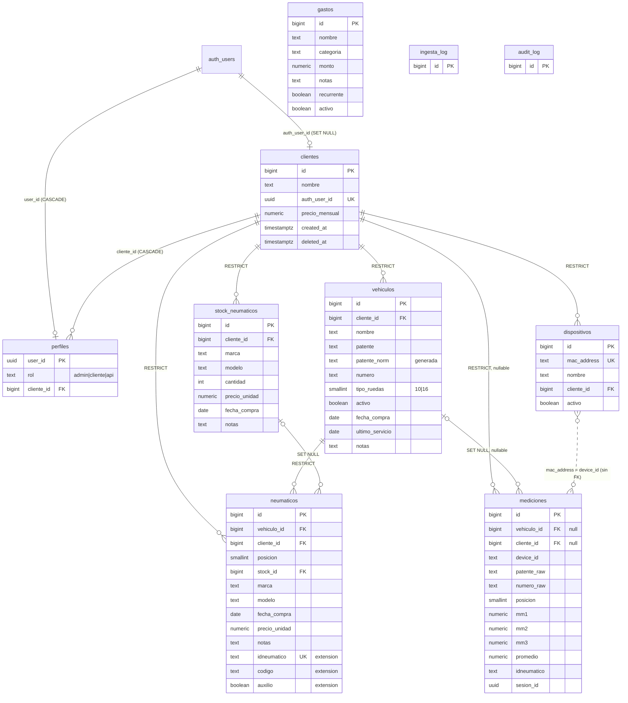

# 08 · Esquema de datos (deducido del código)

> Estado: **aplicado** en Supabase `kootszosdejmawanfxug` (2026-11-06, migraciones 20261106000000/010000/020000). Migración: [`supabase/migrations/20261106000000_init_schema.sql`](../supabase/migrations/20261106000000_init_schema.sql).
> Nota histórica: al redactar este documento el esquema real no estaba en el repo; el esquema se **dedujo** del código del panel (originalmente el monolito `app.js`, hoy módulos ES en `assets/js/`; las referencias `app.js:N` son históricas), `README.md`, `docs/02`, `04`, `07` y `tests/smoke/stub.js`. Lo que no tiene evidencia directa va marcado **[ASUNCIÓN]**. No se ha ejecutado contra ningún proyecto de Supabase.
> Validación realizada: se aplicó dos veces (idempotencia) en un PostgreSQL local desechable con un `auth` simulado y se probaron RLS por rol, RPCs, CHECKs y auditoría (ver §6). **No** se probó en Supabase real.

## 1. Diagrama ER

`ingesta_log` y `audit_log` no tienen FKs a propósito: deben sobrevivir al borrado de lo que describen.

## 2. Tabla por tabla y evidencia

Todas tienen `created_at timestamptz default now()` salvo `perfiles`/logs donde se indica. Los ids son `bigint identity` (el panel hace `parseInt` de los ids: `app.js:406`, `2075`).

### clientes
| Columna | Evidencia |
|---|---|
| `id`, `nombre` | `app.js:105`, `323-325`, `633` |
| `auth_user_id` (unique, → `auth.users`) | `app.js:105`, `149`, `324`; `rls_audit.sql` consulta 7 |
| `precio_mensual` numeric default 0 | `app.js:1347`, `1654` |
| `created_at` | `app.js:325` |
| `deleted_at` | no usado por el panel; pedido por docs/02 S5 |

`ON DELETE`: `auth_user_id` = SET NULL (borrar el usuario Auth no borra al cliente ni su historial).

### perfiles (nueva)
No existe en el código; reemplaza el "admin por exclusión" (`app.js:59-65`, `103-109`; docs/02 S2). CHECK: `admin` ⇒ `cliente_id` nulo; `cliente`/`api` ⇒ `cliente_id` obligatorio. FK a `clientes` = CASCADE (es un mapeo de acceso, no dato de negocio; evita que el `DELETE` del panel quede bloqueado por él). Un trigger en `clientes` crea el perfil `cliente` cuando `crear-cliente` fija `auth_user_id`, sin tocar esa función.

### vehiculos
| Columna | Evidencia |
|---|---|
| `id,nombre,patente,tipo_ruedas` | `app.js:217`, `626` |
| `numero,activo,cliente_id,fecha_compra,ultimo_servicio,notas` | `app.js:1963`, `2084` |
| `clientes(nombre)` embebido (FK cliente) | `app.js:1963` |
| `patente_norm` generada (`upper`, sin espacios) | README (búsqueda por `patente_norm`), docs/07 §3.2 |
| UNIQUE `(cliente_id, patente_norm)` y `(cliente_id, numero)` parciales | docs/07, `asignar_dispositivo...` busca por ambos |

El panel guarda la patente en mayúsculas pero **con** guiones/espacios internos (`app.js:2073`); `patente_norm` solo quita espacios.

### dispositivos
`id,mac_address,nombre,activo,cliente_id,created_at,clientes(nombre)` en `app.js:1740`; escritura `app.js:1929` (`nombre,cliente_id,activo`) y por RPC (`1917`). `mac_address` UNIQUE y CHECK `^([0-9A-F]{2}:){5}[0-9A-F]{2}$`; el panel acepta `-` (`app.js:1908`), por lo que un trigger normaliza `-`→`:` y mayúsculas antes del CHECK.

### mediciones
| Columna | Evidencia |
|---|---|
| `vehiculo_id,posicion,mm1,mm2,mm3,created_at,vehiculos(nombre)` | `app.js:218` |
| `cliente_id` | `app.js:216`, `219` |
| `promedio`, `idneumatico` | `app.js:680` |
| `device_id` | `app.js:1764`, `2634` |
| `patente_raw`, `numero_raw`, `vehiculos(nombre,patente,tipo_ruedas)` | `app.js:2690` |
| `sesion_id` | docs/07 §4.4 (no la lee el panel) |

`vehiculo_id` y `cliente_id` nulos permitidos (modo device-first, README). `vehiculo_id` ON DELETE **SET NULL**: el histórico se conserva y se puede re-vincular por `device_id`/`patente_raw`. `promedio`: **columna normal + trigger** que lo recalcula (no generada), porque la función actual lo inserta (README paso 4) y una columna generada rompería ese INSERT. Mapeo de lecturas: tabla = `mm1,mm2,mm3`; la traducción desde `mm1..mm4` de la API de proveedor ocurre en la Edge Function (`mm4→mm3`, descartar el `mm3` entrante), según docs/07 §3.1.

### neumaticos
> Desde el apéndice F, `vehiculo_id` y `posicion` admiten NULL: una fila sin montar es una **cubierta de stock** (`estado = 'almacenado'`, `condicion`, `sucursal_id`).

`posicion,marca,modelo,fecha_compra,precio_unidad,notas` (`app.js:1023`); escritura con `vehiculo_id,cliente_id,posicion,stock_id,…` y `onConflict:'vehiculo_id,posicion'` (`2343-2355`) ⇒ UNIQUE `(vehiculo_id, posicion)`; `stock_id` y `vehiculos(nombre)` (`2372`). Extensión **no usada por el panel**, requerida por docs/07: `idneumatico text unique`, `codigo text`, `auxilio boolean default false` (un solo auxilio por vehículo, índice parcial). `stock_id` ON DELETE SET NULL (marca/modelo están copiados en la fila).

### stock_neumaticos
`id,marca,modelo,cliente_id,precio_unidad,fecha_compra,cantidad,notas,created_at,clientes(nombre)`: `app.js:2388`, `2530-2538`, `2546`.

### gastos
`nombre,categoria,monto,notas,recurrente,activo` (`app.js:1704`, `1709`), `created_at` (`1348`). Sin `cliente_id`: son gastos de la empresa.

### ingesta_log y audit_log
Estructura de docs/04 §2.1 y §2.2 más campos de docs/07 §4.5 (`endpoint, cuenta, cliente_id, vehiculo_id, n_guardados, n_fallidos`). `audit_log`: trigger `audit_row()` en `clientes, dispositivos, vehiculos, gastos`; trigger de bloqueo de UPDATE/DELETE/TRUNCATE (inmutable incluso para service_role y propietario). Se usan `actor_id`/`actor_rol` (docs/04) en lugar de un único `actor`.

### RPCs
- `get_unregistered_devices() → (device_id, last_seen, total_meds)`: columnas leídas en `app.js:1786-1806`; MAC con mediciones y sin fila en `dispositivos`.
- `asignar_dispositivo_a_cliente(p_mac text, p_cliente_id bigint, p_nombre text default null) → jsonb {dispositivo_id, vehiculos_creados, mediciones_vinculadas}`: parámetros `app.js:1917-1921`, resultado `1924-1925`, lógica README Fase 2.
- Ambas `SECURITY DEFINER`, `search_path=''`, `is_admin()` al inicio, `revoke ... from public, anon`, `grant ... to authenticated`.

## 3. Lista de [ASUNCIÓN]

**Tipos y precisión:** ids `bigint identity`; `precio_mensual numeric(12,2)`; `precio_unidad numeric(12,2)`; `monto numeric(14,2)`; `mm1..3 numeric(5,2)`; `fecha_compra`/`ultimo_servicio` `date`; `numero` text; `tipo_ruedas smallint` default 10; `posicion smallint` 1..99.
**Restricciones:** `mm1..3` NOT NULL y 0..40 (docs/07 §4.3); `cantidad >= 0`; `monto >= 0`; UNIQUE `(cliente_id, numero)`; UNIQUE parcial de un auxilio por vehículo; `mediciones.idneumatico` sin FK.
**Semántica:** `gastos.categoria` texto libre (el `<select>` usa nombres capitalizados y la fixture usa `infra`/`marketing`); `ingesta_log.status in (ok, rechazado, error)`.
**RPC:** identidad de vehículo = `patente_raw` normalizada y, si falta, `numero_raw`; vehículo nuevo con `nombre = patente` o `Nº <numero>` y `tipo_ruedas = 16` si alguna posición > 10; mediciones sin patente ni número solo reciben `cliente_id`; formas de salida de ambas RPC (campos extra como `n` de la fixture se ignoran).
**Extensión API:** `neumaticos.idneumatico/codigo/auxilio`, `mediciones.sesion_id`.
**Mapeo:** `mm1/mm2/mm3` = las tres huellas actuales; orden físico confirmado (app de DAC): `mm1` = interno, `mm2` = centro, `mm3` = externo. Cambiarlo = una constante en `api-proveedor/mapping.ts` (docs/07 §3.1).

## 4. Decisiones de seguridad

- **Defecto = denegar.** RLS activa en las 10 tablas; `anon` sin privilegios de tabla ni de función (y `alter default privileges ... revoke ... from anon`).
- **Rol explícito:** `perfiles` + `is_admin()` / `current_cliente_id()` (`SECURITY DEFINER`, `STABLE`, `search_path=''`, execute solo para `authenticated`). Se acabó el "admin = sin fila en clientes" del lado servidor.

### Matriz de roles vigente

Un perfil por usuario (`perfiles.user_id`). Helpers `SECURITY DEFINER`: `is_admin()`, `current_cliente_id()`, `current_sucursal_id()` (apéndice B) y `precios_visibles()` (migración `20261116500000`). La figura «global» no tiene valor propio: es `rol = 'cliente'` con `sucursal_id` nulo. Las viñetas siguientes de esta sección son del diseño inicial y quedaron desactualizadas: el cliente ya escribe por RPC (apéndices B a G) y el stock, los precios y las sucursales los gestiona el perfil global. Esta matriz es la vigente.

| Rol | Representación | Datos y operaciones |
|---|---|---|
| `admin` | `rol = 'admin'`, `cliente_id` nulo | Lectura y escritura entre todos los clientes. Exclusivas hoy: editar umbrales por UPDATE directo sobre `clientes`, cuentas de API, escritura sobre dispositivos, edición de Balance y de `precio_mensual`, lectura de `ingesta_log` y `audit_log`. No son exclusivas del router: la ficha de cliente, Balance y Clientes no usan `soloAdmin` (solo Dispositivos); las protege el menú y la RLS |
| Cliente global | `rol = 'cliente'`, `sucursal_id` nulo | Todo su cliente: sucursales, stock, precios y costos, recauchutado, montaje y cambio de neumático, nivel crítico de alertas (`alerta_configurar`). Lee también `precio_mensual` de su cliente (ver nota) |
| Cliente de sucursal | `rol = 'cliente'` con `sucursal_id` | Solo su sucursal; sin stock, precios ni costos de neumáticos (`precio_mensual` sí lo lee, ver nota); umbrales solo lectura |
| `api` | `rol = 'api'` | Sin política ni acceso por PostgREST; solo vía `api-proveedor` con service role |
| Sin perfil, `anon` | | Sin acceso |

Nota: `precio_mensual` **no** es exclusivo del admin. `clientes` tiene grant de tabla completa a `authenticated` (`init_schema.sql:448`) y `clientes_self_select` (`:458`) deja a cualquier usuario del cliente, global o de sucursal, leer esa columna de su fila; la interfaz no la muestra, pero la API la entrega. Lo cerró la migración C2 (apéndice Q): hoy ningún rol de `authenticated` lee ni escribe esa columna.

El primer usuario de cada cliente es global (trigger `clientes_sync_perfil`). Hoy no existe forma de quitar el acceso a un usuario.

### Cambio de roles (estado: en curso, F10)

El plan [docs/17](17-plan-roles-admin.md) separa el perfil `admin` (pasa a ser el **equipo Neumet**, sin renombrar el valor en la base) del **administrador de empresa** (el cliente global actual, con gestión de usuarios y umbrales). Estado: en curso (F10). Aplicadas en producción las migraciones A, B, C1 y C2; el front del equipo Neumet ya es de solo lectura y el administrador de empresa gestiona usuarios y umbrales desde Empresa. Quedan pendientes los renombres de interfaz y lo que figure en el tablero ([10](10-tablero.md)). Los nombres de la tabla siguen siendo los del plan.

| Rol en la base | Rol en el plan | Qué cambia |
|---|---|---|
| `admin` | Equipo Neumet | Gana «Uso» por cliente; con la migración C2 solo mira dentro de las empresas (decisión P1 del dueño) |
| Cliente global | Administrador de empresa | Gana Usuarios (crear, asignar sucursal, quitar acceso) y todos los umbrales; función nueva `admin_empresa_cliente_id()`; deja de ver `precio_mensual` (migración C2) |
| Cliente de sucursal, `api` | Usuario de sucursal, Integración | Sin cambios |

### Diseño inicial (desactualizado)

Las viñetas siguientes son del diseño inicial; la matriz vigente es la de arriba.

- **Cliente:** solo SELECT de sus filas (`vehiculos, dispositivos, mediciones, stock_neumaticos`, su fila de `clientes`; `neumaticos` a través del vehículo). El código revisado **no ejecuta ninguna escritura** en modo cliente (todas las mutaciones salen de pantallas `data-admin-only`, `app.js:89-91`), por eso no hay políticas de escritura para él. **No** ve `gastos`, `perfiles` de otros, `audit_log` ni `ingesta_log`.
- **Rol `api`:** sin ninguna política (ni su propia fila de `perfiles`) ⇒ su JWT contra PostgREST ve 0 filas (docs/07 §4.1). Acceso solo vía Edge Function con service role, que debe filtrar por `cliente_id` del token.
- **`mediciones`:** sin política INSERT/UPDATE/DELETE para usuarios; las inserta solo service_role; admin y cliente solo leen.
- **ON DELETE:** RESTRICT para todo lo que cuelga de `clientes` y `vehiculos` (neumáticos); excepciones: `mediciones.vehiculo_id` SET NULL (conservar histórico), `neumaticos.stock_id` SET NULL, `perfiles.cliente_id` CASCADE, `clientes.auth_user_id` SET NULL.
- **Auditoría:** triggers en BD (no manipulables desde el navegador), inmutable, lectura solo admin.
- **Funciones internas** (`audit_row`, `clientes_sync_perfil`): sin execute para nadie salvo uso por trigger.

## 5. Preguntas abiertas

1. **El `DELETE` de clientes del panel (`app.js:343`) fallará** mientras el cliente tenga vehículos, dispositivos, stock o neumáticos (RESTRICT, intencional). Hay que pasar a soft delete (`update deleted_at`) y filtrar `deleted_at is null` en `loadClients`; el panel hoy no lo hace. Idem borrar vehículos con neumáticos asignados (`app.js:2590`).
2. **`precio_mensual` del propio cliente** es visible para él (la RLS filtra filas, no columnas). Si no debe verlo, hay que mover la columna a otra tabla solo-admin o exponer una vista.
3. ¿La BD real tiene columnas que el panel no lee (p. ej. `email`, `updated_at`, más campos de `mediciones`)? Un `supabase db dump --schema-only` lo resolvería; la migración es de arranque, no una réplica.
4. ¿`vehiculo.cliente_id` puede cambiarse con neumáticos asignados? `neumaticos.cliente_id` es redundante y podría quedar inconsistente (la RLS usa el vehículo, no esa columna).
5. Formato del `numero` (docs/07 §5).
6. Los datos existentes (si se migran) pueden violar los CHECK nuevos (MAC con `-`, mm fuera de 0..40, patentes duplicadas por cliente).
7. `crear-cliente` y `guardar-montaje-mm` no están versionadas: confirmar que `crear-cliente` crea la fila `clientes` con `auth_user_id` (el trigger crea el perfil) y que la ingesta inserta con service_role (la RPC `api_guardar_montaje` también crea vehículos y neumáticos: apéndice R).
8. Primer administrador: debe crearse a mano en `perfiles` (instrucciones al final de la migración). Sin ello, nadie puede usar el panel.
9. Resuelta en F10 (docs/17): un cliente tiene un administrador de empresa (perfil `cliente` sin sucursal) y usuarios de sucursal, todos en `perfiles` (PK en `user_id`: un usuario pertenece a un solo cliente). `clientes.auth_user_id` (unique) es solo el vínculo del primer administrador y, desde C2, no se escribe por la API (apéndices N y Q).

## 6. Cómo se validó

- Sin `psql` contra Supabase. En un Postgres local desechable (con roles `anon/authenticated/service_role` y `auth.users`/`auth.uid()` simulados) la migración se aplicó **dos veces sin errores** y se comprobó: promedio calculado, `patente_norm`, CHECK de mm, RLS para admin/cliente/api/anon, RPCs (admin OK; cliente rechazado; segunda llamada con la misma MAC falla por unicidad; 2 vehículos creados y 3 mediciones vinculadas), auditoría y bloqueo de UPDATE/DELETE en `audit_log`.
- No cubre diferencias propias de Supabase (extensiones, roles `supabase_admin`, privilegios por defecto reales). Repetir las comprobaciones del final de la migración y `supabase/audit/rls_audit.sql` en staging.

---

# Apéndice A · Migración de producto `20261106020000_producto_vistas.sql`

Segunda migración (depende solo de la inicial). Añade umbrales por cliente, odómetro, ciclo de vida del neumático, cinco vistas para el panel y la RPC de baja suave. **No está aplicada**: la aplica el director. Idempotente; sin `begin/commit` (la herramienta ya envuelve). Probada en Postgres local con `tests/sql/run.sh` (ver A.6).

## A.1 Columnas y tablas nuevas

| Objeto | Detalle |
|---|---|
| `clientes.umbral_bajo_mm` / `umbral_critico_mm` / `umbral_retiro_mm` | `numeric(4,1)`, defecto 8 / 5 / 3 (igual que `WEAR` de `app.js`). CHECK `retiro < crítico < bajo` y `> 0` |
| `clientes.dias_sin_medir_alerta` | `integer`, defecto 30 |
| `clientes.irregularidad_mm` | `numeric(3,1)`, defecto 2: diferencia máxima entre huellas |
| `mediciones.odometro_km` | `integer` nullable, `>= 0` |
| `vehiculos.odometro_km`, `odometro_actualizado_at` | `integer >= 0` / `timestamptz`, nullable. **Nada los rellena automáticamente**: la Edge Function (o el panel) debe actualizarlos |
| `neumaticos.vida` | `smallint` 0..3 (0 nuevo, 1..3 reencauches), defecto 0 |
| `neumaticos.estado` | `montado` (defecto) / `almacenado` / `reparacion` / `baja` |
| `neumaticos.fecha_baja`, `motivo_baja` | `date`, `text` |
| `eventos_neumatico` | `id, cliente_id (RESTRICT), vehiculo_id (RESTRICT), neumatico_id (SET NULL), idneumatico, tipo (montaje, desmontaje, rotacion, reparacion, reencauche, baja, inspeccion), posicion_origen/destino, odometro_km, costo, notas, created_by (auth.uid()), created_at`. RLS: admin ALL, cliente SELECT de lo suyo, api/anon nada. Trigger `audit_row()` (INSERT/UPDATE/DELETE quedan en `audit_log`). Los eventos no tienen restricción de coherencia `vehiculo.cliente_id = cliente_id`: lo garantiza quien escribe (solo admin) |
| Índice | `mediciones (cliente_id, created_at desc)`; los de `eventos_neumatico` (cliente, vehículo, neumático, fecha) |

## A.2 Vistas (todas `security_invoker = true`: heredan la RLS de quien consulta)

Admin ve todo; un cliente solo lo suyo; el perfil `api` y usuarios sin perfil, 0 filas; `anon`, `permission denied`. Ninguna vista toca `gastos`. Excluyen vehículos inactivos, clientes eliminados (`deleted_at`) y neumáticos no montados.

- **`v_mediciones_neumatico`** `(cliente_id, vehiculo_id, neumatico_id, idneumatico, estado_montaje, posicion_actual, posicion_medicion, medicion_id, mm1..mm3, promedio, odometro_km, device_id, created_at, atribucion)` (migración `20261109000000`): cada medición atribuida al neumático al que pertenece, con la posición donde está HOY. Es la base de las demás vistas y del historial del detalle del vehículo. Regla en el apéndice D.
- **`v_ultima_medicion`** `(cliente_id, vehiculo_id, posicion, medicion_id, idneumatico, mm1..mm3, promedio, odometro_km, device_id, created_at)`: última medición del neumático **montado** en cada `(vehiculo_id, posicion)` (`posicion` = posición actual; `distinct on`, desempate por `id`). Un neumático recién montado sin mediciones no tiene fila.
- **`v_estado_neumaticos`**: una fila por posición (filas de `neumaticos` más posiciones medidas sin fila en `neumaticos`). Columnas: identificación (`cliente_id, vehiculo_id, vehiculo_nombre, patente, posicion, neumatico_id, idneumatico, marca, modelo, vida, estado_montaje`), última lectura (`mm1..3, promedio, odometro_km, ultima_medicion_at, dias_desde_medicion`), `estado`, `sin_medir`, `diferencia_huellas_mm`, `desgaste_irregular`, `n_mediciones_90d`, `tasa_mm_semana`, `semanas_hasta_critico`, `semanas_hasta_retiro` y los umbrales del cliente.
- **`v_alertas`** `(cliente_id, vehiculo_id, vehiculo_nombre, patente, posicion, neumatico_id, idneumatico, tipo, severidad, valor, mensaje, ultima_medicion_at)`: una fila por alerta.
- **`v_resumen_flota_cliente`** `(cliente_id, nombre, n_vehiculos_activos, n_neumaticos_con_datos, n_ok, n_bajo, n_critico, n_sin_datos, n_alertas_sev1..3, ultima_medicion_at)`.
- **`v_salud_dispositivos`** `(dispositivo_id, cliente_id, mac_address, nombre, activo, ultima_actividad_at, total_mediciones, dias_sin_actividad, estado)`.

## A.3 Fórmulas

- **Promedio**: `round((mm1+mm2+mm3)/3, 2)` (trigger existente).
- **Semáforo** (con los umbrales del cliente del vehículo): `sin_datos` si no hay promedio; `critico` si `promedio < umbral_critico`; `bajo` si `promedio < umbral_bajo`; si no `ok`. Límites: 5.00 es `bajo`, 4.99 `critico`, 8.00 `ok`, 7.99 `bajo` (con 8/5).
- **Desgaste irregular**: `max(mm1,mm2,mm3) - min(mm1,mm2,mm3) > irregularidad_mm`, con `clientes.irregularidad_mm` (por defecto 2). Estricto: con umbral 2.0, una diferencia de 2.0 no alerta. Es la regla de la alerta de la base (`desgaste_irregular`) y la que usan las vistas de flota y de detalle del vehículo. Ojo: la lectura de una medición (`unevenWear` en `assets/js/domain/desgaste.js`, visible en `assets/js/views/mediciones.js`) todavía usa `|mm1-mm3| >= 1.5`; queda pendiente unificarla con esta regla.
- **Tasa mm/semana** = `-regr_slope(promedio, epoch(created_at)) * 604800` sobre las mediciones de los **últimos 90 días** de cada **neumático** montado (apéndice D), con **tiempo transcurrido** (no fechas). Solo hay tasa con **al menos 3 mediciones y 14 días** entre la primera y la última de la ventana; si no, `null` («mediciones insuficientes»). La ventana se **reinicia** en el último evento de `reencauche`, `reparacion` o `montaje` del neumático (`eventos_neumatico.neumatico_id`; la rotación no reinicia) y una pendiente negativa da `null` (nunca hay tasa negativa). `n_mediciones_90d` cuenta las mediciones de los últimos 90 días sin reinicio. Desde `20261111000000_tasa_y_rendimiento.sql` la vista se calcula por neumático con sondas a `mediciones_idneumatico_idx` (y, solo para el histórico sin `idneumatico`, a `mediciones_veh_pos_fecha_idx`). Positivo = se está gastando. Un neumático nuevo no mezcla puntos del viejo y, tras rotar, la tasa acompaña al neumático. A diferencia de `mAnalysis` (primera vs última medición), no usa solo los extremos.
- **Semanas hasta crítico / retiro** = `max(promedio - umbral, 0) / tasa` si `tasa > 0`, si no `null` (0 si ya está por debajo del umbral). El retiro por defecto es 3 mm, igual que el `LIMIT` de `mAnalysis`.
- **Alertas** (`severidad`): `critico` (3); `bajo` (2); `cruza_critico_pronto` (2: estado ok o bajo con `semanas_hasta_critico <= 4`, `valor` = semanas); `desgaste_irregular` (2, `valor` = diferencia en mm); `sin_medir` (1: neumático montado sin ninguna medición, o última medición más vieja que `dias_sin_medir_alerta` días, `valor` = días o null).
- **Salud de dispositivo**: `dias_sin_actividad = floor(días desde la última medición con su device_id)`; `activo` ≤ 7, `sin_actividad` ≤ 30, `caido` > 30, `nunca` si no hay mediciones. `activo=false` del dispositivo se informa aparte.

## A.4 RPC

`public.cliente_eliminar_suave(p_id bigint) → jsonb {cliente_id, vehiculos_desactivados, dispositivos_desactivados}`. `SECURITY DEFINER`, `search_path=''`, exige `is_admin()` (42501), cliente inexistente 23503. Marca `deleted_at` (si no lo tenía), pone `activo=false` en vehículos y dispositivos; no borra nada (el `DELETE` directo sigue fallando por RESTRICT). `execute` solo para `authenticated`. Es idempotente. No toca `auth_user_id`/`perfiles`: el cliente eliminado deja de ver sus datos porque `clientes_self_select` exige `deleted_at is null` y las vistas lo excluyen.

## A.5 Guía para el panel (backlog de docs/09 §6)

| # | Pantalla | Qué consultar |
|---|---|---|
| 1 | Panel de flota con prioridades | `v_estado_neumaticos` (contadores por `estado`; orden: `estado`, `promedio` asc); `v_resumen_flota_cliente` para los totales y el filtro por cliente |
| 2 | Centro de alertas | `v_alertas order by severidad desc, ultima_medicion_at` (filtrar por `tipo`/`cliente_id`) |
| 4 | Vista de cliente | `v_resumen_flota_cliente` (una fila), `v_estado_neumaticos where cliente_id=…` y `eventos_neumatico` para costos; el gasto en neumáticos sale de `neumaticos.precio_unidad`/`eventos_neumatico.costo`, que desde el apéndice K solo se leen con `neumaticos_precios()` / `eventos_costos()` |
| 5 | Salud de dispositivos | `v_salud_dispositivos` (combinar con `get_unregistered_devices()` para MAC sin registrar) |
| 8 | Predicción / vida remanente | `v_estado_neumaticos.tasa_mm_semana`, `semanas_hasta_critico`, `semanas_hasta_retiro`; alertas `cruza_critico_pronto` |
| 9 | Desgaste irregular | `v_estado_neumaticos.desgaste_irregular`, `diferencia_huellas_mm`; alertas `desgaste_irregular` |

Para el detalle de un neumático (#6/#7) el panel sigue leyendo `mediciones` (historial) y, para la línea de tiempo, `eventos_neumatico where neumatico_id=… order by created_at`. Los umbrales se editan con un `update` de `clientes` (solo admin; los CHECK validan la coherencia). El panel puede dejar de calcular estado/tasa/predicción en JS y leer estas vistas; mientras tanto, `WEAR` en `app.js` debe coincidir con los umbrales por defecto.

## A.6 Cómo se validó y límites

- `tests/sql/run.sh` crea un Postgres desechable (`initdb`/`pg_ctl` en un directorio temporal; o `TEST_PG_URL`; o Docker), simula `auth.users`/`auth.uid()`/roles, aplica la migración inicial y la de producto **dos veces** (idempotencia) y ejecuta ~170 aserciones: semáforo en límites exactos, tasa y semanas con datos conocidos, cada tipo de alerta, aislamiento por cliente/rol (admin, cliente A, cliente B, api, sin perfil, anon) en todas las vistas y tablas nuevas, estructura (security_invoker, grants, RLS), `eventos_neumatico` (RLS, constraints, auditoría), `cliente_eliminar_suave` y la inmutabilidad de `audit_log`. Sale con código ≠ 0 si algo falla. CI: job `sql` (servicio `postgres:16`).
- **No cubierto**: Supabase real (extensiones, roles `supabase_admin`, PostgREST, privilegios por defecto reales), rendimiento con volumen (no se hizo `EXPLAIN` con datos grandes; los índices existentes cubren los accesos previstos), ni la reconciliación con el esquema de producción. Repetir las comprobaciones de la migración inicial y este conjunto en staging antes de aplicar.
- Heredado de la migración inicial (no se cambia aquí): `normalizar_patente`, `dispositivos_normalizar_mac`, `mediciones_set_promedio` y `audit_log_inmutable` conservan EXECUTE para PUBLIC (funciones puras o de trigger, sin acceso a datos).

---

# Apéndice B · Sucursales (`20261107020000_seccionales.sql`) y cliente Demo

Un **cliente** (empresa) puede tener **sucursales** (p. ej. "Montevideo", "Salto"). Hay un único rol `cliente` con dos alcances:

| Perfil | `perfiles.sucursal_id` | Qué ve (RLS) |
|---|---|---|
| **Global** | `NULL` | Todo el cliente: todas las sucursales y lo que no tiene sucursal |
| **De sucursal** | `= X` | Solo vehículos, neumáticos, mediciones, eventos y dispositivos de la sucursal X; sus alertas, estado y salud (las vistas `security_invoker` heredan la RLS). **No** ve el stock del cliente, otras sucursales, mediciones/eventos sin vehículo ni gastos, y no puede editar nada (tampoco los umbrales) |
| Admin | — | Todo; gestiona sucursales y asignaciones |

## B.1 Objetos
| Objeto | Detalle |
|---|---|
| `sucursales` | `id, cliente_id (RESTRICT), nombre, created_at`. Único por `(cliente_id, lower(btrim(nombre)))`. `unique(id, cliente_id)` para las FK compuestas. RLS: admin ALL; cliente SELECT (global: las suyas; de sucursal: solo la suya). Auditada con `audit_row()` |
| `vehiculos.sucursal_id`, `dispositivos.sucursal_id` | Nullable ("sin sucursal" = solo perfil global). FK compuesta `(sucursal_id, cliente_id)` → `sucursales(id, cliente_id)` `ON DELETE RESTRICT`: no se puede asignar una sucursal de otro cliente |
| `perfiles.sucursal_id` | Nullable (NULL = global). FK compuesta igual; CHECK `sucursal_id is null or rol = 'cliente'` |
| `perfiles.email` | Informativo (lo escribe `crear-usuario-seccional`); no se usa para autorizar |
| `current_sucursal_id()` | `SECURITY DEFINER`, `search_path=''`, `stable`; solo `authenticated`. NULL = global o sin perfil (siempre se combina con `current_cliente_id()`) |

**Por qué `RESTRICT` y no `SET NULL`**: con `SET NULL`, borrar una sucursal convertiría en perfiles **globales** (ven todo el cliente) a sus usuarios. Con `RESTRICT` hay que reasignar o eliminar antes sus vehículos, dispositivos y usuarios. Consecuencia: un `DELETE` físico de un cliente con sucursales falla (la baja suave `cliente_eliminar_suave` no se ve afectada).

Políticas reescritas (solo `SELECT` del cliente): `vehiculos`, `dispositivos`, `neumaticos` (vía vehículo), `mediciones` (vía `vehiculo_id`), `eventos_neumatico` (vía `vehiculo_id`), `stock_neumaticos` (solo global), más `sucursales`. `clientes_self_select` no cambia (el perfil de sucursal ve la fila de su cliente: nombre y umbrales de solo lectura).

## B.2 Panel
- **Cliente global con sucursales**: selector "Todas las sucursales / …" en la barra superior (`core/seccional.js`). Filtra Inicio, Flota, Alertas, Reportes, Vehículos, Dispositivos, Salud y Mediciones por `vehiculos.sucursal_id` / `dispositivos.sucursal_id`. Inicio, Reportes, Vehículos, Dispositivos y Mediciones filtran en el servidor; Flota, Alertas y Salud filtran en el navegador (las vistas v_* no traen la sucursal) y Flota recalcula los KPI desde las filas filtradas.
- **Perfil de sucursal**: no ve el selector (la RLS ya limita todo); el rol se muestra como "Sucursal".
- **Administrador de empresa** (rol `cliente` sin sucursal; vistas Empresa y Sucursales): crea usuarios de sucursal de su empresa con la función `crear-usuario-seccional` (invitación por email o contraseña de 12+ caracteres); el equipo Neumet (`admin`) recibe 403 en esa función y ve «Sucursales y usuarios» de la Ficha de cliente solo en lectura (salvo asignar un dispositivo a una sucursal). No se vincula un usuario Auth ya existente: la API de Auth no permite buscarlo por email de forma fiable; se invita a uno nuevo.
- La detección de rol usa ahora `perfiles` (un usuario de sucursal no figura en `clientes.auth_user_id`) con el vínculo `clientes.auth_user_id` como respaldo.

## B.3 Datos de demo
`supabase/seed/demo.sql` (NO es migración; se ejecuta a mano). Ver su cabecera. Resumen: requiere el cliente `Demo Transportes` ya creado; genera 2 sucursales, 14 vehículos `DEMO001..014`, 6 dispositivos `02:DE:00:00:00:0N`, ~10 semanas de mediciones y stock/eventos de ejemplo; es idempotente y re-ejecutarlo refresca las fechas.

## B.4 Cómo se validó
`tests/sql/t_50_seccionales.sql` (global ve todo, sucursal A no ve B, admin ve todo, cliente B aislado, anon nada, escrituras y FK compuestas) y `t_60_seed_demo.sql` (seed idempotente, vistas con filas, perfil de sucursal del demo). Smoke: `tests/smoke/run.sh admin|cliente|secuser`.

---

# Apéndice C · Escritura del cliente (gomero): cambio de neumático (`20261108000000_cambio_neumatico.sql`)

El rol `cliente` sigue siendo de **solo lectura sobre las tablas**: no se añadió ninguna política de INSERT/UPDATE/DELETE para él. Cuando el taller
cambia un neumático, el gomero lo registra por **RPC `SECURITY DEFINER` acotadas** (`search_path=''`, `revoke` de `public`/`anon`, `grant execute` a `authenticated`).

## C.1 Modelo de autorización (verificado dentro de la función)

`public.neumatico_autorizar_vehiculo(p_vehiculo_id)` es interna (sin `grant`: solo la ejecutan las RPC, que corren como dueño). Bloquea la fila del vehículo
(`FOR UPDATE`, serializa cambios concurrentes) y autoriza a:

| Quien llama | Alcance |
|---|---|
| `is_admin()` | cualquier vehículo |
| perfil `rol='cliente'` global (`sucursal_id` null) | vehículos de **su** cliente (cliente no dado de baja) |
| perfil `rol='cliente'` de sucursal | vehículos de su cliente **y** `vehiculos.sucursal_id = perfiles.sucursal_id` |
| rol `api`, usuario sin perfil, `anon` | nada (42501) |

El cliente y la sucursal se leen de `perfiles` con `auth.uid()`; ningún parámetro del llamador decide el alcance. Un vehículo inexistente o ajeno responde
igual (`42501 permiso denegado`) para no revelar existencia. El **stock** (inventario con precios) solo lo consume el admin o el perfil global (igual que su
política de lectura) y siempre del mismo cliente del vehículo; el de sucursal ingresa el neumático nuevo con `p_nuevo`.

## C.2 RPC

- `neumatico_cambiar(p_vehiculo_id, p_posicion, p_destino_viejo, p_motivo, p_odometro_km, p_stock_id, p_nuevo jsonb, p_numero_quema text, p_km_previos integer)` (los dos últimos desde el apéndice E): el viejo (montado, no en baja) pasa a
  `baja` (fecha/motivo) / `reencauche` (`vida+1`, máx. 3, queda `almacenado`) / `reparacion` / `almacenado`; como `(vehiculo_id, posicion)` es único, queda
  "aparcado" en una posición libre (98 hacia abajo; las vistas solo cuentan `estado='montado'`). El nuevo sale del stock (`p_stock_id`: marca/modelo/precio/fecha del lote,
  `cantidad-1` con control `>0`, error `55000` si no hay) **o** de `p_nuevo` (`marca` obligatoria, `modelo`, `codigo`, `precio`, `vida`; se valida tipo y rango; exactamente
  uno de los dos). Se monta en la misma posición con `idneumatico` generado (`CN-<veh>-<pos>-<hash>`) y hereda `auxilio`. Eventos (`created_by = auth.uid()`, odómetro, costo = precio del nuevo):
  `baja`, o `desmontaje` (+ `reencauche`), y `montaje`. Si `p_odometro_km` es mayor al del vehículo se actualiza `odometro_km`/`odometro_actualizado_at`. Todo en una transacción.
  Devuelve jsonb con ids, posición del viejo, stock restante y ids de eventos.
- `vehiculo_registrar_odometro(p_vehiculo_id, p_odometro_km)`: misma autorización; el cliente no puede bajar el kilometraje (`23514`), el admin sí (cambio de tablero).
- `neumatico_rotar(...)`: misma lógica que antes pero con esta autorización (antes solo admin), de modo que el gomero también puede rotar en su vehículo.

## C.3 Panel

`views/cambio-neumatico.js` registra `neumatico-cambiar` (`data-vehiculo-id`, `data-posicion`; `core/actions.js` pasa esos números como argumentos si no hay `data-args`) y
`neumatico-rotar-pos`; lógica pura y traducción de errores en `domain/cambio-neumatico.js`. Al terminar emite `neumet:neumatico-cambiado` y recarga la vista activa.
Punto de entrada temporal: botón "Cambiar neumático" en el modal de ciclo de vida abierto desde la lista de vehículos; abierto desde el detalle (administrador de empresa) el bloque se oculta, porque la acción de la rueda ya existe.

## C.4 Pruebas

`tests/sql/t_70_cambio_neumatico.sql`: admin, cliente global, sucursal A (sí en el suyo, no en el de B ni con stock), otro cliente, api, sin perfil y anon (no); stock ajeno y con cantidad 0
rechazados; validaciones; escritura directa denegada; atomicidad (fallo en el último paso no deja nada a medias); la migración se aplica dos veces en `run.sh`.

# Apéndice D · Las mediciones siguen al neumático (migración `20261109000000`)

## D.1 Regla de atribución

Antes las vistas tomaban la última medición por `(vehículo, posición)`: tras **cambiar** un neumático crítico la rueda nueva seguía mostrando los mm del viejo y tras **rotar** el estado se quedaba en la posición. Ahora cada posición montada toma sus datos de las mediciones del **neumático montado ahí**:

1. **Por `idneumatico`**: una medición pertenece al neumático con ese `idneumatico`, esté donde esté hoy y en el estado que sea (el historial de un neumático en baja o almacenado se conserva, pero no cuenta para el estado de la flota).
2. **Histórico con `idneumatico` NULL**: se atribuye al neumático **montado** en su `(vehículo, posición)` solo si (a) ese neumático no tiene **ninguna** medición con `idneumatico` y (b) ningún evento `montaje`, `desmontaje`, `rotacion` o `baja` del vehículo tocó esa posición (origen o destino) **después** de la medición. Si no, queda huérfana: no cuenta para el estado actual (mejor `sin_datos` que mm de otro neumático). Si el neumático no tiene `idneumatico`, solo aplica (b).
3. **Posición sin fila en `neumaticos`**: se conserva el comportamiento anterior (última medición de la posición), con las mismas exclusiones (medición de un neumático conocido o anterior a un evento que movió esa posición).
4. Un neumático **recién montado** sin mediciones propias figura `sin_datos` y `sin_medir`; no hereda nada de la posición.
5. La **tasa de desgaste** se calcula por neumático. `v_alertas` y `v_resumen_flota_cliente` no cambian de definición: leen `v_estado_neumaticos`.

Las vistas conservan sus columnas, tipos, `security_invoker` y permisos. `v_ultima_medicion` deja de listar posiciones de neumáticos que no están montados (antes aparecía, p. ej., la posición de un neumático en baja).

## D.2 API de proveedor

`api_obtener_montaje` devuelve, por posición, la última medición **del neumático montado** (misma regla) y solo neumáticos `montado` (el viejo, aparcado tras un cambio, ya no se ofrece). `api_guardar_montaje` inserta con el `idneumatico` del neumático montado actual de la posición y rechaza (`posicion`) posiciones sin neumático montado.

## D.3 Panel

El detalle del vehículo (gráfico y última medición), la vista Mediciones y el PDF de reporte leen `v_mediciones_neumatico` (por `posicion_actual` y `estado_montaje = 'montado'`); los eventos del panel se filtran por neumático. El CSV de Mediciones, Reportes y el modo Dispositivo muestran el registro crudo de lo medido (posición donde se midió) y no cambian.

## D.4 Pruebas

`tests/sql/t_55_mediciones_neumatico.sql` (cambio, rotación, histórico con `idneumatico` NULL, neumáticos fuera de servicio, aislamiento por cliente y sucursal, API, columnas y permisos); `run.sh` aplica la migración dos veces. E2E: `tests/e2e/specs/mediciones-neumatico.mjs`.

# Apéndice E · Número de coche, número de quema y km del neumático (migración `20261110000000_numero_quema.sql`)

## E.1 Número de coche

`vehiculos.nombre` es el **número de coche** que usa el cliente (`106`, `201`). La interfaz lo pide como «Número de coche» y lo muestra como «Coche 106» cuando son solo dígitos (`domain/coche.js`); los nombres anteriores con texto («Unidad Sur») se muestran tal cual. No se renombra ninguna columna. El formulario ya no tiene un campo «Nombre del vehículo» aparte: `vehiculos.numero` (único por cliente, lo usa la API de proveedor) acompaña al nombre (`numeroDesdeNombre`): se escribe igual al nombre si cabe en 10 caracteres y se conserva el valor guardado si el nombre no cambió. El buscador encuentra por matrícula, número de coche (también escrito «Coche 106») y número de quema. `supabase/seed/demo.sql` usa nombres `101..109` y `201..205`.

## E.2 Número de quema (`neumaticos.numero_quema`)

| Aspecto | Decisión |
|---|---|
| Tipo | `text`, nullable. Un trigger `BEFORE INSERT/UPDATE` recorta los extremos y convierte `''` en `NULL`; un CHECK exige 1 a 40 caracteres sin espacios en los extremos |
| Unicidad | Índice único parcial `neumaticos_cliente_quema_uk` sobre `(cliente_id, lower(numero_quema)) where numero_quema is not null`. `neumaticos.cliente_id` existe en cada fila (lo escriben `neumatico_cambiar` y el panel de administración); se ancla en él y no en el vehículo para poder indexar. Abarca todos los estados (montado, almacenado, reparación, baja): el número identifica al neumático físico. Dos clientes pueden repetir un número |
| Captura | `neumatico_cambiar(..., p_numero_quema text default null, p_km_previos integer default 0)` y el formulario de ruedas del administrador. Quema repetida: `23505` «el número de quema ya está registrado en otro neumático» (se comprueba antes de tocar nada). El neumático retirado conserva su quema |
| Lectura | Se lee de `neumaticos` (la RLS por vehículo y sucursal ya existente): panel de la rueda y detalle del vehículo, tabla de ciclo de vida y buscador. **Las vistas `v_*` no cambian** (no hizo falta recrearlas ni tocar sus columnas); un perfil de sucursal solo ve las quemas de sus vehículos |
| Buscador | Coincide exacta o por prefijo (sin distinguir mayúsculas, espacios ni guiones) con las quemas de neumáticos **montados** y abre el vehículo donde está montado. No se busca «dentro» de la quema: un `101` contenido en `Q1101` daría coincidencias sin relación |
| Compatibilidad | Se eliminó la firma de 7 argumentos y la nueva (9, con valores por defecto) la reemplaza: las llamadas anteriores, posicionales o por nombre, siguen valiendo y no queda una segunda sobrecarga ambigua |

## E.3 Km: tres datos distintos

El campo que el taller llamaba «kilometraje» mezclaba dos conceptos y rechazaba un `0` porque lo comparaba con el odómetro del vehículo. Ahora:

| Dato | Dónde vive | Reglas |
|---|---|---|
| **Km que ya traía el neumático** (`p_km_previos`) | `neumaticos.km_previos integer not null default 0` | Entero entre 0 y 999 999 999. `0` es válido y es el valor por defecto (neumático nuevo). `NULL` en la RPC se toma como 0. No depende del vehículo |
| **Odómetro del vehículo** (`p_odometro_km`) | `vehiculos.odometro_km` (sin cambios) | Dato aparte y **opcional**. Si se informa no puede ser menor al actual: `23514` «el odómetro del vehículo no puede ser menor al actual (X km)» (antes la RPC lo aceptaba y solo ignoraba la actualización; para corregir a la baja el admin usa `vehiculo_registrar_odometro`). Se guarda en los eventos del cambio |
| **Km recorridos** | calculado | Suma de tramos montados (odómetro final menos inicial de cada montaje en el mismo vehículo) más el tramo actual; desde `20261115000000` lo calcula la vista `v_km_cubierta` (apéndice H). Sin odómetro no hay recorridos conocidos y se muestra «Sin dato» |
| **Km totales** | calculado | `km_previos` más km recorridos (`km_totales` de la vista; NULL si ningún tramo tiene dato) |

El modelo ya permitía el cálculo con `eventos_neumatico.odometro_km`; solo hizo falta la columna `km_previos`. El evento de montaje anota la quema y los km previos en `notas`.

## E.4 Pruebas

SQL: `tests/sql/t_75_numero_quema.sql` (restricciones, trigger, unicidad por cliente y entre mayúsculas, firma anterior, 0 km previos, odómetro menor/igual, alcance por rol: admin, global, sucursal A/B, otro cliente, api, anon) y `t_60_seed_demo.sql` (nombres y quemas del demo); `run.sh` aplica la migración dos veces. Unitarias: `coche.test.mjs`, `quema.test.mjs`, `cambio-neumatico.test.mjs`, `busqueda.test.mjs`. Smoke: formulario de vehículo, cambio con quema/km, panel de la rueda y buscador por quema. E2E: `specs/taller.mjs` (cambio por la interfaz, rechazos en la base, aislamiento) y `specs/buscador.mjs`.

# Apéndice F · Stock individual de cubiertas (migración `20261113000000_stock_cubiertas.sql`)

El cliente con perfil **global** agrega y gestiona él mismo su stock. Hasta ahora el stock eran **lotes** (`stock_neumaticos`: marca, modelo, cantidad, precio) que solo cargaba el administrador. El modelo nuevo es **una cubierta = una unidad física** con identidad propia (hoja de ruta F1, `docs/16`): número de quema (obligatorio, único por cliente y el mismo que `neumaticos.numero_quema`), marca, modelo, fecha de compra, precio opcional, **condición** y **ubicación** (una sucursal del cliente o «sin sucursal»).

## F.1 Decisión de diseño

**Una cubierta de stock es una fila de `neumaticos` sin montar**: `vehiculo_id` y `posicion` nulos, `estado = 'almacenado'`, `sucursal_id` = ubicación, `condicion` nueva. La misma fila (mismo `id`, mismo `idneumatico`, misma quema) vive toda la vida de la carcasa: stock → vehículo → stock → otro vehículo. Así las mediciones (`mediciones.idneumatico`), los eventos (`eventos_neumatico.neumatico_id`) y los km previos siguen a la misma cubierta sin copiar ni migrar datos, y condición, ubicación y estado son dimensiones separadas (`docs/16`, principios 2 y 3).

| Alternativa | Por qué no |
|---|---|
| Tabla nueva `stock_cubiertas` y, al montar, copiar a `neumaticos` | Dos identidades por carcasa: al volver a stock habría que copiar en sentido inverso; la quema única por cliente tendría que repartirse entre dos tablas; las mediciones y eventos se pegan a `idneumatico`/`neumatico_id` y habría que reasignarlos. Es justo lo que F1 pide evitar |
| Extender `stock_neumaticos` con cantidad 1 | Mantiene dos modelos mezclados en una tabla y no resuelve el regreso desde un vehículo |
| **Fila de `neumaticos` sin montar** (elegida) | Una sola identidad; los cambios del esquema son pequeños y verificables (abajo); montar es un `UPDATE` de la misma fila |

**Restricciones que lo impedían y cómo se resolvieron**

| Restricción | Resolución |
|---|---|
| `vehiculo_id` y `posicion` `NOT NULL` | Se admiten nulos. `UNIQUE (vehiculo_id, posicion)` y el índice de auxilio no se ven afectados (los nulos no chocan) |
| `CHECK (posicion between 1 and 99)` | Sin cambio: no se evalúa con `NULL` |
| `CHECK` de coherencia | Nuevo `neumaticos_stock_ck`: sin vehículo ⇔ sin posición; sin vehículo ⇒ `almacenado` y sin auxilio; sucursal solo si no está montada; condición `nuevo` solo sin vehículo |
| FK y unicidad | `neumaticos_cliente_quema_uk` (`cliente_id, lower(numero_quema)`) ya cubre todos los estados. Nueva FK compuesta `(sucursal_id, cliente_id) → sucursales (id, cliente_id)`, `ON DELETE RESTRICT`: la ubicación es siempre del **mismo cliente** |
| RLS de lectura por vehículo | Nueva política `neumaticos_stock_cliente_select`: filas sin vehículo del propio cliente, **solo perfil global** (el de sucursal sigue sin ver el stock, igual que los lotes). El admin ya ve todo. No hay políticas de escritura nuevas |
| Vistas `v_*` | `v_estado_neumaticos`, `v_alertas`, `v_ultima_medicion`, `v_resumen_flota_cliente` y las RPC `api_obtener_montaje` y `api_guardar_montaje` filtran `estado = 'montado'` o parten de vehículos: no cambian y una cubierta sin montar no entra en ellas (probado). `v_mediciones_neumatico` sí se ajusta: su regla 1 hacía `join vehiculos` y una cubierta devuelta a stock perdía su historial en la vista. Ahora lee el cliente de `neumaticos.cliente_id` y usa el vehículo actual o, en stock, aquel donde se midió; el join eliminado además la abarata. Sin CTE recursivas nuevas en vistas |
| Triggers | `neumaticos_condicion_auto` (`BEFORE INSERT/UPDATE`): «Nuevo» pasa a «Usado» al tener vehículo, también ante una escritura directa del admin. `neumaticos_normalizar_quema` sigue aplicando |
| `neumatico_cambiar` y `neumatico_rotar` | La rotación no cambia (opera por `vehiculo_id` y `posicion`). `neumatico_cambiar` se amplía (F.4) |
| `CHECK` de tipos de evento | Se amplía: `alta_stock`, `traslado`, `cambio_condicion` (constante `eventos_neumatico_tipo_ck`; se elimina la restricción de nombre automático) |

## F.2 Esquema

| Objeto | Detalle |
|---|---|
| `neumaticos.condicion` | `text not null default 'usado'`: `nuevo`, `usado`, `reparado` o `recauchutado`. Al crear la columna, lo existente queda `usado` (o `recauchutado` si `vida > 0`): todo neumático existente ya estuvo montado. La cubierta que se agrega nace `nuevo` |
| `neumaticos.sucursal_id` | `bigint` nullable, FK compuesta con `cliente_id`; solo con la cubierta sin montar. Al montar vuelve a `NULL` (la ubicación de un neumático montado es la de su vehículo) |
| `eventos_neumatico.sucursal_origen_id` y `sucursal_destino_id` | `bigint` sin FK (historial: sobrevive a la sucursal). Los nombres se copian en `notas` |
| Índice | `neumaticos_stock_idx (cliente_id, sucursal_id) where vehiculo_id is null` |
| `idneumatico` | `CB-<cliente>-<8 hex>`; se genera al agregar y no cambia |

**Condición, ubicación y vida son datos distintos.** «Recauchutado» es una etiqueta de la banda que marca el cliente (o el destino «Recauchutado» del cambio, que además suma una vida como antes). Marcarla a mano en stock **no** modifica `vida` (el flujo completo de recauchutado por carcasa es F5, `docs/16`).

## F.3 RPC nuevas (`SECURITY DEFINER`, `search_path = ''`, autorización dentro)

La autorización reutiliza `sucursal_autorizar_gestion` (apéndice de sucursales): **admin** (indica `p_cliente_id`) o perfil **global** de su propio cliente. Perfil de sucursal, rol `api`, sin perfil, `anon` y otro cliente reciben el mismo `42501`; para un no-admin, «no existe», «es de otro cliente» y «es de una sucursal» son indistinguibles. Hay dos auxiliares internos sin `grant`: `stock_cubierta_autorizar_por_id` (bloquea la fila `FOR UPDATE`) y `stock_cubierta_sucursal` (valida y bloquea la sucursal `FOR SHARE`).

| RPC | Qué hace |
|---|---|
| `stock_cubierta_agregar(p_numero_quema, p_marca, p_modelo, p_fecha_compra, p_precio, p_sucursal_id, p_cliente_id)` | Quema de 1 a 40 caracteres, marca obligatoria (hasta 60), precio ≥ 0, fecha no futura, sucursal del mismo cliente. Quema repetida (sin distinguir mayúsculas, en cualquier estado): `23505` «el número de quema ya está registrado en otro neumático». Crea la fila `nuevo/almacenado` y el evento `alta_stock` |
| `stock_cubierta_editar(p_id, p_datos jsonb)` | Claves admitidas: `marca`, `modelo`, `fecha_compra`, `precio`, `condicion` (ausente = no se toca; `null` borra modelo, fecha o precio). La condición solo pasa a `reparado` o `recauchutado`. **No** edita la quema ni la sucursal (esta última, con `mover`, para que nunca haya un cambio de ubicación sin registro). Cubierta montada: `55000`. Evento `cambio_condicion` si cambió y auditoría `STOCK_CUBIERTA_EDITAR` con antes y después |
| `stock_cubierta_mover(p_id, p_sucursal_id)` | `null` = «sin sucursal». Evento `traslado` con origen, destino, fecha y autor (`created_by`, `created_at`) y auditoría `MOVER_SUCURSAL` (entidad `neumaticos`). Mover al mismo lugar no hace nada |
| `stock_cubierta_eliminar(p_id)` | Solo si nunca se usó: sin mediciones y sin eventos que no sean propios del stock (`alta_stock`, `traslado`, `cambio_condicion`). Borra la fila y esos eventos y deja `STOCK_CUBIERTA_ELIMINAR` en `audit_log` con la fila completa. Si tuvo uso: `55000` y el historial se conserva |
| `sucursal_eliminar` | Ahora cuenta también las cubiertas en stock de la sucursal (`23503` con el recuento) |

## F.4 Montar y devolver (`neumatico_cambiar`, 13 parámetros)

Se elimina la firma de 9 argumentos; los 4 nuevos tienen valor por defecto, así que las llamadas anteriores siguen valiendo.

- `p_cubierta_id`: tercera fuente del neumático nuevo (exactamente una entre lote, cubierta e ingresado). Solo admin o perfil global. Bloquea la cubierta (`FOR UPDATE`), exige que sea del mismo cliente, sin vehículo y `almacenado` (si no, `P0002`), y hace `UPDATE` de la **misma fila**: ocupa la posición, `estado = 'montado'`, `sucursal_id = NULL`, y el trigger pasa «Nuevo» a «Usado». Conserva quema, `idneumatico`, `km_previos` y vida. El costo de compra se imputa una sola vez (primer montaje). Dos montajes simultáneos de la misma cubierta: uno confirma y el otro recibe `P0002` (probado en e2e).
- `p_devolver_stock`, `p_sucursal_stock`, `p_quema_viejo`: con destino `almacenado`, el neumático retirado **vuelve al stock** (misma fila, sin vehículo ni posición) en esa sucursal, conservando su quema; si no tenía, se indica `p_quema_viejo` (`22023` si falta, `23505` si ya existe). Solo admin o global. Sin `p_devolver_stock` se mantiene el comportamiento anterior (queda «aparcado» en una posición libre del vehículo): lo usa el perfil de sucursal y los flujos anteriores. El evento `desmontaje` conserva el vehículo y lleva la sucursal de destino.
- Los destinos `reencauche` y `reparacion` marcan la condición `recauchutado` y `reparado` del neumático retirado (siguen aparcados en el vehículo). Un neumático ingresado con vida mayor a 0 nace `recauchutado`; con vida 0, `usado`.

## F.5 Convivencia con los lotes anteriores

No se migran ni se tocan: `stock_neumaticos` sigue con su cantidad y su RLS (solo lectura para el cliente, ABM del admin) y `neumatico_cambiar(..., p_stock_id)` sigue descontando una unidad y creando un neumático nuevo `usado`. En el panel, «Cambiar neumático» ofrece «Cubierta del stock» (por defecto si hay), «Lote del stock» e «Ingresar uno nuevo». El bloque de lotes se muestra solo si el cliente tiene lotes (o al admin, que los carga); cuando no queden se podrá retirar.

## F.6 Panel

`views/stock.js` y `domain/stock-cubiertas.js`: lista con distintivo de condición (con texto: no depende del color), filtros por sucursal y condición, búsqueda por quema, marca o modelo, y las acciones Editar, Cambiar sucursal (antes «Mover»), Enviar a recauchutar y Eliminar; «Agregar cubierta» (el admin elige el cliente). El filtro de sucursal de la barra superior es de vehículos y se oculta en Stock. El buscador global (`core/buscador.js`) suma las quemas de las cubiertas en stock: una coincidencia abre Stock filtrado; varias, una lista. Textos: `docs/14`.

## F.7 Riesgos y límites

- La RLS de `neumaticos` tiene ahora dos políticas de lectura del cliente (por vehículo y la de stock). Toda consulta nueva sobre `neumaticos` debe tener en cuenta que `vehiculo_id` puede ser nulo (las del panel que filtran por `vehiculo_id` no cambian).
- Los km por cubierta entre vehículos distintos se calculan en `v_km_cubierta` (apéndice H); `km_previos` no se actualiza al devolver a stock.
- Las cubiertas que vuelven por `reparacion` o `recauchutado` siguen «aparcadas» en el vehículo (comportamiento anterior); llevarlas al stock con su ubicación es parte de F1 y F5.
- Un perfil de sucursal que retira un neumático con «Almacenar» lo deja aparcado en su vehículo (no puede gestionar stock).
- `idneumatico` de cubiertas (`CB-…`) y de montajes manuales (`CN-…`) comparten el espacio único de `neumaticos.idneumatico`.
- Aplicación: la migración debe aplicarse **antes** de fusionar el front (usa `condicion`, `sucursal_id` y las RPC). Es aditiva e idempotente y no borra datos.

## F.8 Pruebas

SQL: `tests/sql/t_85_stock_cubiertas.sql` (matriz admin, global, sucursal, otro cliente, api, sin perfil y anon sobre las cuatro RPC; quema duplicada; sucursal de otro cliente; CHECK y FK; lectura y escritura directa; Nuevo → Usado al montar; no eliminar con uso; historial conservado al mover, montar y devolver; vistas y API sin cubiertas sin montar; lotes y destinos anteriores) y `t_60_seed_demo.sql` (12 cubiertas del demo); `run.sh` aplica la migración dos veces. Unitarias: `stock-cubiertas.test.mjs` y `cambio-neumatico.test.mjs`. Smoke: `stock.flow.js` y `cambio.flow.js`. Visual: `stock`, `stock-alta`, `stock-mover`, `stock-busqueda`, `cambio-cubierta` y `cambio-almacenar`. E2E: `specs/stock-cubiertas.mjs` (lista contra la base, alta, edición, traslado y eliminación por la interfaz, montar y devolver, montajes simultáneos, aislamiento de la sucursal y de «Otra Empresa SA»).

# Apéndice G · Montar y retirar neumáticos sin reemplazo (migración `20261114500000_montar_neumaticos.sql`)

Un vehículo creado sin neumáticos (`vehiculo_crear`) no podía recibirlos: `neumatico_cambiar` solo sustituye uno existente. La migración añade dos RPC `SECURITY DEFINER` (`search_path = ''`) con la **misma autorización que `neumatico_cambiar`** (`neumatico_autorizar_vehiculo`, que bloquea la fila del vehículo): admin; perfil global, en los vehículos de su cliente; perfil de sucursal, solo en los de su sucursal y sin usar el stock. Rol `api`, sin perfil, `anon` y otro cliente reciben el mismo `42501` (para un no-admin un vehículo inexistente es indistinguible de uno ajeno). No toca tablas, vistas ni RLS y es independiente de la migración de km por cubierta.

## G.1 `neumatico_montar(p_vehiculo_id, p_posicion, p_cubierta_id, p_nuevo, p_odometro_km, p_notas)`

Monta un neumático en una posición **libre**. Origen: una cubierta del stock (`p_cubierta_id`) o un neumático ingresado a mano (`p_nuevo`); exactamente uno.

| Regla | Detalle |
|---|---|
| Posición | Entero de 1 a 99. **Esperada** según el tipo del vehículo: 1-10 si `tipo_ruedas = 10`, 1-16 si es 16, y **99 = auxilio**. Igual que `layoutRuedas` del panel, un vehículo de 10 con algún neumático montado en 11..98 se trata como de 16. Las posiciones 17..98 no se crean aquí ni por la API (la ingesta solo crea 1..16 y 99, apéndice R). Fuera de lo esperado: `23514` |
| Libre | Si cualquier fila ocupa `(vehiculo_id, posicion)` (también un neumático aparcado): `55000` «la posición N ya tiene un neumático». Un segundo auxilio: `55000` |
| Cubierta del stock | Solo admin o perfil global (sucursal: `42501`), del **mismo cliente** que el vehículo, sin vehículo y `almacenado`; si no (inexistente, de otro cliente o ya montada, mismo mensaje): `P0002`. Misma fila: conserva quema, `idneumatico`, `km_previos` y mediciones; `sucursal_id` pasa a `NULL` y el trigger convierte «Nuevo» en «Usado». El costo de compra se imputa solo en el primer montaje |
| Ingresado a mano | `p_nuevo` (jsonb): `marca` (obligatoria, hasta 60), `modelo`, `codigo`, `numero_quema` (hasta 40, **única por cliente** sin distinguir mayúsculas: `23505`), `km_previos` (entero 0..999999999), `fecha_compra` (no futura), `precio` (≥ 0), `vida` (entero 0..3; con vida > 0 nace «Recauchutado», si no «Usado»). Una clave desconocida da `22023`. `idneumatico` = `CN-<vehículo>-<posición>-<8 hex>` (el mismo formato que genera `neumatico_cambiar`) |
| Odómetro | Opcional: no puede ser menor al del vehículo (regla de `neumatico_cambiar`, `23514`); solo sube el del vehículo |
| Evento | `montaje` con `posicion_destino`, `odometro_km`, `costo`, `sucursal_origen_id` (cubierta del stock) y `notas` |
| Concurrencia | El vehículo queda bloqueado: dos montajes simultáneos en la misma posición se serializan (uno confirma, el otro `55000`). La cubierta se bloquea `FOR UPDATE`: la misma cubierta en dos vehículos, uno confirma y el otro `P0002` |

## G.2 `neumatico_desmontar(p_vehiculo_id, p_posicion, p_destino, p_motivo, p_odometro_km, p_sucursal_stock, p_quema)`

Retira el neumático **montado** de una posición **sin poner otro** (corrige un montaje equivocado). Sin neumático montado ahí: `P0002`.

| Destino | Efecto |
|---|---|
| `almacenado` (stock) | Solo admin o perfil global. Misma fila sin vehículo ni posición, en la sucursal indicada (del mismo cliente o `null` = sin sucursal), conservando quema, condición y mediciones. Necesita quema (la propia o `p_quema`, `22023` si falta, `23505` si ya existe). Evento `desmontaje` con la sucursal de destino |
| `reparacion` | Queda «aparcado» en el vehículo (posición libre de 98 hacia abajo, como en `neumatico_cambiar`) con estado `reparacion` y condición `reparado`. Evento `desmontaje` |
| `baja` | Motivo obligatorio (hasta 200). Aparcado con estado `baja`, `fecha_baja` y `motivo_baja`. Evento `baja` |

El odómetro opcional sigue la misma regla. La sucursal y la quema solo se aceptan con destino stock.

## G.3 API de proveedor

`api_guardar_montaje` resuelve por `neumaticos.idneumatico` de los neumáticos `montado`. Un coche al que se montan neumáticos (siempre con `idneumatico`) deja de dar el motivo `sin_neumaticos`: sus posiciones montadas guardan la medición, y una posición sin neumático sigue dando `posicion` (probado en SQL y e2e). Las mediciones quedan en el neumático: una cubierta del stock conserva su historial.

## G.4 Panel

`views/montar-neumatico.js` y `domain/montaje.js`. En el detalle del vehículo, las posiciones sin neumático se dibujan como **ruedas punteadas «Vacía»** (no «sin datos»: un neumático montado sin mediciones sigue siendo «sin datos»). Elegir una rueda vacía abre un panel con «Montar neumático»; un vehículo sin neumáticos muestra un estado vacío con «Cargar neumáticos». El modal tiene las pestañas «Del stock» (búsqueda por quema, marca o modelo; solo admin y perfil global) y «Cubierta nueva», y tras montar ofrece la **siguiente posición libre** sin cerrar el flujo («Terminar» lo cierra). El panel de una rueda montada suma «Retirar neumático» (destino stock + sucursal, reparación o baja + motivo). En Sucursales, «Cargar neumáticos ahora» lleva al detalle del vehículo recién creado. El auxilio no se dibuja vacío: se monta eligiendo «Auxilio» en la lista de posiciones.

## G.5 Riesgos y límites

- Retirar a reparación o baja deja el neumático aparcado en el vehículo (como `neumatico_cambiar`); llevarlo al stock con su ubicación al volver de reparación es parte de F1.
- Una baja por montaje equivocado queda como baja (con su motivo); para corregir sin perder la cubierta, retirar a stock.
- Se asume que `tipo_ruedas` es 10 o 16. Un vehículo con más ruedas necesita una migración propia.
- Aplicación: la migración debe aplicarse **antes** de fusionar el front. Es aditiva e idempotente y no borra datos.

## G.6 Pruebas

SQL: `tests/sql/t_87_montar_neumaticos.sql` (matriz admin, global, sucursal propia y ajena, otro cliente, api, sin perfil y anon; posición ocupada, fuera de rango y por tipo de ruedas; auxilio 99; quema duplicada; cubierta de otro cliente; odómetro; evento; desmontar a stock, reparación y baja; historial conservado; API). Unitarias: `montaje.test.mjs`. Smoke: `montar.flow.js` (`tests/smoke/run.sh montar`). Visual: `detalle-vacio`, `detalle-vacio-rueda`, `montar-neumatico`, `montar-nueva`, `montar-siguiente`, `retirar-neumatico`. E2E: `specs/montar-neumaticos.mjs` (coche vacío, montar del stock y nueva, retirar, alta con «Cargar neumáticos ahora», perfil de sucursal, «Otra Empresa SA», concurrencia y API).

# Apéndice H · Km por cubierta y control de odómetro (migración `20261115000000_km_por_cubierta.sql`, hoja de ruta F2)

## H.1 Regla

**Km totales de una cubierta = `km_previos` + suma de sus tramos montados.** Un tramo es un `montaje` y su cierre (`desmontaje` o `baja`) **en el mismo vehículo**: odómetro del evento de cierre menos odómetro del evento de montaje. El tramo en curso de una cubierta montada llega hasta el odómetro actual del vehículo (`vehiculos.odometro_km`), con mínimo 0. Nunca se comparan odómetros de vehículos distintos.

- **Rotación**: `neumatico_rotar` registra un evento `rotacion` por cubierta pero no abre ni cierra tramo: la cubierta sigue en el mismo vehículo, así que no se duplican ni se pierden km.
- **Cambio de vehículo**: son un `desmontaje` (cierra el tramo en el vehículo A, puede volver al stock) y un `montaje` (abre uno en el vehículo B). Los km de A quedan en `km_en_vehiculos`.
- **Sin precisión inventada**: un tramo sin odómetro en algún extremo, con fin menor que inicio, sin evento de montaje, o un montaje sin cierre en una cubierta que ya no está montada es un tramo **sin dato**: no suma km y deja `km_confiable = false`. Si todos los tramos son sin dato, el valor es NULL (nunca 0). Una cubierta que nunca estuvo montada tiene 0 km en vehículos (dato real) y su total son los `km_previos`.

## H.2 Vista `v_km_cubierta` (`security_invoker = true`, `select` solo para `authenticated`)

| Columna | Significado |
|---|---|
| `neumatico_id`, `cliente_id`, `vehiculo_id`, `idneumatico`, `numero_quema`, `estado` | identidad y ubicación actual (`vehiculo_id` nulo = stock) |
| `km_previos` | km que ya traía (`neumaticos.km_previos`) |
| `km_en_vehiculos` | suma de tramos cerrados con dato; 0 si no hay tramos cerrados; NULL si los hay y ninguno tiene dato |
| `km_tramo_actual` | odómetro actual del vehículo menos el del último montaje (mínimo 0); NULL si no está montada o falta algún odómetro |
| `km_totales` | `km_previos + km_en_vehiculos + km_tramo_actual` con lo conocido; NULL si hay tramos sin dato y ninguno con dato |
| `km_confiable` | false si hay tramos sin dato o un odómetro decreciente; true en caso contrario |
| `tramos_con_dato`, `tramos_sin_dato`, `odometro_anomalo` | desglose de la confiabilidad |

Una cubierta montada sin evento de `montaje` (p. ej. cargada a mano antes de existir el historial) tiene tramo actual NULL y `km_confiable = false`: la vista no supone un odómetro de montaje.

**Historial completo con RLS.** Los tramos de cada cubierta los agrega `km_tramos_cubierta(p_neumatico)` (`SECURITY DEFINER`, `search_path = ''`, `plpgsql`, `select`/`execute` sin `anon`). La RLS de `eventos_neumatico` oculta a un perfil de sucursal los eventos de vehículos de otras sucursales; si la vista agregara solo los eventos visibles, una cubierta que pasó por otra sucursal mostraría km subestimados con `km_confiable = true`. La función responde **solo** por una cubierta que quien llama ya puede ver (el mismo criterio que las políticas de `neumaticos`: admin; perfil cliente con la cubierta en un vehículo de su cliente y, si es de sucursal, de su sucursal; perfil global con la cubierta en su stock) y devuelve solo agregados (cantidad de tramos, km, último odómetro de montaje y si hubo odómetro decreciente), sin fechas, notas ni datos de otras sucursales. Para `api`, sin perfil u otro cliente no devuelve ninguna fila (ni una de ceros). Un rol que ya omite la RLS (`service_role`, dueño, superusuario) ve todo. Los eventos en sí siguen ocultos para el perfil de sucursal.

**Rendimiento.** Sin CTE recursiva. La vista hace un `LATERAL` correlacionado por `n.id` (la función usa `eventos_neumatico_neum_idx`), así que un filtro por `vehiculo_id` o `neumatico_id` solo agrega los eventos de esas cubiertas. Medido con `tests/perf/gen.sql` (ahora con unos 7 eventos de km por neumático: montajes, desmontajes en otro vehículo y rotaciones) y `tests/perf/bench.sh`, como `authenticated` con RLS, mediana de 3 `EXPLAIN ANALYZE`:

| Consulta | PG17 `jit=off`, 3.000 neumáticos / 18.905 eventos | PG17 `jit=off`, 29.400 / 189.050 | PG16 `jit=on`, 3.000 |
|---|---|---|---|
| un vehículo, cliente | 2,7 ms | 2,8 ms | 2,8 ms |
| un vehículo, admin | 2,3 ms | 2,3 ms | 2,3 ms |
| un neumático, cliente | 1,8 ms | 1,7 ms | 1,8 ms |
| vista completa, cliente | 83 ms | 87 ms | 82 ms |
| vista completa, admin | 72 ms | 819 ms | 73 ms |

Costo estimado del plan: 140 a 153 por vehículo; vista completa 30.350 (3.000) y 303.693 (29.400 como admin, que en una base con JIT activo lo dispararía; producción tiene `jit = off`). La vista completa cuesta unos 30 µs por cubierta (una llamada a la función por fila): para reportes sobre toda la flota (F4) conviene una agregación por lotes.

## H.3 Diagnóstico `odometro_anomalias(p_vehiculo bigint)`

Función `STABLE`, `SECURITY INVOKER` (la RLS de `eventos_neumatico` y `vehiculos` decide qué se ve; un vehículo ajeno devuelve cero filas), sin `grant` a `anon`. **Señala; no corrige ni borra nada.** Recorre los eventos con odómetro del vehículo por fecha y devuelve una fila por anomalía:

| `anomalia` | Cuándo |
|---|---|
| `decreciente` | el odómetro del evento es menor al del evento anterior con odómetro del mismo vehículo |
| `negativo` | odómetro < 0 (la tabla ya lo impide con un CHECK; defensa por si se relaja) |
| `actual_menor_que_evento` | el odómetro actual del vehículo es menor al del último evento con odómetro |

Columnas: `vehiculo_id, evento_id, neumatico_id, tipo_evento, fecha, odometro_km, odometro_previo_km, evento_previo_id, anomalia`. En la fila `actual_menor_que_evento` no hay evento propio: `evento_id` es NULL, `odometro_km` es el odómetro actual del vehículo y `evento_previo_id`, `odometro_previo_km`, `tipo_evento`, `fecha` y `neumatico_id` son los del último evento con odómetro. La vista marca `odometro_anomalo` con el mismo criterio pero solo sobre los eventos del propio neumático (un odómetro decreciente entre eventos de neumáticos distintos del mismo vehículo lo ve la función, no la vista): así la vista se puede consultar por vehículo o por neumático sin recorrer todos los eventos.

`neumatico_cambiar` rechaza un odómetro menor al actual del vehículo (`23514`) y `vehiculo_registrar_odometro` solo deja bajarlo al admin; no cambian. La corrección auditada de un odómetro queda pendiente de F2.

## H.4 Invariantes de montaje (verificados, sin cambios de esquema)

- Una posición, una cubierta: `neumaticos_vehiculo_posicion_uk unique (vehiculo_id, posicion)` (las cubiertas de stock tienen ambos nulos y no chocan) y un solo auxilio por vehículo (`neumaticos_un_auxilio_por_vehiculo`).
- Una cubierta, una posición: cada cubierta es una fila de `neumaticos`; solo tiene un `vehiculo_id` y una `posicion`; el CHECK `neumaticos_stock_ck` exige que sean ambos nulos o ambos con valor.
- Montaje simultáneo de la misma cubierta: `neumatico_cambiar` la bloquea con `FOR UPDATE`; uno confirma y el otro recibe `P0002` (`tests/e2e/specs/stock-cubiertas.mjs`, «dos montajes simultáneos»).
- Rotación atómica: `neumatico_rotar` intercambia por una posición libre dentro de una transacción.

## H.5 Límites

- Un perfil de **sucursal** ve los km completos de sus cubiertas (incluidos los tramos en vehículos de otras sucursales) a través de `km_tramos_cubierta`, pero no los eventos de esas sucursales: el detalle de dónde se recorrieron queda para el perfil global y el admin.
- Los eventos se ordenan por `created_at` y luego por `id`: una carga manual con fecha anterior que altere el orden puede producir tramos sin dato.
- El orden de eventos de un mismo instante (varios eventos de una RPC comparten transacción) se resuelve por `id`.

## H.6 Panel y pruebas

Panel: el detalle del vehículo (panel de la rueda) y Ciclo de vida muestran «Km que ya traía», «Km recorridos», «En el tramo actual» y «Km totales» desde `v_km_cubierta` (`domain/km-cubierta.js`), con la nota «Estimado: faltan lecturas de odómetro» (o «hay lecturas de odómetro decrecientes») cuando `km_confiable` es false y «Sin dato» cuando no hay ningún tramo con dato. Se retiraron `kmPorNeumatico` y `kmTotalesNeumatico`: el cálculo vive solo en la base.

Pruebas: SQL `tests/sql/t_86_km_por_cubierta.sql` (tramos, rotación sin duplicar, cambio de vehículo por el stock, odómetros faltantes, decreciente, invariantes, matriz admin / global / sucursal Norte y Sur / otro cliente / api / sin perfil / anon, los km completos que ve Sur de una cubierta que pasó por Norte y `km_tramos_cubierta` sin filas para quien no ve la cubierta); `run.sh` aplica la migración dos veces. Unitarias: `km-cubierta.test.mjs`. Smoke: `vehiculo.flow.js` y `ciclo.flow.js`. Visual: `ciclo-vida` y `detalle-rueda-km`. E2E: `specs/km-cubierta.mjs`.

## I. Calidad de datos de las mediciones (migración `20261116000000`)

Decisión: columnas en `mediciones` (no una tabla aparte), para que cada sonda por índice de las vistas filtre sobre la fila que ya lee, sin anti-join. El historial de cambios vive en `audit_log` (inmutable).

| Columna | Significado |
|---|---|
| `calidad` | `valida` (defecto) / `sospechosa` / `invalidada`. Solo `invalidada` se excluye de `v_mediciones_neumatico`, `v_ultima_medicion`, `v_estado_neumaticos`, `v_alertas`, `ultimas_mediciones`, `api_obtener_montaje` y de los reportes del panel. |
| `calidad_motivo`, `calidad_at`, `calidad_por` | Hallazgo o motivo, momento y autor (`sistema` o uuid del usuario). |
| `unidad_origen` | `mm` (defecto) o `32avos`. `mm1..mm3` siempre normalizados a mm (1/32" = 0,79375 mm; `convertir_32avos_a_mm`, espejo de `convertir32avos` en `mapping.ts`). |
| `valor_original` | jsonb opcional con el valor crudo en la unidad de origen. La API de proveedor sigue recibiendo mm. |
| `clientes.huella_absurda_mm` | Umbral por cliente (defecto 10 mm) de la regla de huellas. |

Detección: `medicion_evaluar_calidad` (función pura) y el trigger `AFTER INSERT` `mediciones_registrar_calidad`, que nunca rechaza la inserción (un fallo interno queda como aviso). Reglas, todas hacia `sospechosa`: medición incompleta o no numérica (nulo, nunca cero; la tabla exige las tres huellas), huella fuera de 0..30 mm, diferencia entre huellas mayor al umbral, aumento mayor a 1,0 mm del promedio sin evento de recauchutado, reparación o montaje entre ambas («Aumento sin recauchutado»), lectura duplicada (±2 min) y odómetro menor al anterior del vehículo. Una medición invalidada que era la previa se ignora al comparar.

Acción manual: `medicion_invalidar(p_medicion_id, p_motivo)` (motivo obligatorio, 3 a 300 caracteres) y `medicion_revalidar(p_medicion_id)`; SECURITY DEFINER, `search_path = ''`; admin, perfil global (su cliente) o perfil de sucursal (su sucursal); resto 42501. Ambas registran en `audit_log` (`INVALIDAR_MEDICION`, `REVALIDAR_MEDICION`; los hallazgos del sistema, `CALIDAD_DETECTADA`).

Límites: una medición etiquetada invalidada sigue impidiendo la atribución por posición (el neumático figura «sin datos»). Una medición antigua que llega tarde no se recomprueba contra las posteriores. No hay pantalla para editar `huella_absurda_mm`. Pruebas: `tests/sql/t_88_calidad_datos.sql`.

# Apéndice K · Precios y costos solo para admin y perfil global (migración `20261116500000_privilegios_precios.sql`)

## K.1 El fallo
La RLS filtra **filas**, no columnas. `authenticated` tenía `SELECT` de tabla sobre `neumaticos` y `eventos_neumatico`, así que un perfil de **sucursal** (rol `cliente` con `sucursal_id`) leía por la API REST `neumaticos.precio_unidad` y `eventos_neumatico.costo` de los vehículos de su sucursal. La regla del producto es que ese perfil no ve costos ni precios (`stock_neumaticos` ya los esconde: su política es solo del perfil global).

## K.2 Solución: privilegios por columna
| Pieza | Qué hace |
|---|---|
| `REVOKE SELECT` de tabla a `authenticated` sobre `neumaticos` y `eventos_neumatico` | Se otorga de nuevo `SELECT (columna, …)` para todas **menos** `precio_unidad` y `costo`. Pedir esas columnas, o `*`, filtrarlas, ordenarlas o embeberlas (`vehiculos?select=neumaticos(precio_unidad)`) responde **403 / 42501** a todos los autenticados, admin incluido. `anon` sigue sin nada |
| `precios_visibles()` | `SECURITY DEFINER`, `search_path=''`, `stable`; `true` para el admin y para el perfil **global** de un cliente (rol `cliente`, sin sucursal); `false` para sucursal, rol `api`, sin perfil. Solo `authenticated` ejecuta |
| `neumaticos_precios(p_vehiculo bigint default null, p_solo_stock boolean default false)` → `(id, precio_unidad)` | Único camino de lectura del precio. Solo filas con precio, ordenadas por `id` (se pagina con `.order('id').range()`: PostgREST corta en 1.000). Alcance igual al de la RLS de `neumaticos`: admin todo; global los neumáticos de vehículos de su cliente y las cubiertas de stock de su cliente. Para los demás: cero filas (no error) |
| `eventos_costos(p_vehiculo bigint default null)` → `(id, costo)` | Igual para el costo de los eventos (alcance de `eventos_cliente_select`: eventos del propio cliente) |

Las escrituras no cambian: `INSERT`/`UPDATE` siguen siendo privilegios de tabla y solo el admin tiene política. Las RPC `SECURITY DEFINER` (`neumatico_cambiar`, `neumatico_montar`, `stock_cubierta_*`) leen y escriben como su dueño y no se ven afectadas; copian el precio al evento (`costo`) como antes.

## K.3 Qué NO cambia y por qué sigue funcionando
Las vistas `security_invoker` (`v_estado_neumaticos`, `v_alertas`, `v_mediciones_neumatico`, `v_ultima_medicion`, `v_km_cubierta`, `v_resumen_flota_cliente`) y las funciones `SECURITY INVOKER` (`ultimas_mediciones`, `odometro_anomalias`, `posiciones_medidas_sin_neumatico`) leen estas tablas con los privilegios del invocante, pero **ninguna lee `precio_unidad` ni `costo`**: se comprobó por rol. Los privilegios de columna no alteran el plan: `tests/perf/bench.sh` sobre 3 clientes × 300 vehículos (8.820 neumáticos) da los mismos tiempos antes y después (p. ej. `v_estado_neumaticos` 1.000 filas como cliente 21,4 → 21,8 ms; `v_km_cubierta` completa como admin 224 → 222 ms; `v_alertas` 29,9 → 29,8 ms). `neumaticos_precios()` cuesta unos 0,8 ms para un vehículo y 3 a 5 ms para toda la base de esa prueba.

## K.4 Contrato para migraciones futuras
- Una **columna nueva** de `neumaticos` o `eventos_neumatico` no es legible hasta que la migración haga `grant select (columna) on …`. `tests/sql/t_90_precios_solo_global.sql` falla si alguna columna (salvo `precio_unidad`/`costo`) no tiene el permiso.
- **Ninguna vista `security_invoker` ni función `SECURITY INVOKER` puede leer `precio_unidad` o `costo`**: fallaría con 42501 para todos. Debe usar `neumaticos_precios()` / `eventos_costos()`, o ser `SECURITY DEFINER` con `precios_visibles()` en su condición y su propio filtro de alcance. **F4 (costos y CPK, `v_costo_cubierta`) debe reutilizar `precios_visibles()` como su `costos_visibles()`** (misma regla) y reescribir las lecturas de `n.precio_unidad` y `e.costo`.
- `INSERT ... ON CONFLICT DO UPDATE SET precio_unidad = excluded.precio_unidad` también exige `SELECT` sobre la columna: no usar `upsert` con ella. El panel del admin (Neumáticos del vehículo) actualiza por `id` o inserta. Los `RETURNING`/`.select()` tras escribir no pueden pedir `precio_unidad` ni `costo`.
- `select('*')` sobre `neumaticos` o `eventos_neumatico` ya no funciona para `authenticated`: usar listas de columnas.

## K.5 Panel
`core/precios.js` (`traerPrecios`, `traerCostos`) llama a las funciones solo si `puedeVerPrecios()` (admin o perfil global; espejo de `precios_visibles()` en `domain/rol.js`): el perfil de sucursal no hace la llamada. Se incorporan por `id` con `domain/precios.js` (`conValor`). Usan los precios: **Stock** (`views/stock.js`, cubiertas sin montar), **Ciclo de vida** (costo de cada evento) (el editor «Neumáticos del vehículo» del admin, `views/neumaticos.js`, se retiró en el PR 9a de F10: el equipo Neumet ya no escribe neumáticos). El reporte imprimible dejó de pedir `precio_unidad` (no lo mostraba).

## K.6 Pruebas
SQL `tests/sql/t_90_precios_solo_global.sql`: contrato de privilegios (tabla, columna, columnas nuevas, `anon`, `PUBLIC`), sucursal Norte y Sur (denegado por select directo, `select *`, `to_jsonb`, filtro, orden, agregado y subconsulta; sigue leyendo el resto con su RLS; funciones vacías; vistas y funciones existentes; `neumatico_cambiar` con precio), global, admin (incluidas escrituras: insert, update por id, `RETURNING`; el upsert con `excluded.precio_unidad` se documenta como denegado), otro cliente, rol `api`, sin perfil y `anon`. Los tests existentes que leían precio o costo como `authenticated` usan ahora `test.pu(id)` / `test.cu(id)` (`01_fixtures.sql`). Smoke: `privilegios.fixture.js` emula los privilegios (cualquier `select('*')` o con las columnas sensibles falla con 42501 y la sucursal no puede llamar a las funciones; `precios.flow.js`). Unit `tests/unit/precios.test.mjs`. E2E `tests/e2e/specs/precios-solo-global.mjs`: matriz por la API real (403/42501 en todas las formas de pedir, funciones por rol contra la verdad SQL, Otra Empresa SA aislada, `anon`), el panel de sucursal sin precios, Stock y Ciclo de vida con importes, y la edición del admin sin pisar los demás precios.

## K.7 Aplicación y riesgos
Aplicar con `supabase db push --remote` **antes** de fusionar el front. Orden de versión: entre `20261116000000` (calidad de datos) y `20261117000000` (costos y CPK). El front anterior (`select('*')` en `neumaticos` y `eventos_neumatico`, `upsert` del admin, `precio_unidad` en Stock) deja de funcionar al aplicar la migración, y el nuevo front no funciona sin ella (llama a las funciones). Cualquier integración externa que lea esas dos columnas con un usuario `authenticated` recibirá 42501; `service_role` (Edge Functions, API de proveedor) no cambia. La API de proveedor no devuelve precios. Si algún día se habilita Realtime sobre `neumaticos` o `eventos_neumatico`, tener en cuenta que Realtime filtra filas con la RLS pero no aplica privilegios de columna: las dos tablas no deben publicarse (hoy no hay ninguna publicación ni suscripción).

---

# Apéndice J · Costos por cubierta y costo por km, CPK (migración `20261117000000_costos_cpk.sql`, hoja de ruta F4)

## J.1 Tabla `costos_neumatico`

`id`, `cliente_id`, `neumatico_id`, `concepto` (`compra`, `reparacion`, `recauchutado`, `montaje`, `otro`), `monto numeric(12,2) >= 0`, `moneda` (3 letras mayúsculas, por omisión `UYU`), `fecha`, `notas` (hasta 500), `created_by`, `created_at`. FK compuesta `(neumatico_id, cliente_id)` a `neumaticos (id, cliente_id)` (se agrega `unique (id, cliente_id)`, trivial porque `id` ya es clave primaria), `on delete cascade`: borrar una cubierta borra sus costos y queda en `audit_log`. Auditoría con `audit_row`.

RLS: lectura solo para el admin y el perfil **global** del cliente. El perfil de sucursal, `api`, anon y sin perfil no ven nada. Sin políticas ni privilegios de escritura: se escribe solo con `costo_registrar` y `costo_eliminar` (`SECURITY DEFINER`, `search_path = ''`, autorización con `sucursal_autorizar_gestion`: admin o global del cliente dueño; todo lo demás, incluida una cubierta o costo inexistente para un no admin, es `42501`; el admin recibe `P0002`). Validaciones: concepto, monto (>= 0, no NaN, hasta 9.999.999.999,99), moneda de 3 letras (se normaliza a mayúsculas), fecha no posterior a mañana ni anterior a 2000, notas.

## J.2 Sin doble conteo

El precio de compra ya existe en `neumaticos.precio_unidad` y `neumatico_cambiar` / `neumatico_montar` lo copian al evento de `montaje` (`eventos_neumatico.costo`, solo en el alta o primer montaje). Es la misma compra. La vista cuenta **una** compra, con esta precedencia: entradas `compra` de `costos_neumatico` (corrigen el dato original) > `precio_unidad` > costo del evento de montaje (cubiertas cargadas sin precio). Eventos con costo que no son montaje suman por tipo (`reparacion`, `reencauche` como `recauchutado`, el resto como `otro`). Las demás entradas manuales suman siempre. Un costo escrito a mano directamente en un evento de `montaje` se descarta si hay precio (`precio_unidad` o entrada `compra`): se toma como la compra repetida. `precio_unidad` y los eventos sin moneda se toman como `UYU`.

## J.3 Vista `v_costo_cubierta` (`security_invoker`, solo `authenticated`)

Una fila por cubierta visible, solo para quien ve costos (`precios_visibles()` de la migración 20261116500000: admin y global; un rol que omite la RLS ve todo): el perfil de sucursal no recibe filas. Columnas: identidad y `sucursal_id` efectiva, `marca`, `modelo`, `vida`, `condicion`, `fecha_alta` (compra o creación), `tiene_costo`, `moneda`, `monedas`, `moneda_mixta`, `costo_total`, `costo_por_concepto` (jsonb), `km_totales`, `km_recorridos`, `km_confiable` (de `v_km_cubierta`), `cpk`, `cpk_provisional`, `cpk_carcasa`.

- Monedas distintas: `costo_total`, `costo_por_concepto`, `cpk` y `cpk_provisional` son NULL y `moneda_mixta` es true. Nunca se suman monedas.
- **Costo por km recorrido.** `km_recorridos = km_totales - km_previos`: lo recorrido en vehículos (tramos cerrados más tramo actual). `cpk = costo_total / km_recorridos` solo con `km_confiable` y `km_recorridos > 0`; si no, NULL (nunca divide por cero ni inventa). El costo total (incluida la compra) se divide íntegro sobre los km recorridos desde que el cliente tiene la cubierta: los `km_previos` no entran en el divisor. `cpk_provisional` es el mismo cociente cuando los km no son confiables pero hay `km_recorridos > 0` (la interfaz lo rotula «Estimado»). `cpk_carcasa = costo_total / km_totales` (con los km previos) es una columna aparte, solo con km confiables.
- **Dependencia de `v_km_cubierta`.** `v_costo_cubierta` se basa en `v_km_cubierta`: al cambiar o recrear esa vista (`drop view`) hay que recrear `v_costo_cubierta` (reaplicar la migración 20261117).
- **Vida y carcasa.** La identidad del neumático es la carcasa y la vista acumula costos y km de todas sus vidas (`cpk_carcasa` es el CPK final de carcasa: costo neto total / suma de km de todas las vidas; `cpk` solo cuenta lo recorrido). Un CPK por vida requiere el flujo de F5 (vida con costo y km propios).

## J.4 `cpk_por_grupo(p_grupo, p_desde, p_hasta, p_cliente_id)`

`p_grupo` es `marca`, `modelo` (marca + modelo) o `sucursal` (la del vehículo donde está montada o la de stock). **CPK de grupo = suma de costos / suma de km**, nunca el promedio de CPK individuales (ejemplo de prueba: CPK 1,0 y 0,01 con km recorridos 1.000 y 10.000 dan 0,1, no 0,505). Entran solo cubiertas con costo en una moneda y km recorridos confiables > 0 (el grupo suma `km_recorridos`); las demás con costo se cuentan en `n_sin_km`; las de moneda mixta no entran. Una fila por grupo y moneda. `muestra_baja` si `n_neumaticos < 5`. `p_desde`/`p_hasta` definen una **cohorte** por fecha de alta (inclusivos, opcionales): los costos y km de cada cubierta son siempre los de toda su vida. `p_cliente_id` acota a un cliente (el admin, si no, agrega todos). `SECURITY INVOKER` sobre la vista: el perfil de sucursal no recibe filas.

## J.5 Rendimiento

`tests/perf/gen.sql` (ahora con marcas, precios, montajes con costo y costos manuales) y `tests/perf/bench.sh`; mediana de 3 `EXPLAIN ANALYZE`, como `authenticated` con RLS, en ms.

| Consulta | PG17 `jit=off` 3.000 neum. | PG17 `jit=off` 29.400 | PG16 `jit=on` 29.400 |
|---|---|---|---|
| costo de un vehículo, cliente | 4,7 | 4,9 | 4,9 |
| costo de un vehículo, admin | 4,0 | 4,1 | 4,4 |
| costo de un neumático, cliente | 2,5 | 2,5 | 2,6 |
| vista completa, cliente (3.000 de su cliente) | 183 | 185 | 191 |
| vista completa, admin | 164 | 1.833 | 1.876 |
| `cpk_por_grupo` marca, cliente | 184 | 188 | 198 |
| `cpk_por_grupo` modelo, cliente | 184 | 192 | 195 |
| `cpk_por_grupo` sucursal, cliente | 187 | 186 | 198 |
| `cpk_por_grupo` marca, admin (todos los clientes) | 163 | 1.849 | 1.928 |

Sin CTE recursiva. Tras los privilegios por columna (apéndice K), la vista `security_invoker` no puede leer `precio_unidad` ni `eventos_neumatico.costo`: el costo de cada cubierta lo calcula `costo_cubierta_items(neumatico_id)` (`SECURITY DEFINER`, `search_path = ''`, exige `precios_visibles()` y que la cubierta sea visible para quien llama; devuelve también marca, modelo, vida, condición, fecha de alta y sucursal efectiva, de modo que la vista no vuelve a unirse a `neumaticos`). Es una llamada por fila (unos 20 µs), igual que `km_tramos_cubierta`; frente a la versión que leía las tablas, la vista completa de un cliente pasó de unos 110 ms a unos 185 ms y el admin sobre 29.400 cubiertas de 1,1 s a 1,8 s. Se eligió una función por fila y no una vista `SECURITY DEFINER` para no disparar el aviso del linter de Supabase y conservar la RLS de `v_km_cubierta`. El reporte de toda la flota del admin se evita en el panel: exige elegir cliente (`p_cliente_id`).

## J.6 Panel y pruebas

Panel: panel de la rueda y Ciclo de vida muestran «Costo» y «Costo por km» (nota «Estimado: faltan lecturas de odómetro» cuando corresponde) y «Registrar costo» (modal: concepto, monto, moneda, fecha, notas) solo para admin y perfil global; Reportes agrega la tabla «Costo por km» por marca, modelo o sucursal con muestra y km, el aviso de comparación y exportación CSV. Dominio `domain/costos.js`. En Reportes, el administrador debe elegir un cliente (sin cliente no se consulta: «Elegir un cliente para ver el costo por km»); con una sucursal elegida en el selector del perfil global, el reporte por marca o modelo no se filtra por ella (la pantalla lo avisa).

## J.7 Precios y costos con privilegios por columna

Desde la migración 20261116500000 (apéndice K) `authenticated` no tiene `select` sobre `neumaticos.precio_unidad` ni `eventos_neumatico.costo`; el perfil de sucursal tampoco los lee por la API. Esta migración respeta ese contrato: `v_costo_cubierta` lee precio y costo solo por `costo_cubierta_items` (`SECURITY DEFINER`, con `precios_visibles()`), y `costos_neumatico`, la vista y `cpk_por_grupo` devuelven vacío al perfil de sucursal. No hay interfaz para eliminar costos (la RPC `costo_eliminar` existe).

---

# Apéndice L · Recauchutado por carcasa (migración `20261118000000_recauchutado_carcasa.sql`, hoja de ruta F5)

## L.1 Modelo

La carcasa es la fila de `neumaticos` (misma quema, mismo `idneumatico`). Un recauchutado exitoso suma una **vida** (`neumaticos.vida`, 0 a 3) a esa misma fila; los km no se reinician (`v_km_cubierta` sigue sumando todos los tramos). La vida 0 es la banda original.

Flujo: `enviado` → `apto` (dictamen del proveedor) → `recibido` (aceptación, nueva banda). Un rechazo (dictamen no apto, o rechazo al recibir una cubierta apta) cierra el proceso como `rechazado` **sin** crear vida ni costo: la cubierta vuelve al stock con la vida y la condición que tenía.

| Objeto | Detalle |
|---|---|
| `recauchutados` | Un proceso por envío: cubierta, copia de quema, marca y modelo, `vida_origen`, `vida_nueva` (solo si `recibido`), proveedor, fechas de envío, dictamen y cierre, motivo, notas. Un solo proceso abierto (`enviado` o `apto`) por cubierta (índice único parcial) |
| `neumatico_vidas` | Una fila por banda aplicada (vida 1 a 3): profundidad inicial (mm, 0 a 30), marca y modelo de la banda. `unique (neumatico_id, vida)` |
| `costos_neumatico.vida` | El costo pertenece a una vida. Los costos anteriores se asignaron a la vida actual de su cubierta (la compra, a la vida base) al crear la columna |
| Eventos | `envio_recauchutado`, `dictamen_recauchutado`, `rechazo_recauchutado`; la aceptación deja un `reencauche` sin costo (el costo va en `costos_neumatico`, sin doble conteo). El `reencauche` justifica un aumento de profundidad en F3 y reinicia la ventana de la tasa |

Lectura por RLS: admin y perfil global del cliente (como el stock); sucursal, otro cliente, api, sin perfil y anon no ven nada. Sin escritura directa.

## L.2 RPC (`SECURITY DEFINER`, `search_path = ''`, autorización dentro)

Autorización: `sucursal_autorizar_gestion` (admin, o perfil global del cliente dueño). Sucursal, api, sin perfil, anon, otro cliente e inexistente (para un no-admin) dan el mismo `42501`; el admin recibe `P0002` si no existe. Los procesos se bloquean `FOR UPDATE` (junto con la cubierta): dos operaciones concurrentes, una confirma y la otra recibe `55000`.

| RPC | Regla |
|---|---|
| `recauchutado_enviar(p_neumatico_id, p_proveedor, p_fecha, p_notas)` | Cubierta no montada y no dada de baja, con vida < 3 y sin proceso abierto. Una cubierta aparcada en un vehículo sale de él. Queda sin vehículo ni sucursal («en el proveedor») |
| `recauchutado_dictaminar(p_id, p_apto, p_motivo, p_fecha, p_sucursal_id)` | Desde `enviado`. Apto → `apto`. No apto exige motivo, cierra como `rechazado` y devuelve la cubierta a la sucursal indicada |
| `recauchutado_aceptar(p_id, p_profundidad_mm, p_banda_marca, p_banda_modelo, p_costo, p_moneda, p_fecha, p_sucursal_id, p_notas)` | Desde `apto`. Profundidad obligatoria. Suma la vida, condición `recauchutado`, fila en `neumatico_vidas`, costo `recauchutado` de la vida nueva (opcional) y evento `reencauche`. Todo o nada |
| `recauchutado_rechazar(p_id, p_motivo, p_fecha, p_sucursal_id)` | Desde `apto`, con motivo |

**Guardia:** el trigger `neumaticos_guardia_recauchutado` impide, con `55000`, cambiar `vehiculo_id`, `sucursal_id`, `estado` o `vida` de una cubierta con proceso abierto (no se monta con `neumatico_montar` ni `neumatico_cambiar`, ni se mueve). Las RPC la omiten con una variable de transacción que apagan al terminar.

`neumatico_cambiar` con destino «Recauchutado» sigue sumando la vida al retirar el neumático, sin proceso ni banda registrada (para un recauchutado hecho fuera de este flujo). Se consideran ambos caminos al repartir costos y km.

## L.3 Costo y km por vida

Vida vigente en un evento = `vida_base` + eventos `reencauche` hasta él, con `vida_base = neumaticos.vida` menos el total de eventos `reencauche` (cubiertas que entraron con vida > 0). `costo_vida_items(neumatico_id)` (`SECURITY DEFINER`, solo con `precios_visibles()`, mismo contrato que `costo_cubierta_items`) devuelve una fila por vida: costo (mismas fuentes y misma regla de no doble conteo; la suma de las vidas es el total de la carcasa; la compra va a la vida base), y km (tramos de montaje asignados a la vida vigente al montar; tramo sin dato → `km_confiable = false`; los `km_previos` no pertenecen a ninguna vida).

- `v_costo_vida` (`security_invoker`): una fila por cubierta y vida con banda, profundidad inicial, costo, moneda mixta (→ NULL), km, `cpk` y `cpk_provisional`. La sucursal no recibe filas.
- `cpk_por_grupo(p_grupo, …)` acepta `'vida'` («Banda original», «Recauchutado nº N») y `'banda'` (marca y modelo de la banda; «Sin dato de banda» si no se registró). Mismas reglas: ponderado, muestra baja (< 5), una fila por grupo y moneda, cohorte por fecha de alta de la cubierta.
- Sin CTE recursiva en vistas; planes muy por debajo de 100.000 (probado en `t_91`).

## L.4 Panel y pruebas

Panel: vista **Recauchutado** (admin y perfil global; `views/recauchutado.js`, `domain/recauchutado.js`): lista de procesos con las acciones de cada estado y «Enviar a recauchutar» (solo cubiertas del stock); Stock marca «En recauchutado», oculta «Cambiar sucursal» (antes «Mover») y ofrece «Enviar a recauchutar» en la fila de cada cubierta con vida menor a 3; Reportes suma los grupos «Vida» y «Banda» al costo por km. Textos según `docs/14`.

Pruebas: SQL `tests/sql/t_91_recauchutado_carcasa.sql` (flujo completo, rechazos sin vida ficticia, guardia, matriz de roles, costos y km por vida, ponderación, planes), con doble pasada de la migración y PG16/PG17. Unitarias: `recauchutado.test.mjs`. Smoke: el menú de `inicio.flow.js`.

## L.5 Límites

- Un recauchutado hecho por «Cambiar neumático» no registra banda ni proceso.
- El costo por vida usa los km recorridos en vehículos de esa vida; un recauchutado sin km aún no tiene costo por km.
- Aplicación: la migración debe aplicarse **antes** de fusionar el front. Es aditiva e idempotente; la asignación de `vida` a los costos existentes se hace una sola vez, al crear la columna.

---

# Apéndice M · Alerta única «Neumático crítico» con estado (migración `20261118500000_alerta_critica.sql`, hoja de ruta F7)

Implementa la etapa 1 de `docs/15` sección B. Sin ML. La migración está lista para aplicar; no se aplicó a Supabase desde el PR.

## M.1 Regla de producto

Un solo tipo de alerta: **crítico**. Un neumático montado genera una alerta cuando su promedio de mm es menor que el umbral crítico de su cliente (`clientes.umbral_critico_mm`), que el propio cliente edita. «Bajo», «cruza el crítico pronto», «desgaste irregular» y «sin medir» ya no son alertas: son indicadores de `v_estado_neumaticos` (`estado`, `semanas_hasta_critico`, `desgaste_irregular`, `sin_medir`), visibles en la ficha, el diagrama y «Requieren atención». Un dato no medido (promedio nulo) nunca abre alerta.

## M.2 Esquema

- `clientes.alerta_histeresis_mm numeric(3,1)` (0,5 por defecto, entre 0 y 3).
- Tabla `alertas` (RLS activa; `authenticated` solo `select`): `estado` (`abierta`, `reconocida`, `resuelta`), `umbral_mm` vigente, `mm_apertura`, `mm_minimo`, `mm_actual`, `silenciada_hasta` con motivo y autor, `resuelta_motivo` (`recuperada`, `cambio`, `baja`, `manual`, `sin_datos`), `veces_reabierta`. Índice único parcial: a lo sumo una alerta no resuelta por neumático. Auditada con `audit_row` (`trg_audit_alertas`).
- Política de lectura como `vehiculos`: admin todo; cliente lo de su cliente; el perfil de sucursal solo alertas de vehículos de su sucursal. Cliente eliminado: sin alertas en la vista.
- `v_alertas` (`security_invoker`) lee la tabla y conserva sus columnas y tipos (`severidad` = 3, `tipo` = `critico`); agrega al final `alerta_id`, `estado`, `umbral_mm`, `mm_apertura`, `mm_minimo`, `abierta_at`, `reconocida_at`, `silenciada_hasta`, `veces_reabierta`. `v_resumen_flota_cliente` no cambia: `n_alertas_sev3` cuenta las críticas vivas y `sev1`/`sev2` quedan en 0.

## M.3 Evaluación

`alerta_sincronizar(cliente, neumáticos[])` (interna, sin `execute` para nadie fuera del dueño) es la única función de evaluación, una sola sentencia sobre `v_estado_neumaticos`:

| Situación | Resultado |
|---|---|
| promedio < umbral y sin alerta no resuelta | abre; si el neumático tuvo una alerta resuelta por `recuperada` en los últimos 7 días, reabre esa fila (`veces_reabierta` + 1) |
| alerta no resuelta y promedio < umbral + histéresis | sigue; actualiza mm actual, mínimo, umbral, vehículo y posición |
| alerta no resuelta y promedio >= umbral + histéresis | resuelve `recuperada` |
| alerta no resuelta y sin promedio válido (todas las mediciones invalidadas) | resuelve `sin_datos` |
| neumático ya no montado | resuelve `cambio` o `baja` |

La alerta sigue al neumático: rotar no crea otra y cambiarlo la resuelve. Disparadores: `mediciones` (insert y update, por sentencia con tabla de transición: un lote de la API es una evaluación), `neumaticos` (estado, posición, vehículo, idneumatico) y `clientes` (umbral crítico o histéresis: reevalúa toda la flota). Un fallo de la evaluación no bloquea la escritura de origen: queda como `WARNING`. El relleno inicial abre las alertas de los neumáticos críticos actuales.

## M.4 RPC (`SECURITY DEFINER`, `search_path` vacío, autorización interna con `neumatico_autorizar_vehiculo`, 42501 uniforme)

- `alerta_reconocer(id, nota)`: `abierta` a `reconocida`; idempotente.
- `alerta_silenciar(id, hasta, motivo)`: hasta 90 días; `hasta` nulo quita el silencio. La alerta sigue abierta.
- `alerta_resolver(id, nota)`: nota obligatoria; motivo `manual`. Con el neumático aún bajo el umbral, la siguiente medición abre una alerta nueva.
- `alerta_configurar(cliente, umbral_critico_mm, histeresis_mm)` (firma de 3 parámetros, reemplazada en el apéndice N por una de 8): solo admin o perfil de cliente global (el de sucursal recibe 42501). Mantiene retiro < crítico < bajo (23514), un decimal (22023); reevalúa la flota.
- Resuelta o con estado incompatible: 55000. Alerta inexistente: 42501 para no admin (P0002 para admin). Rol `api`, sin perfil y `anon`: sin acceso.

## M.5 Panel

- Alertas: tabla con estado (Abierta, Reconocida, Silenciada, siempre con texto y símbolo), mensaje, vehículo, posición y acciones: Ver vehículo (abre el coche en la rueda), Reconocer, Silenciar 7 días o Quitar silencio, y Resolver (modal con nota obligatoria). Filtro y chips por estado.
- Nivel crítico e histéresis: desde el PR 9c (docs/17) se editan en Empresa > Umbrales (`alerta_configurar`), no en Alertas; el equipo Neumet los ve en solo lectura en la ficha del cliente desde el PR 9a (el trigger reevalúa igual).
- Inicio: «N alertas críticas sin reconocer» y enlace a Alertas.

## M.6 Pruebas

`tests/sql/t_92_alerta_critica.sql` (apertura sin duplicados, histéresis, reapertura, lote de la API, rotar, cambiar, baja, sin datos, umbral por cliente, matriz de roles, RLS por sucursal, sin escritura directa, auditoría con actor, consistencia con `v_estado_neumaticos`, privilegios de funciones y planes < 100000 para que PG16 no active el JIT); ajustes en t_10, t_20, t_55, t_58, t_60 y t_88; `tests/unit/alertas.test.mjs`; smoke de Flota y Alertas; e2e `alertas-dispositivos` (estados, reconocer, nivel crítico).

## M.7 Límites

Sin anulaciones por eje, posición ni marca/modelo, sin destinatarios, correo ni reevaluación nocturna (docs/15 B.5, etapas 2 y 3). La reapertura a 7 días no es configurable todavía.

---

# Apéndice N · Administración de empresa: base (migración `20261119000000`, F10 PR 2)

Primera migración del plan de roles ([`docs/17`](17-plan-roles-admin.md) §9, migración A). Solo agrega esquema y RPC: ningún cambio de interfaz ni de Edge Function (esos son los PR siguientes). La migración está aplicada en producción (`20261119000000`, ver el apéndice N).

## N.1 Regla de producto

El administrador de empresa es un `perfiles.rol = 'cliente'` con `sucursal_id` nulo; el usuario de sucursal tiene `sucursal_id`. «Quitar acceso» borra la fila de `perfiles` (falla cerrado) y deja una fila en `accesos_quitados`; reponer la vuelve a crear. El perfil `admin` (equipo Neumet) no gestiona usuarios.

## N.2 Esquema

- `admin_empresa_cliente_id()`: devuelve el `cliente_id` del administrador de empresa vigente, o nulo.
- `accesos_quitados` (RLS activa, sin políticas y sin grants a `anon` ni `authenticated`): `id`, `cliente_id` (FK con cascada), `user_id`, `email`, `rol`, `sucursal_id`, `clientes_desvinculados`, `quitado_por/at`, `repuesto_por/at`, `bloqueo_auth_aplicado_at`, `bloqueo_auth_levantado_at`. Dos índices (por usuario y por cliente).
- Orden de bloqueos fijo para evitar deadlocks: filas de `perfiles` primero, la fila más reciente de `accesos_quitados` después.

## N.3 RPC (`SECURITY DEFINER`, `search_path` vacío, 42501 uniforme)

| RPC | Quién | Resultado |
|---|---|---|
| `usuarios_empresa_listar(p_cliente_id)` | administrador de empresa; equipo Neumet (con `p_cliente_id`), solo lectura | `user_id, email, alcance, sucursal_id, sucursal_nombre, estado` (`vigente`/`quitado`), `desde`, `acceso_id`, `bloqueo_auth_pendiente` |
| `usuario_empresa_quitar_acceso(p_user_id, p_acceso_id default null)` | administrador de empresa | `quitado` (baja nueva) o `ya_quitado` (reintento de la baja `p_acceso_id`) |
| `usuario_empresa_reponer_acceso(p_acceso_id, p_sucursal_id)` | administrador de empresa | `repuesto` o `ya_repuesto` |
| `accesos_quitados_marcar_auth(p_id, p_marca)` | solo `service_role` | estado `{id, existe, tiene_perfil, escrita, es_la_mas_reciente, ultima_repuesta, ultima_bloqueo_auth_aplicado_at, ultima_bloqueo_auth_levantado_at}`: `id` es el pedido y `ultima_*` describen la fila más reciente del usuario (puede ser otra); con `p_marca` nulo es solo lectura |
| `vehiculo_corregir_odometro(p_vehiculo_id, p_odometro_km)` | administrador de empresa | corrige el kilometraje hacia abajo, con auditoría |
| `alerta_configurar(...)` | ampliada a 8 parámetros (se elimina la firma de 3) | conserva la rama de `admin` hasta C2 |

Reglas:
- No se puede quitar al último administrador de la empresa ni a uno mismo; quitar es idempotente (`ya_quitado`) y reponer también (`ya_repuesto`, incluido un perfil presente reasignado por el equipo Neumet dentro de la misma empresa; de otra empresa es 42501).
- **Reintento frente a baja nueva**: lo declara quien llama con `p_acceso_id`. Con `p_acceso_id`, es un reintento de esa baja y solo vale si el perfil del usuario sigue ausente y la fila es de este cliente, de ese usuario, la más reciente y sin reponer; con perfil presente (una reposición ganó la carrera) o cualquier otra cosa, 42501 sin tocar Auth ni crear fila. Sin `p_acceso_id`, es una baja nueva y exige perfil del objetivo en este cliente (sin perfil, 42501). Se eliminó la firma de un parámetro.
- **Empresa dada de baja**: `admin_empresa_cliente_id()` devuelve nulo si `clientes.deleted_at` no es nulo, así que listar, quitar, reponer y corregir kilometraje responden 42501 al administrador de esa empresa.
- `accesos_quitados_marcar_auth` nunca rechaza (salvo 22004 por `p_id` nulo y 22023 por marca desconocida) y escribe la marca solo si es cierta, bajo `for update` de la fila más reciente. El bucle de convergencia con Auth (PR 3) empieza leyendo con `p_marca` nulo.

## N.4 Auditoría

`audit_row()` rotula `actor_rol` como `admin_empresa` (sucursal nula) o `sucursal`; antes todo era `cliente`. Solo cambian las filas escritas por trigger: las RPC que insertan en `audit_log` por su cuenta (`gestion_sucursales`, `stock_cubiertas`, `calidad_datos`) siguen con `cliente`.

## N.5 Pruebas

- `tests/sql/t_93_admin_empresa.sql`: matriz por rol para cada RPC (administrador de empresa, usuario de sucursal, global, `admin`, sin perfil, `api`, `anon`), acceso directo a `accesos_quitados`, último administrador, JWT vigente de un quitado, vínculo `auth_user_id` en otra empresa, reintento con `p_acceso_id`, empresa dada de baja, auditoría y `alerta_configurar` ampliada. `tests/sql/concurrencia_admin_empresa.sh` incluye el reintento de baja que pierde frente a «reponer» (42501, B queda repuesto, sin fila nueva).
- `tests/sql/concurrencia_admin_empresa.sh` (lo carga `run.sh`): dos sesiones reales con bloqueos; bajas cruzadas, bajas mutuas, dos reposiciones y reposición contra reintento.
- `tests/e2e/specs/admin-empresa.mjs`: las mismas RPC por la API real con el JWT de cada rol.
- `tests/unit/inventario-perfiles.test.mjs`: repite los cuatro `grep` de `docs/17` §2.5 y falla ante una ruta nueva sin revisar (regenerar con `--regenerar` tras clasificarla).

## N.6 Límites

Las Edge Functions que usan estas RPC (`quitar-acceso-usuario`, `reponer-acceso-usuario`, PR 3) no cambian la base: llaman a las RPC con el JWT del llamante y a `accesos_quitados_marcar_auth` con la clave de servicio. Sin panel (PR 4 en adelante), sin cambios en `api-proveedor`, sin migraciones B (uso) ni C1/C2 (recorte de `admin`), sin MFA. Las RPC existentes que insertan en `audit_log` y `vehiculo_registrar_odometro` no cambian.

---

# Apéndice O · Uso mensual por cliente (migración B `20261119500000_uso_cliente_mensual.sql`, F10 PR 6)

## O.1 Regla de producto

Migración B del plan de roles (`20261119500000_uso_cliente_mensual.sql`, docs/17 §5, F10 PR 6): el uso de cada cliente mes a mes se guarda de forma permanente. **No es para facturar** (docs/17 P5). Solo el equipo Neumet lo lee; el administrador de empresa y el resto reciben `42501` (docs/17 §5 dice que las RPC «solo autorizan al equipo Neumet»; abrirlo al administrador de empresa sobre su propio cliente es un cambio de una línea en `uso_clientes_listar`, pero es decisión de producto).

## O.2 Esquema

- Índice `ingesta_log (cliente_id, recibido_at)` para agregar por cliente y mes. `mediciones` no recibe índice nuevo: el cierre usa `mediciones_cliente_fecha_idx (cliente_id, created_at desc)` (migración `20261106020000`), y un tercer B-tree encarecería cada inserción de la tabla más escrita.
- `uso_cliente_mensual (cliente_id, mes)`, clave primaria compuesta, `mes` = primer día del mes UTC (con `check`). Columnas: `api_llamadas`, `api_por_endpoint` (jsonb `{endpoint: {ok, rechazado, error}}`), `logins`, `mediciones`, `vehiculos_activos`, `dispositivos_activos`, `usuarios`, `ultimo_ingreso_at`, `cerrado_at`. RLS activada, **sin políticas y sin ningún grant** para `anon` ni `authenticated` (los privilegios por defecto de `public` se revocan explícitamente). No hay costos ni precios: no requiere privilegios por columna.

## O.3 Definición de lo que cuenta

Mes calendario en UTC (no se toma la zona de Chile: es una decisión de presentación pendiente).
- **Recalculables** (salen de `ingesta_log` y `mediciones`; volver a cerrar el mes los reescribe): `api_llamadas` y `api_por_endpoint` cuentan las filas de `ingesta_log` con `cliente_id` del mes **excluyendo `endpoint = 'login'`** (se cuenta aparte; si no, el login se contaría dos veces), `logins` cuenta `endpoint = 'login'` (el PR 5 solo registra los exitosos y desde 2026-11-16, así que los meses anteriores dan 0), `mediciones` cuenta las filas con `cliente_id` del mes. Las filas sin `cliente_id` (401 sin cuenta) no se atribuyen a nadie.
- **Fotos del primer cierre** (no se pisan al re-cerrar): `vehiculos_activos` (`activo`), `dispositivos_activos` (activos y con alguna medición en el mes), `usuarios` (perfiles `cliente`, no `api`) y `ultimo_ingreso_at` (máximo de `auth.users.last_sign_in_at` de esos usuarios, a la fecha del cierre; solo lo lee la función de cierre).
- Clientes incluidos: los creados antes del fin del mes y no dados de baja antes de su inicio.

## O.4 Funciones

- `uso_cerrar_mes(p_mes date default null) returns integer` (`SECURITY DEFINER`, `search_path` vacío): `p_mes` nulo = mes anterior; rechaza el mes en curso o futuro (`22023`); bloqueo consultivo (advisory lock) para no solaparse; `insert ... on conflict do update` solo de las columnas recalculables, por lo que es **idempotente y reejecutable**. `revoke` a `public`, `anon` y `authenticated`; `execute` solo a `service_role` (y el rol dueño, que es el que usa pg_cron). **No se programa en la migración** (runbook §3.2.1).
- `uso_clientes_listar(p_desde, p_hasta, p_cliente_id) returns table(...)` (`SECURITY DEFINER`): `is_admin()` o `42501`; con nombre del cliente, ordenado por mes descendente. `execute` solo a `authenticated` (el `42501` interno cubre a quien no es `admin`).

## O.5 Pruebas

- `tests/sql/t_94_uso_cliente_mensual.sql`: conteos (sin login, por endpoint y estado, bordes de mes, filas sin cliente), idempotencia y fotos que no se pisan, mes en curso y futuro, y la matriz por rol (equipo Neumet, administrador de empresa, usuario de sucursal, `api`, sin perfil, `anon`, servicio) para cerrar, leer por RPC y acceso directo a la tabla.
- `tests/e2e/specs/uso-cliente.mjs`: las RPC y la tabla por la API real con el JWT de cada rol.
- `tests/sql/00_stub_auth.sql` suma `auth.users.last_sign_in_at` (existe en Supabase real).

## O.6 Límites

La pantalla «Uso» (isla Svelte, solo `admin`, meses calendario UTC, solo meses cerrados) consume `uso_clientes_listar`; no llama a `uso_cerrar_mes`. Sin programar el cierre y sin retención de `ingesta_log` (docs/17 §5, propuesta de 13 meses): ambos son pasos operativos posteriores. Sin umbrales ni reglas de facturación.

---

# Apéndice P · RPC del precio mensual (migración C1 del plan de roles)

## P.1 Regla de producto

`clientes.precio_mensual` es un dato interno de Neumet (docs/17 P2). Antes de C2 lo leía y escribía Balance directo sobre `clientes`, y la política `clientes_self_select` dejaba leer la fila propia a un usuario global o de sucursal; Balance usa las RPC desde el PR 9b y C2 cerró ese acceso. La migración C1 (`20261120000000_precio_mensual_rpc.sql`, F10 PR 8) crea el camino definitivo, por RPC y solo para el equipo Neumet, **sin quitar nada** (el front vigente de entonces siguió funcionando). Cerrar el acceso directo es la migración C2 (apéndice Q), que se aplicó cuando Balance ya usaba estas RPC (PR 9b).

## P.2 Funciones

- `cliente_precios_mensuales()` devuelve `(cliente_id, precio_mensual)` de todos los clientes. Solo `is_admin()`; el resto recibe `42501`.
- `cliente_precio_mensual_fijar(p_cliente_id, p_precio)` fija el precio y devuelve el valor guardado (`numeric(12,2)`, redondeado). Solo `is_admin()`. Errores: `22023` si el precio es nulo, negativo o, una vez redondeado a 2 decimales, igual o mayor a 10^10; `P0002` si el cliente no existe.
- Ambas son `SECURITY DEFINER` con `search_path` vacío, sin `execute` para `public` ni `anon`. El `UPDATE` dispara `trg_audit_clientes`, así que cada cambio queda en `audit_log` con el actor.

## P.3 Pruebas

- `tests/sql/t_95_precio_mensual_rpc.sql`: contrato (definer, `search_path`, privilegios), equipo Neumet (lectura, escritura, redondeo, auditoría, errores) y `42501` para administrador de empresa, usuario de sucursal, `api`, sin perfil y `anon`; comprueba además que authenticated conserva `select` y `update` de la columna (retrocompatible).
- `tests/e2e/specs/precio-mensual.mjs`: las RPC por la API real con el JWT de cada rol, y Balance en el panel real (lee por RPC, fija con Enter, muestra los errores `22023`, se relee de la base, el administrador de empresa no ve la pantalla) con la aserción de que ninguna petición toca `clientes.precio_mensual` directo (PR 9b).

## P.4 Límites

No cambia privilegios ni políticas: los cerró C2 (apéndice Q, ya aplicada), que retiró el privilegio de la columna `precio_mensual`; desde entonces solo estas RPC la leen y la escriben. Balance las usa desde el PR 9b (solo front).

---

# Apéndice Q · Cierre de escrituras del equipo Neumet (migración C2 del plan de roles)

Migración `20261120500000_cerrar_escrituras_neumet.sql` (F10 PR 11, docs/17 §4.1 y §4.3). Idempotente, sin `begin/commit`. El perfil `admin` (equipo Neumet, `is_admin()`) pasa a solo lectura sobre los datos de los clientes.

## Q.1 Qué cambia

- **RPC:** se quita la rama de `admin` de las 26 RPC de escritura de docs/17 §4.1 y de sus siete helpers de autorización (`neumatico_autorizar_vehiculo`, `sucursal_autorizar_gestion`, `sucursal_autorizar_por_id`, `stock_cubierta_autorizar_por_id`, `recauchutado_autorizar`, `medicion_autorizar`, `alerta_cargar`). El equipo Neumet recibe `42501` de forma uniforme, también con ids inexistentes (antes `P0002` o `22004`).
- **Políticas:** `*_admin_all` pasa a `*_admin_select` (`FOR SELECT`, `is_admin()`) en `clientes`, `neumaticos`, `eventos_neumatico`, `perfiles`, `stock_neumaticos`, `sucursales` y `vehiculos`. Se agrega `clientes_admin_update` (`FOR UPDATE`).
- **Privilegios:** `revoke insert, update, delete, truncate` de `authenticated` sobre esas siete tablas y sobre todas las vistas, vistas materializadas y tablas foráneas de `public` (también de `anon`).
- **`clientes`:** `authenticated` pierde `select` y `update` de tabla; recibe `select` de todas las columnas salvo `precio_mensual` y `update (nombre)`. `auth_user_id` tampoco se escribe por la API: la reasignación de la cuenta dueña de un cliente ya no se hace desde el panel ni por API (si hiciera falta, se desarrollará una acción específica y auditada; mientras tanto, a mano desde Supabase). `precio_mensual` solo se lee y escribe por las RPC de C1 (apéndice P).
- **Se conservan:** `dispositivos_admin_all`, `gastos_admin_all`, `asignar_dispositivo_a_cliente`, `cliente_eliminar_suave` y el camino de la Edge Function `crear-cliente` (clave de servicio).

## Q.2 Consecuencias

- Un `UPDATE`/`DELETE` directo sin privilegio da `42501` (antes afectaba 0 filas).
- Una medición sin cliente (dispositivo sin asignar) ya no se puede invalidar ni revalidar: solo lo hacía el equipo Neumet. Salida: asignar el dispositivo a un cliente con `asignar_dispositivo_a_cliente` (el admin la conserva) y que la invalide el administrador de empresa.
- `select=*` sobre `clientes` da `42501` (incluye `precio_mensual`): hay que pedir columnas. **Regla de revisión:** en el front, `select('*')` sobre `clientes` (también con `.update(...).select()` sin columnas) falla con `42501` para todos los roles por los privilegios por columna; revisar que cada lectura de `clientes` nombre sus columnas.

## Q.3 Comentario desactualizado en la migración

El comentario de `20261120500000_cerrar_escrituras_neumet.sql:765` dice que con solo `FOR SELECT` el `UPDATE` de `clientes.nombre` y `auth_user_id` afectaría 0 filas; tras el ajuste de la ronda 1 de C2 `auth_user_id` ya no se escribe (privilegio por columna solo sobre `nombre`). No se edita porque la migración ya está aplicada (regla: nunca se modifica una migración aplicada). Vale lo de esta sección Q.1.

## Q.4 Pruebas

- `tests/sql/t_96_cerrar_escrituras_neumet.sql`: catálogo (privilegios, políticas, grupos de funciones; una guarda falla si aparece una función `SECURITY DEFINER` ejecutable sin clasificar), matriz por rol generada desde `pg_proc`, lo que el admin conserva, escrituras directas denegadas y columnas de `clientes` por rol. Las pruebas `t_10` a `t_95` se adaptaron: el actor es el cliente global y el admin recibe `42501`.
- `tests/e2e/specs/cerrar-escrituras-neumet.mjs`: PostgREST real con el JWT de cada rol.

---

# Apéndice R · La API crea el vehículo y sus neumáticos (migración `20261121000000_api_crea_vehiculo.sql`)

## R.1 Qué cambia

`public.api_guardar_montaje` (SECURITY DEFINER, `search_path` vacío, solo `service_role`; misma firma) ya no responde `no_encontrado` a una patente inexistente del cliente cuando hay datos para crearla: crea el vehículo, sus neumáticos y las mediciones en la misma transacción. Comportamiento y respuesta: docs/07, apéndice B («Alta de vehículo»).

## R.2 Decisiones del dueño

1. `tipo_ruedas` se deduce de las posiciones: 1..10 más auxilio 99 = 10; cualquier 11..16 = 16. Fuera de 1..99 sigue siendo 400.
2. Neumáticos sin marca, modelo, precio ni fecha de compra, con `idneumatico = 'API-<vehiculo_id>-P<posicion>'`. Un auxilio con los cuatro `null` no se crea.
3. Protección siempre activa para todas las cuentas `api` (sin bandera por cuenta).
4. Sucursal: las cuentas `api` no pueden tener sucursal (`perfiles_sucursal_rol_ck`), así que el vehículo queda con `sucursal_id` nulo y lo ve el perfil global. No se agregó ninguna columna.

## R.3 Reglas que se conservan

- `normalizar_patente`; unicidad `vehiculos_cliente_patente_norm_uk (cliente_id, patente_norm)`: una patente de otro cliente no se revela y no impide el alta propia.
- Concurrencia: `pg_advisory_xact_lock` por cliente y patente más `insert ... on conflict do nothing`; savepoint por posición; idempotencia por `api_idempotencia` (el replay no crea).
- Lecturas inválidas no crean vehículo ni neumático; si ninguna posición es válida no se crea nada (o se borra el vehículo recién insertado si ninguna se pudo guardar).
- `ingesta_log` registra el alta (`motivo = 'vehiculo_creado'`, `payload_resumen.vehiculo_creado` y `neumaticos_creados`, sin payload). `v_salud` y el uso mensual (`api_llamadas`, `mediciones`) no cambian.

## R.4 Límites

Una patente mal escrita crea un vehículo huérfano (acotado por el límite de 120 requests/min). Hoy no hay forma de archivarlo desde el panel (ninguna RPC ni vista pone `vehiculos.activo = false` y `authenticated` no tiene UPDATE sobre `vehiculos`): el equipo Neumet solo puede darlo de baja con SQL manual, y mientras tanto suma a `vehiculos_activos` de `uso_cliente_mensual` y al KPI «Vehículos activos» (riesgo asumido); las posiciones 17..98 no se crean; en un vehículo existente las posiciones nuevas siguen respondiendo `posicion`; el tipo de ruedas puede quedar mal deducido si la primera request es parcial.

## R.5 Pruebas

- `tests/sql/t_97_api_crea_vehiculo.sql` (alta, tipo 10 y 16, auxilio, mixtos, ninguna válida, cliente B no toca a A, idempotencia, privilegios) y `tests/sql/concurrencia_api_alta.sh` (dos sesiones reales, un solo vehículo). `t_58` se adaptó: una medición válida sobre una patente inexistente ya crea.
- `tests/e2e/specs/api-crea-vehiculo.mjs`: RPC por PostgREST real con el JWT de cada rol.
- `supabase/functions/api-proveedor/handler_test.ts`: forma de la respuesta, log y replay.

---

# Apéndice S · Distribución de neumáticos del vehículo (migración `20261122000000_distribucion_vehiculo.sql`)

## S.1 Qué cambia

- `vehiculos.distribucion text` (nulo): código del catálogo (`4x2`, `6x2`, `6x4`, `8x2`, `8x4`) con `check` `vehiculos_distribucion_ck`. Nulo = sin definir (los vehículos existentes y los que crea la API sin informarla). Define qué neumático físico es cada posición; ver docs/07, apéndice B («Distribución del vehículo»).
- `public.distribucion_ruedas(text) → smallint` (inmutable, `search_path` vacío): ruedas de una distribución (6, 8, 10, 10, 12) o nulo si el código no es del catálogo. Es la única fuente del catálogo en la base y la usa el `check`; ampliar el catálogo es redefinirla.
- `vehiculo_crear` recibe `p_distribucion` (al final, `default null`: las llamadas existentes no cambian). Con distribución, `tipo_ruedas` se **deriva** (hasta 10 ruedas = 10; más = 16) y `p_tipo_ruedas` se ignora; un código fuera del catálogo da `23514`. Sin ella, valida el tipo como antes.
- `api_obtener_montaje` devuelve `distribucion` (`''` si no está definida).
- `api_guardar_montaje` recibe `p_distribucion` (opcional): alta con la distribución, adopción en un vehículo sin ella (si su `tipo_ruedas` coincide) y, si el vehículo ya tiene otra o la adopción es incompatible, ninguna posición se guarda (motivo `distribucion`). Un código ajeno al catálogo en una llamada directa da `22023` (el handler ya lo rechaza con 400).
- Las firmas anteriores de `vehiculo_crear` y `api_guardar_montaje` se eliminan (`drop function if exists`): con ambas, una llamada sin el parámetro nuevo sería ambigua. Los permisos se vuelven a declarar (`vehiculo_crear`: `authenticated`; `api_guardar_montaje` y `api_obtener_montaje`: solo `service_role`).

## S.2 Decisiones

1. **Catálogo cerrado con `check`**, no tabla: son cinco filas que cambian con una migración, no con datos; una tabla pediría RLS, políticas por rol y pruebas por rol sin ganar nada. La función es la fuente y el panel y la API guardan copias comprobadas por `tests/unit/distribucion.test.mjs`.
2. **Un conflicto no se guarda**, no se ignora: las posiciones significan neumáticos distintos según la distribución y guardarlas sería asignar lecturas al neumático equivocado.
3. **La distribución entra al hash de idempotencia solo si viene**: sin ella el hash es el de siempre.
4. **`obtener_montaje` devuelve `''`, no `null`**, igual que el resto de los textos ausentes del contrato.
5. **`tipo_ruedas` se conserva** (no nulo, 10 o 16): el panel lo usa para el diagrama y los nombres de posición. Con distribución se deriva de ella para que no se contradigan.

## S.3 Compatibilidad y orden de despliegue

Migración aplicada y verificada → recién entonces la función `api-proveedor` (envía `p_distribucion` solo cuando la app la informa, así que una función vieja o nueva funciona contra la base nueva) y el front. Requiere `20261121000000` (el cuerpo de `api_guardar_montaje` parte de esa versión). Sin riesgo sobre datos: columna nueva nula, sin backfill; `lock_timeout` de 5 s.

## S.4 Límites

El catálogo no cubre 2, 4, 14, 16 y 18 ruedas (esos vehículos se crean como «Otra distribución», sin definir). El diagrama del detalle y los nombres de posición del panel salen de la distribución cuando el vehículo la tiene y de `tipo_ruedas` si no; el panel edita la distribución de un vehículo ya creado con «Cambiar distribución» (apéndice X). La app móvil no la usa todavía.

## S.5 Pruebas

- `tests/sql/t_98_distribucion_vehiculo.sql`: catálogo, `check`, `vehiculo_crear` (derivación del tipo, código inválido, rechazos), `api_obtener_montaje`, `api_guardar_montaje` (alta, rango por distribución, adopción, conflicto, idempotencia, privilegios). `t_58` pasa a esperar `distribucion` entre las claves de `obtener_montaje`.
- `supabase/functions/api-proveedor/handler_test.ts`: opcional, normalización, 400, hash, 409, forma de la respuesta y `obtener`.
- `tests/unit/distribucion.test.mjs` y `tests/unit/sucursales.test.mjs`: catálogo, validación del alta y coincidencia de las tres copias.
- `tests/smoke/seccionales.flow.js` (modo `cliente`): el diálogo «Agregar vehículo» exige distribución y envía los argumentos correctos.

---

# Apéndice T · Cinco categorías de desgaste y alerta de desgaste límite (`20261123000000_categorias_desgaste.sql`)

Migración idempotente, sin `begin/commit`. Requiere `20261122000000_distribucion_vehiculo.sql` y `20261118500000_alerta_critica.sql`. **No está aplicada en producción**: la aplica el director tras la compuerta de calidad.

## T.1 Qué cambia

### Categorías visibles

El panel y las vistas pasan a mostrar cinco categorías, calculadas a partir de los umbrales históricos que no se renombran:

| Rango de `promedio` (mm) | Estado (`v_estado_neumaticos.estado`) | Etiqueta para el operario |
|---|---|---|
| `>= umbral_bajo_mm` | `nuevo` | Buen estado (antes «Nuevo») |
| `>= umbral_critico_mm` | `poco_desgaste` | Poco desgaste |
| `>= umbral_retiro_mm` | `mayor_desgaste` | Mayor desgaste |
| `< umbral_retiro_mm` | `desgaste_limite` | Desgaste límite |
| sin promedio | `desconocido` | Sin datos (antes «Desconocido») |

Valores por defecto: `umbral_bajo_mm = 8`, `umbral_critico_mm = 5`, `umbral_retiro_mm = 3`.

### Alerta única

- El tipo de alerta pasa de `critico` a `limite` (`public.alertas.tipo`).
- Se dispara cuando `promedio < umbral_retiro_mm`.
- Se resuelve cuando `promedio >= umbral_retiro_mm + alerta_histeresis_mm` (histéresis por cliente, 0,5 mm por defecto).
- Los demás indicadores («poco desgaste», «mayor desgaste», desgaste irregular, sin medir) no tienen estado de alerta: se muestran en la ficha, el diagrama y «Requieren atención» de Inicio.

### Vistas afectadas

- `v_estado_neumaticos`: columna `estado` con los cinco valores; sigue exponiendo `semanas_hasta_critico` y `semanas_hasta_retiro`.
- `v_alertas`: solo genera filas de tipo `limite`, con mensaje «Desgaste límite: X mm (umbral Y mm)».
- `v_resumen_flota_cliente`: conserva los nombres históricos `n_ok`, `n_bajo`, `n_critico`, `n_sin_datos` y agrega `n_mayor_desgaste`, con el mapeo semántico documentado en T.2.
- `alerta_sincronizar` evalúa sobre `umbral_retiro_mm` y aplica la histéresis.
- El trigger de reevaluación de `clientes` también escucha cambios en `umbral_retiro_mm`.

## T.2 Mapeo de columnas históricas

`v_resumen_flota_cliente` no se renombra para no romper reportes ni integraciones existentes:

| Columna SQL | Significado nuevo |
|---|---|
| `n_ok` | neumáticos `nuevo` |
| `n_bajo` | neumáticos `poco_desgaste` |
| `n_mayor_desgaste` | neumáticos `mayor_desgaste` |
| `n_critico` | neumáticos `desgaste_limite` |
| `n_sin_datos` | neumáticos `desconocido` |

El dominio del panel (`assets/js/domain/umbrales.js`, `assets/js/domain/flota.js`) y los tests traducen estos nombres.

## T.3 Panel

- Inicio muestra cinco cifras y la barra segmentada en el orden: buen estado, poco desgaste, mayor desgaste, desgaste límite, sin datos (los valores de la base no cambian, solo el texto; ver docs/14 §3).
- Flota filtra por los cinco estados y sus KPIs reflejan vehículos en desgaste límite, mayor desgaste, sin medir y alertas activas.
- El diagrama del vehículo y los chips usan cuatro niveles visuales (`neutral`/`ok`/`warn`/`crit`) y el texto completo de cada categoría.
- El selector de estados en Flota, los contadores de Mediciones y los textos de Alertas, Ficha y Empresa > Umbrales pasan a las nuevas etiquetas.

## T.4 Seed de demo

`supabase/seed/demo.sql` se ajustó para que `DEMO006` posición 2 tenga un promedio de 2,5 mm (`desgaste_límite`), usado por el e2e de cambio de neumático.

## T.5 Pruebas

- SQL: `tests/sql/t_92_alerta_limite.sql` (apertura, resolución con histéresis, rotación, cambio de neumático, aislamiento por rol), `tests/sql/run.sh` (idempotencia, dos aplicaciones).
- Unitarias: `tests/unit/desgaste.test.mjs`, `tests/unit/inicio.test.mjs`, `tests/unit/flota.test.mjs`.
- Smoke: `tests/smoke/run.sh` en modos `admin`, `cliente`, `flota`, `detalle`, `detalle-admin`, `montar`, `empresa`, `empresa-sucursal`, `empresa-admin`, `sinperfil`.
- E2E: `tests/e2e/specs/mediciones-neumatico.mjs`, `alertas-dispositivos.mjs`, `recorrido.mjs`, `taller.mjs`, `stock-cubiertas.mjs`, `inicio.mjs`, `buscador.mjs`, `detalle.mjs`, `aislamiento.mjs`.
- Visual: `tests/visual/run.sh` escenas que incluyan Inicio, Flota, detalle y Alertas.

## T.6 Compatibilidad y orden de despliegue

Migración aplicada y verificada → recién entonces el front. No hay cambios de Edge Functions. Los nombres internos (`umbral_bajo_mm`, `umbral_critico_mm`, `umbral_retiro_mm`, `alerta_histeresis_mm`) se conservan; solo cambian los textos y el significado de la alerta.

# Apéndice U · Eliminar vehículo (`20261124000000_vehiculo_eliminar.sql`)

Migración idempotente, sin `begin/commit`. **No está aplicada en producción**: la aplica el director tras la compuerta de calidad. Orden de despliegue: migración aplicada y verificada → recién entonces se fusiona el front (el botón «Eliminar vehículo» llama a una RPC que antes no existe).

## U.1 Decisión: baja lógica, no `DELETE`

Un `DELETE` físico se descartó: `eventos_neumatico.vehiculo_id` es `RESTRICT` (bloquearía el borrado de cualquier vehículo con historial) y arrastraría mediciones, alertas y costos que el cliente puede necesitar para el costo por km de sus cubiertas. En su lugar el vehículo se marca como eliminado y deja de verse; su historial (mediciones, eventos, alertas) se conserva como auditoría, con la visibilidad que detalla U.2.

Columnas nuevas en `vehiculos` (`add column if not exists`):

| Columna | Qué guarda |
|---|---|
| `deleted_at` | Momento de la eliminación; no nulo = eliminado |
| `deleted_by` | Usuario que eliminó (`auth.uid()`) |
| `patente_baja`, `numero_baja` | Patente y número originales |

Al eliminar, `patente` y `numero` pasan a `NULL` (los índices únicos parciales quedan libres: la patente se puede volver a registrar, incluida por la API de proveedor), `activo = false` y `sucursal_id = NULL` (borrar la sucursal después no queda bloqueado).

## U.2 Visibilidad

Las políticas `vehiculos_cliente_select` y `vehiculos_admin_select` agregan `deleted_at is null`; como las vistas son `security_invoker`, el vehículo eliminado deja de verse para todos los roles, incluido el equipo Neumet. Los helpers `neumatico_autorizar_vehiculo` y `vehiculo_corregir_odometro` lo tratan como inexistente. No se filtra cada tabla del historial: queda como auditoría. Qué se ve y para quién:

| Dato del vehículo eliminado | Perfil global de la empresa | Perfil de sucursal | Equipo Neumet |
|---|---|---|---|
| El vehículo | no | no | no |
| Neumáticos dados de baja con él (conservan `vehiculo_id`) | no (su política los une a `vehiculos`) | no | sí: la fila, sus mediciones y sus eventos (política `is_admin` sin unión) |
| Precio, costos y km de esos neumáticos | no | no | no: `neumaticos_precios`, `costo_cubierta_items`, `costo_vida_items` y `km_tramos_cubierta` los descartan |
| Neumáticos que volvieron al stock | sí, en el stock, con su historial | según su política de stock | sí |
| Mediciones, eventos y alertas del vehículo | sí (historial de auditoría) | no (su política los une a `vehiculos`) | sí |

Los neumáticos aparcados en «reparación» en el vehículo (retirados a reparación sin salir de él) cuentan como neumáticos del vehículo: con destino `stock` pasan a `almacenado` y con destino `baja`, a `baja`. Los que ya estaban en `baja` no se tocan.

## U.3 RPC `vehiculo_eliminar(p_vehiculo_id bigint, p_destino_neumaticos text default null) returns jsonb`

`SECURITY DEFINER`, `search_path` vacío, `execute` solo para `authenticated`. Autoriza únicamente al **administrador de empresa** (`admin_empresa_cliente_id()`): equipo Neumet, usuario de sucursal, otra empresa, sin perfil, `api` y anónimo reciben `42501` (uniforme, también para un vehículo ajeno o inexistente).

| Situación | Resultado |
|---|---|
| Id nulo | `22004` |
| Destino distinto de `stock` o `baja` | `22023` |
| Vehículo ya eliminado (reintento, otra pestaña) | `P0002`, sin duplicar eventos |
| Con neumáticos y sin destino | `22023` |
| Destino `stock` con algún neumático sin número de quema | `22023` (la quema identifica la cubierta física; hay que darlo de baja o completar la quema) |
| Neumático con recauchutado activo | `55000` (la guarda existente), sin cambios parciales |

Bloquea la fila del vehículo (`for update`) y los neumáticos (`order by id for update`) ANTES de contarlos, así dos eliminaciones simultáneas se serializan (la segunda responde `P0002`) y un `recauchutado_enviar` concurrente no cambia el conjunto entre el conteo y la actualización. Neumáticos con `estado = 'baja'` no se tocan ni se cuentan.

- **`stock`**: `vehiculo_id = NULL`, `posicion = NULL`, `auxilio = false`, `estado = 'almacenado'`, `sucursal_id` = la del vehículo; evento `desmontaje` con `sucursal_destino_id` y nota «Vehículo eliminado · vuelve al stock».
- **`baja`**: `estado = 'baja'`, `fecha_baja = current_date`, `motivo_baja = 'Baja del vehículo'`; evento `baja`.
- Devuelve `{vehiculo_id, neumaticos, destino}` (`destino` nulo si no había neumáticos).

## U.4 Panel

Botón «Eliminar vehículo» en la cabecera del detalle, solo para el administrador de empresa (la base lo hace cumplir; el botón es comodidad). El diálogo cuenta los neumáticos y pide elegir «Enviar los N neumáticos al stock, conservan su historial» o «Dar de baja los N neumáticos, dejan de verse en Neumáticos» (singular con un solo neumático: «deja», «conserva»); «Baja» nunca viene preelegida, y el stock se deshabilita con aviso si hay neumáticos sin quema. Sin neumáticos es una confirmación simple con el foco en «Eliminar vehículo» (Enter confirma); con neumáticos el foco inicial cae en la opción elegida (o en «Cancelar» si no hay ninguna) y Enter confirma solo si ya hay destino. Al cerrar, el foco vuelve al botón que abrió el diálogo. Tras eliminar siempre se invalida el catálogo de la búsqueda global. Estado de carga, bloqueo de doble envío, errores traducidos y espera máxima de 20 s sin reintento (la eliminación pudo aplicarse: se vuelve a la lista). Clics desde el detalle (tarea nueva, no existía): 2 sin neumáticos o con neumáticos al stock (abrir el diálogo y confirmar; Enter confirma), 3 para dar de baja (más elegir «Dar de baja»).

## U.5 Pruebas

- SQL: `t_99_vehiculo_eliminar.sql` (roles denegados, validaciones, stock, baja, sin neumáticos, reintento, visibilidad incluida la de las funciones de precios, costos y km, privilegio de `anon`, reutilización de patente, sucursal, recauchutado) y `concurrencia_vehiculo_eliminar.sh` (dos sesiones). `t_96` suma la función al catálogo de `SECURITY DEFINER`.
- Unitarias: `tests/unit/vehiculo-eliminar.test.mjs`. Smoke: `montar` (diálogo con y sin neumáticos, foco al cerrar, error, doble envío), `montar-sucursal` y `detalle-admin` (el botón no aparece). e2e: `specs/eliminar-vehiculo.mjs`.

# Apéndice V · Baja sin vehículo (`20261125000000_baja_sin_vehiculo.sql`)

Permite guardar neumáticos dados de baja sin vehículo (descartes de una carga inicial, issue #137). Sin tablas nuevas.

- **`neumaticos_stock_ck`**: sin vehículo, el estado es `almacenado` (stock, como antes) **o** `baja` con `fecha_baja` y `motivo_baja` (no vacío). Sin auxilio y sin posición en ambos casos; el resto de las reglas no cambia.
- **No es stock**: `neumaticos_precios(p_solo_stock := true)` solo devuelve `almacenado`. El panel filtra `estado = 'almacenado'` en Stock (`views/stock.js`), montar, cambio de neumático y la búsqueda global. La RLS de lectura (`neumaticos_stock_cliente_select`) no cambia: el perfil global del cliente sigue pudiendo leer sus bajas por la API, y los costos de una baja siguen autorizados como los de cualquier cubierta del cliente. No hay vista «Dadas de baja» todavía.
- **Pruebas**: `t_100_baja_sin_vehiculo.sql` (el check rechaza baja sin fecha o motivo y montado sin vehículo; el precio de la baja no entra al stock) y `importar_carga_inicial.sh` (la carga completa usa esta restricción).

# Apéndice W · El auxilio no cuenta como advertencia (`20261125500000_auxilio_sin_alerta.sql`)

Migración idempotente, sin `begin/commit`. **No está aplicada en producción**: la aplica el director tras la compuerta de calidad. Orden: migración aplicada y verificada, luego fusionar el front.

## W.1 Regla

La rueda de auxilio casi siempre tiene poca vida útil: su mayor desgaste y su desgaste límite no son advertencia. Es auxilio **la rueda que está en la posición 99**: la posición manda y el indicador `neumaticos.auxilio` no es confiable (`v_estado_neumaticos` no lo expone y antes `neumatico_rotar` no lo mantenía). Se sigue mostrando con su estado y su medición (`v_estado_neumaticos` no cambia) y sigue en el total de neumáticos.

## W.2 Qué cambia

| Objeto | Cambio |
|---|---|
| `alerta_sincronizar` | Un neumático en la posición 99 no abre alerta y sus alertas abiertas se resuelven con `resuelta_motivo = 'sin_datos'`. Al salir de 99 el trigger de `neumaticos` (que ya mira `posicion`) lo reevalúa y abre alerta si sigue en límite |
| `v_alertas` | Excluye las alertas de una rueda que está hoy en la posición 99: no figuran en la lista ni en los conteos de alertas del inicio y la flota |
| `neumatico_rotar` | Mantiene `auxilio = (posicion = 99)` y ya no aparca en 99 durante el intercambio (usa la más alta libre bajo 99; 99 solo si no hay otra), para no cerrar un instante la alerta de una rueda de ruta |
| Datos | `update` idempotente: `auxilio = (posicion = 99)` en los montados (primero libera, luego asigna, por el índice de un auxilio por vehículo) |
| `v_resumen_flota_cliente` | Mismas columnas; el auxilio en mayor desgaste o límite se cuenta como poco desgaste (`n_bajo`) y sigue en `n_neumaticos_con_datos` |

Alertas existentes: se resuelven (no se borra nada). El paso final reevalúa todos los clientes.

## W.3 Front

`assets/js/domain/auxilio.js` (`esAuxilio`, `estadoContable`) aplica la misma regla en flota, inicio, ficha de cliente (`seccional`), reportes y detalle del vehículo (chips y semáforo). El diagrama y el detalle de la rueda no cambian.

## W.4 Pruebas

SQL `t_101_auxilio_sin_alerta.sql`; unitaria `tests/unit/auxilio.test.mjs`.

# Apéndice X · Cambiar la distribución de un vehículo (`20261125600000_vehiculo_cambiar_distribucion.sql`)

Corrige la distribución de ruedas de un vehículo existente (p. ej. tras una carga inicial) sin eliminarlo y crearlo de nuevo.

### X.1 RPC `vehiculo_cambiar_distribucion(p_vehiculo_id bigint, p_distribucion text, p_tipo_ruedas smallint default null) returns jsonb`
- `SECURITY DEFINER`, `search_path` vacío. Autoriza con `neumatico_autorizar_vehiculo`: administrador de empresa o usuario de la sucursal del vehículo. El equipo Neumet (solo lectura), `api`, sin perfil, anónimo y otra empresa reciben `42501`.
- `p_distribucion`: un código del catálogo (`4x2`, `6x2`, `6x4`, `8x2`, `8x4`; `tipo_ruedas` se deriva: hasta 10 ruedas, 10; si no, 16) u `otra` (la distribución queda `NULL` y `p_tipo_ruedas` 10 o 16 es obligatorio).
- Rechaza (`23514`, en español, con las posiciones) una distribución con menos ruedas que las posiciones con neumático no dado de baja; el auxilio (99) no cuenta. Los neumáticos no se tocan.
- Devuelve `{vehiculo_id, distribucion, tipo_ruedas, anterior}`. La base no audita cambios de vehículo, así que no deja evento.

### X.2 Panel
- Detalle del coche: botón «Cambiar distribución» (quien puede operar) y diálogo con las mismas opciones que «Agregar vehículo». Tres clics (abrir, elegir, guardar; Enter guarda).
- El diagrama y los nombres de posición se dibujan según la distribución (`layoutRuedas(posiciones, tipoLayout(veh))`): 6x2 = 8 ruedas (simple, doble, simple), sin ejes de más. Sin distribución o «Otra» se conserva el dibujo por `tipo_ruedas`. Un neumático en una posición fuera de la distribución se dibuja como eje extra.

### X.3 Pruebas
`tests/sql/t_102_vehiculo_cambiar_distribucion.sql`, unitarias (`distribucion`, `vehiculo-detalle`) y smoke `montar`.

# Apéndice Y · Estado y alertas por la huella mínima (`20261126000000_huella_minima.sql`)

Implementa RN-01 y RN-08 (G-01, P0-3): el estado de desgaste, las alertas y los conteos se deciden por `min(mm1, mm2, mm3)`. El promedio sigue expuesto, solo como dato informativo.

### Y.1 Qué cambia
- `v_estado_neumaticos`: columna nueva `minimo` (al final, para que `create or replace view` no rompa a `v_resumen_flota_cliente` ni a las consultas por nombre). `estado` se decide con `minimo`: `< umbral_retiro_mm` es `desgaste_limite`; `< umbral_critico_mm` es `mayor_desgaste`; `< umbral_bajo_mm` es `poco_desgaste`; si no, `nuevo`. `mm1`, `mm2`, `mm3` y `promedio` no cambian.
- `alerta_sincronizar`: abre, mantiene, cierra y reabre con `minimo`. `mm_actual`, `mm_minimo` y `mm_apertura` guardan el mínimo, así que el mensaje de `v_alertas` («Desgaste límite: X mm») coincide con la decisión. La histéresis (`alerta_histeresis_mm`) se aplica sobre el mínimo.
- La regla del auxilio (posición 99, Apéndice W) no cambia. Los umbrales siguen siendo los de `clientes`; no hay umbrales por eje.
- Mapeo DAC `mm1..mm4` sin cambios. Front: `assets/js/domain/desgaste.js` (`huellaMinima`) es el espejo de `least()`.

### Y.2 Contrato de nulos
- `minimo` es `NULL` si falta cualquiera de `mm1`, `mm2` o `mm3`. `least()` ignora nulos y daría un mínimo falso, por eso la vista lo fuerza a `NULL`.
- Sin una huella completa no hay estado: `estado = 'desconocido'` (sin datos) y no se abre ni se mantiene alerta. En la base, `mediciones.mm1..mm3` son `NOT NULL`, así que el caso real es «sin medición» (todas las huellas `NULL` por el `coalesce` de la vista).
- En el front, `huellaMinima` devuelve `null` si falta una huella o no es un número. Un `0` medido es un valor, no un dato faltante. `Math.min(null, 4)` daría 0; por eso no se usa sin validar.

### Y.3 Compatibilidad y despliegue
- Sin backfill: no se reescriben mediciones, no se reevalúan clientes y no se tocan alertas existentes. La migración no tiene `update` masivo ni llamada a `alerta_sincronizar` en masa.
- Riesgo: una alerta abierta antes de esta migración conserva su `mm_actual` (promedio) hasta su próxima sincronización. Esa sincronización ocurre con la siguiente medición de la cubierta, un cambio de umbral del cliente o la acción de sincronizar. Una cubierta con promedio por encima de 3 mm pero mínimo bajo 3 mm puede seguir sin alerta hasta entonces. Se recomienda reevaluar en el piloto, con el dueño, antes de cerrar la migración.
- Cambio de contrato: `v_estado_neumaticos` pasa de 30 a 31 columnas (`minimo`). Las consultas por nombre no cambian; las que listan todas las columnas en orden, sí.
- Permisos: sin cambios. `v_estado_neumaticos` sigue con `security_invoker` y `select` para `authenticated`; `alerta_sincronizar` sigue sin ejecución para `public`, `anon` y `authenticated`. No se endurece la RPC de rotación en esta ola (movimientos posteriores).
- Aplicación: solo con el CLI, con dry-run previo. La migración es idempotente (`create or replace`, `revoke`).

### Y.4 Presentación (panel)
- Estado, chips, conteos, semáforo de vehículo, «Requieren atención», «Próximos cambios» (mm), mapa de la ficha, gráfico de evolución, tooltip, CSV de reportes, resumen impreso y leyenda de Mediciones usan el mínimo.
- El promedio aparece con su rótulo «(informativo)» en la tabla de la ficha, en el tooltip del gráfico, en el CSV y en el reporte.
- Bajo retiro (menos de 3 mm en una huella), la ficha del neumático no ofrece «Rotar» ni elegir destino: muestra «Retirar ya» y los botones «Retirar neumático» y «Cambiar neumático». Sigue siendo un clic por acción. Sin rotación a otro eje (RN-08).
- Inicio, «Últimas mediciones» (`ultimas_mediciones`): la RPC devuelve el promedio de la visita (`mm_ahora`, `mm_antes`); no trae las tres huellas. El mini vehículo de esa fila sale de `v_estado_neumaticos` (con huellas). Si el vehículo no tiene filas ahí, el fallback solo conoce la posición: sin huellas no hay mínimo ni estado, el mini sale sin color (Sin datos) y el promedio de la visita se muestra rotulado «(informativo)». Ese promedio nunca alimenta `huellaMinima` ni el estado (RN-01).
- Tabla de la ficha («Última medición»): encabezados «Mínimo» y «Prom.» (a 390 px «Promedio» se partía en dos líneas); el nombre accesible de la última columna es «Promedio» (`aria-label`). La nota «El mínimo decide el estado; el promedio es informativo» va debajo de la tabla.
- Fuera de alcance de esta ola: la proyección de «semanas hasta el retiro» (tasa, G-04) sigue basada en el promedio; el indicador «Desgaste alto» de «Últimas mediciones» compara promedios entre visitas (la RPC no trae el mínimo); los colores por huella de la vista de Mediciones son por medición, no por estado. Se documentan como pendientes.

### Y.5 Pruebas
- SQL: `tests/sql/t_103_huella_minima.sql` (CA-01, CA-08, bordes de 3, 5, 6 y 8 mm, sin medición, histéresis sobre el mínimo). Se registra en `tests/sql/run.sh` y la migración se aplica dos veces. `t_55` y `t_88` se actualizan al nuevo número de columnas.
- Unitarias: `tests/unit/huella-minima.test.mjs` (paridad con la tabla SQL, nulos, `Math.min(null, 4)`). Las fixtures que solo tenían `promedio` reciben las tres huellas iguales, de modo que su mínimo es el valor esperado.
- Smoke: `flota`, `detalle`, `admin`, `cliente`. Regresión RN-01 en Inicio: la visita del vehículo 15 (fixture `flota`, sin filas en `v_estado_neumaticos`, promedio 3,67) no pinta ruedas por desgaste y su promedio sale «(informativo)». Mutación de RN-08 (restaurar «Rotar» bajo retiro): el smoke `detalle` falla. E2E y visuales según `docs/11`.

### Y.6 Clics
- Sin aumento. Retirar una cubierta bajo 3 mm: un clic en «Retirar neumático» (antes también). Rotar a otro eje ya no se ofrece bajo retiro: se quita un camino, no se agrega ninguno.

# Apéndice Z · Auxilio (posición 99): corte de tramos de km y frecuencia (`20261126010000_auxilio_tramos_km.sql`)

Implementa RN-13 y G-13 (sección 4.5 del spec de reglas de negocio): la rueda de auxilio (posición 99) no rueda, así que no suma km, y no figura como sin medir. Sustituye la regla de la rotación del apéndice H.1 («no abre ni cierra tramos»): desde esta migración las rotaciones que entran a la 99 o salen de ella sí cortan y abren tramos.

### Z.1 Regla
- Un tramo se corta al **entrar a la 99** (rotación de ruta a 99, o desmontaje o baja desde ruta) y se abre otro al **salir a una posición de ruta** (1 a 98: rotación desde 99, o montaje en ruta).
- Rotación entre dos posiciones de ruta: no corta ni abre. Montaje directo en la 99: no abre tramo. Desmontaje o baja desde la 99: no cierra tramo ni crea km.
- Se decide por la posición de **cada evento** (`posicion_origen` y `posicion_destino`) y su odómetro, no por el vehículo actual. En un intercambio de `neumatico_rotar`, cada cubierta recibe su evento: la que sale de ruta a la 99 cierra su tramo, la que entra desde la 99 abre el suyo.
- La 99 no tiene tramo abierto: su tramo actual es 0 km (no rueda, y no es un dato faltante).

### Z.2 Firma y contrato
- `km_tramos_cubierta(p_neumatico bigint)`: misma firma y columnas (`cerrados`, `cerrados_con_dato`, `km_cerrados`, `montajes_sin_cierre`, `ultimo_montaje`, `ult_odo`, `ult_veh`, `decreciente`). `ultimo_montaje` significa ahora «el último tramo está abierto». `SECURITY DEFINER`, `search_path = ''`, `execute` solo para `authenticated`. Mismo criterio de visibilidad por rol.
- `v_km_cubierta`: mismas columnas, tipos y orden; `security_invoker = true`; `select` solo para `authenticated`. `v_costo_cubierta` y `cpk` leen de esta vista sin cambios de firma.
- `v_estado_neumaticos`: mismas columnas que `20261126000000`. Solo cambia `sin_medir`, que es `false` en la posición 99.
- Sin permisos nuevos ni escrituras nuevas. Un solo auxilio por vehículo: se conserva el índice `neumaticos_un_auxilio_por_vehiculo`.

### Z.3 Nulos y confiabilidad
- Un tramo sin odómetro en algún extremo, con odómetro decreciente, o sin cierre es **sin dato**: no suma, deja `km_confiable = false` y cuenta en `tramos_sin_dato`. Si todos los tramos son sin dato, `km_en_vehiculos` y `km_totales` son NULL (nunca 0).
- Cuando hay tramos con y sin dato, `km_totales` suma lo conocido y `km_confiable` queda en `false`. Este contrato no cambia (lo fija el caso C5 de `t_86`).
- `km_tramo_actual` de una cubierta en ruta sin odómetro (o con odómetro del vehículo menor al del último montaje) es NULL. Se quitó `greatest(..., 0)`: un odómetro decreciente ya no se muestra como 0 km, sino como sin dato con `odometro_anomalo = true`. El caso D1 de `t_86` se actualizó a NULL por eso.
- `km_tramo_actual` de una cubierta en la 99 es 0 y no depende del odómetro del vehículo.

### Z.4 Sin backfill
- No hay `update` masivo, no se reescriben eventos, mediciones ni alertas, no se llama a `alerta_sincronizar` en masa y no se reevalúan clientes. Es un cambio de lectura: los km se recalculan al consultar.
- Riesgo sobre datos históricos: una rotación de ruta a la 99 o desde la 99 registrada **sin odómetro** (eventos anteriores a RN-12) ahora corta o abre un tramo sin dato. Esas cubiertas pasan a `km_confiable = false` y sus totales quedan parciales o NULL. Es lo correcto (no se inventa precisión), pero el panel mostrará más «Sin dato» hasta que se registre el odómetro. No se corrige en esta migración.
- Riesgo sobre eventos históricos con rotaciones a 99 con odómetro: los km de esas cubiertas bajan respecto de lo mostrado hasta hoy (ya no cuentan el tiempo en el auxilio). Es la corrección buscada, pero cambia cifras ya visibles.

### Z.5 Frecuencia (`sin_medir`)
- `v_estado_neumaticos.sin_medir` es `false` para la posición 99: no se considera vencido a los 31 días, ni sin ninguna medición. `dias_desde_medicion` se sigue mostrando. No se fijó un plazo propio para el auxilio (no se inventa un plazo de 90 días). Un plazo propio queda como decisión pendiente.
- `alerta_sincronizar` no usa `sin_medir`, así que no cambia ninguna alerta.
- `cubiertas_sin_medir(dias?)`, citada en el apéndice de reglas, no existe en las migraciones: no hay que cambiarla aquí.

### Z.6 Pruebas
- SQL: `tests/sql/t_104_auxilio_tramos_km.sql`. Cubre CA-13 exacto (50.000 con dos tramos de 30.000 y 20.000, sin conteo durante el auxilio y tramo actual en ruta de 10.000), montaje directo y desmontaje en 99 (0 km), segundo auxilio rechazado (RPC con 55000 e índice con 23505), frecuencia (31 días: auxilio no vencido, ruta vencida), odómetro ausente en entrada y salida, rotación con intercambio en ambos sentidos (RPC) y matriz de roles (admin, global, sucursal, otra empresa, api, sin perfil, anon). CPK por vida y por banda con `cpk_por_grupo` (Z.8). `t_86` se actualizó en D1 (tramo sin dato, no 0).
- Migración aplicada dos veces en `tests/sql/run.sh`.
- E2E: `tests/e2e/specs/km-cubierta.mjs`, caso del auxilio (CA-13) leído por la API del rol global.
- Regresión: la prueba falla con la implementación anterior (CA-13 devuelve 100.000 en vez de 50.000) y con dos mutaciones controladas (rotación a 99 que no cierra; `sin_medir` sin excepción del auxilio). Las mutaciones se restauraron con verificación de checksum.

### Z.7 Migración sin aplicar
- `20261126010000_auxilio_tramos_km.sql` **no está aplicada en producción**. Su aplicación es un paso aparte con `supabase db push --dry-run` y luego el CLI, después de la compuerta de calidad.
- Depende de `20261126000000_huella_minima.sql`, que ya es la última de `main`.

### Z.8 Clics y CPK por vida
- Sin cambio de clics. No se modifica la interfaz: el panel muestra los mismos campos (`km_totales`, `km_tramo_actual`, `km_confiable`) con los valores que devuelve la base.
- CPK por vida (`costo_vida_items`, `v_costo_vida`, `cpk_por_grupo('vida' | 'banda')`): la migración también redefine `costo_vida_items` con el mismo corte de tramos que `km_tramos_cubierta`. Firma, columnas, tipos, permisos y la comprobación de precios (`precios_visibles()`) no cambian; los costos y la asignación de vidas por reencauche no cambian.
  - Regla: un tramo se abre en la vida en que se montó (montaje en ruta, o salida de la 99 a ruta) y se cierra al desmontar, dar de baja o entrar a la 99. Montaje directo en la 99 y desmontaje desde la 99 no abren ni cierran tramo. Rotaciones entre rutas no cortan. La 99 no suma km ni queda con un tramo abierto.
  - Nulos: un borde sin odómetro, un odómetro decreciente o un abre sin cierre (salvo el tramo en curso de una cubierta montada en ruta) es «sin dato»: no suma y cuenta en `tramos_sin_dato`. Nunca 0 ni una estimación.
  - Coherencia: para una cubierta, la suma de `km_recorridos` por vida es `km_en_vehiculos` de `v_km_cubierta` y los km de `v_costo_cubierta` (con `km_previos` en 0). Con CA-13, 50.000 km y CPK 1.000 / 50.000 = 0,02 en las tres vistas.
  - Prueba: `tests/sql/t_104_auxilio_tramos_km.sql`, sección H (`costo_vida_items`, `v_costo_vida`, `v_costo_cubierta`, CPK, E1 y E2) y `cpk_por_grupo('vida')` y `cpk_por_grupo('banda')` con una cohorte aislada: `fecha_compra` de la cubierta CA-13 en 2020-01-01 y `desde = hasta = 2020-01-01` en cliente 1. La fila esperada es una sola (`n_neumaticos = 1`, `moneda = UYU`, 50.000 km y CPK 0,0200 en la clave «Banda original»). Falla con la versión que solo cambiaba `v_km_cubierta` (obtenido 100.000 y CPK 0,0100 en `cpk_por_grupo('vida')`) y pasa con la redefinición. Mutación controlada (quitar en `costo_vida_items` el cierre al entrar a la 99): H da 20.000 y falla; restaurada con checksum.
  - Sin backfill: es una lectura. Los CPK por vida de cubiertas con rotaciones a la 99 bajan por lo que se dejó de contar en el auxilio. Es la corrección buscada, pero cambia cifras ya visibles.

# Apéndice AA · Odómetro obligatorio por cliente y motivo de cada movimiento (`20261126020000_odometro_motivos.sql`)

Implementa RN-12 (odómetro obligatorio, en transición) y RN-14 (motivo de cada movimiento), P0-1 y P0-5 de la hoja de ruta (docs/16). Esta migración es la parte de base de datos: el panel y la API se actualizan en la misma rama, en commits aparte, y el orden de despliegue está en AA.7.

### AA.1 Regla
- Con `clientes.odometro_obligatorio = true`, montar, desmontar, cambiar y rotar sin odómetro responden `22023` con el mensaje «odometro obligatorio: …». Con `clientes.odometro_obligatorio_api = true`, lo mismo para `api_guardar_montaje`. Los dos flags son independientes y valen `false` por defecto.
- Con el flag en `false`, el km queda «Sin dato»: nunca se estima ni se guarda un cero.
- Rotar, cambiar y retirar exigen un motivo del catálogo (`p_motivo_codigo`); sin código válido, `22023`. Montar standalone no lleva motivo.
- `neumatico_rotar` rechaza un odómetro menor al del vehículo (`23514`) y, como montar y desmontar, sube `vehiculos.odometro_km` solo si el valor es mayor.

### AA.2 Flags y ayudantes
- `clientes.odometro_obligatorio` (panel) y `clientes.odometro_obligatorio_api` (API): `boolean not null default false`, con privilegio de columna `select` para `authenticated`. `authenticated` no escribe ninguno: los cambia el equipo por SQL (docs/11 §3.2.2).
- `odometro_obligatorio_validar(bigint, integer)` (panel) y `odometro_obligatorio_api_validar(bigint, integer)` (API). Ambos `SECURITY DEFINER`, `search_path = ''`, sin ejecución para `public`, `anon` ni `authenticated`. El mensaje contiene «odometro» a propósito: el handler de la API lo traduce a 422 (docs/07).

### AA.3 Catálogo `motivos_movimiento`
- Columnas: `id`, `cliente_id` (null = base), `tipo`, `codigo`, `etiqueta`, `orden`, `activo`, `created_at`. `tipo` ∈ `rotacion`, `rotacion_disco`, `alineacion`, `cambio`, `desmontaje`, `baja`. Índices únicos parciales: `(tipo, codigo)` para la base y `(cliente_id, tipo, codigo)` para los propios.
- `rotacion_disco` y `alineacion` están en el CHECK sin filas sembradas: son de la ola siguiente.
- Catálogo base cerrado, sin códigos inventados:
  - `baja` (6): `desgaste` Desgaste · `danio` Daño · `venta` Venta · `chatarra` Chatarra · `devolucion_proveedor` Devolución al proveedor · `otro` Otro.
  - `rotacion` (5): `swap_20000` Swap a 20.000 km · `diferencia_huellas` Diferencia entre huellas · `paso_direccional_a_traccion` Direccional pasa a tracción o eje loco · `paso_a_eje_loco` Paso a eje loco · `otro` Otro.
  - `cambio` (4): `desgaste` Desgaste · `danio` Daño o pinchazo · `desgaste_irregular` Desgaste irregular · `otro` Otro. Propuesta pendiente de confirmar con negocio.
  - `desmontaje` (4): `desgaste` Desgaste · `danio` Daño o pinchazo · `traslado` Pasa a otro vehículo o al stock · `otro` Otro. Propuesta pendiente de confirmar con negocio.
- `otro` exige texto (máx. 300) en todos los tipos. Los seeds usan `on conflict ... do update` para etiqueta y orden: volver a correr la migración cambia el texto, no borra filas ni cambia códigos.
- RLS de lectura: la base la ve cualquier usuario con cliente (un usuario «sin perfil» no la ve); el personalizado, solo su cliente; el admin del equipo ve todo. No hay políticas de escritura: el catálogo se cambia con una migración.

### AA.4 Motivo por tipo de evento (propuesta)
El trigger `eventos_motivo_validar` (`before insert or update of tipo, motivo_codigo, motivo_texto`) valida el código contra el catálogo **y** contra el tipo de evento, también en escrituras directas:

| Evento (`eventos_neumatico.tipo`) | Tipos de catálogo que admite |
|---|---|
| `rotacion` | `rotacion`, `rotacion_disco`, `alineacion` |
| `desmontaje` | `desmontaje`, `cambio` |
| `baja` | `baja` |
| `reencauche` | `cambio` |
| `montaje` | `cambio`, `baja` |
| `reparacion` y el resto | ninguno: no admite motivo |

Es una propuesta que sale de lo que escriben las RPC: desmontar y cambiar con destino baja usan el tipo `baja`; con otro destino, desmontar usa `desmontaje` y cambiar usa `cambio`. El montaje del neumático nuevo en cambiar lleva el mismo motivo que el retiro. Confirmar con negocio antes de ampliarla.

### AA.5 Firmas
- `neumatico_montar`: sin motivo (montaje standalone).
- `neumatico_desmontar` y `neumatico_cambiar`: agregan al final `p_motivo_codigo text default null` y `p_motivo_texto text default null`. `p_motivo` se conserva por compatibilidad de firma y no decide nada: el motivo es `p_motivo_codigo`.
- `neumatico_rotar(p_vehiculo_id, p_pos_a, p_pos_b, p_odometro_km integer default null, p_motivo_codigo text default null, p_motivo_texto text default null)`.
- `api_guardar_montaje`: agrega `p_odometro_km integer default null` al final. El Deno viejo sigue llamando sin él.

### AA.6 Historia y nulos
- Los eventos anteriores quedan con `motivo_codigo` y `motivo_texto` NULL: no se migran motivos ni textos. No hay `update` masivo, no se reevalúan alertas y no se activa ningún cliente.
- Un `odometro_km` NULL en un evento es «Sin dato», no cero.

### AA.7 Compatibilidad y despliegue
- Incompatibilidad documentada: una llamada antigua a rotar, cambiar o desmontar sin `p_motivo_codigo` responde `22023`, aunque traiga `p_motivo`. Entre aplicar la migración y fusionar el panel, esas tres acciones fallan en producción. Por eso el orden es migración aplicada y verificada, luego fusión del front (docs/11 §3.1).
- Montar sigue funcionando con el panel anterior, porque no lleva motivo y el flag de movimientos empieza en `false`.
- Aplicar la migración no cambia la exigencia de ningún cliente: los dos flags siguen en `false` hasta que se activen (docs/11 §3.2.2).

### AA.8 Pruebas
- SQL: `tests/sql/t_105_odometro_motivos.sql`. Cubre el catálogo y los flags (conteos y grants), la RLS por rol (global, sucursal, cliente, sin perfil, admin, anon), los flags en `false` y en `true` para montar, desmontar, cambiar, rotar y la API, el odómetro menor (`23514`), CA-14 por RPC (código inexistente, de otro tipo, «otro» sin texto, texto de 301, motivo inactivo, cambio a baja y a reparación), el trigger en escrituras directas y CA-03 (rotar 1 a 7 en 6×2 con motivo y odómetro).
- `t_90` y `t_96` pasan sin cambios. `t_96` recorre todas las columnas de `clientes` (las nuevas son legibles y no escribibles por `authenticated`) y `t_90` las de `eventos_neumatico`.
- La migración corre dos veces en `tests/sql/run.sh` (idempotencia).

### AA.9 Migración sin aplicar
- `20261126020000_odometro_motivos.sql` **no está aplicada en producción**. Depende de `20261126010000_auxilio_tramos_km.sql` (apéndice Z), que tampoco está aplicada: se aplican en ese orden, con `supabase db push --dry-run` y luego el CLI, tras la compuerta de calidad.
