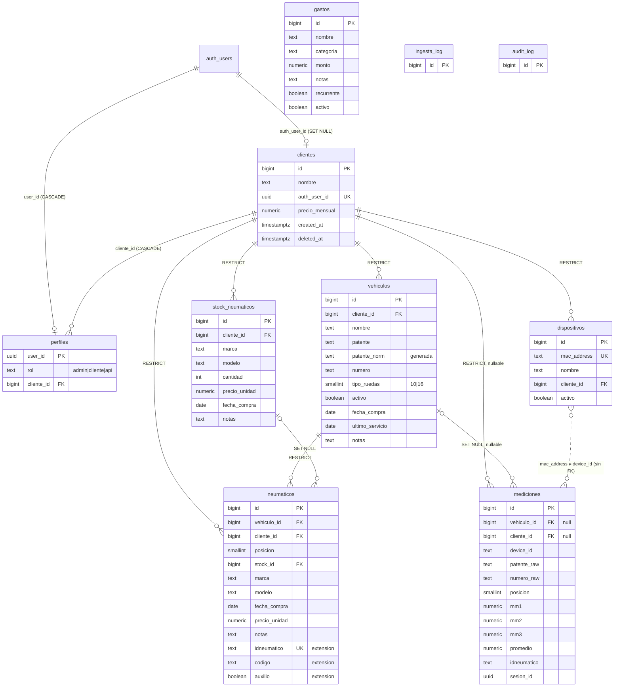

# 08 · Esquema de datos (deducido del código)

> Estado: **aplicado** en Supabase `kootszosdejmawanfxug` (2026-11-06, migraciones 20261106000000/010000/020000). Migración: [`supabase/migrations/20261106000000_init_schema.sql`](../supabase/migrations/20261106000000_init_schema.sql).
> Nota histórica: al redactar este documento el esquema real no estaba en el repo; el esquema se **dedujo** del código del panel (originalmente el monolito `app.js`, hoy módulos ES en `assets/js/`; las referencias `app.js:N` son históricas), `README.md`, `docs/02`, `04`, `07` y `tests/smoke/stub.js`. Lo que no tiene evidencia directa va marcado **[ASUNCIÓN]**. No se ha ejecutado contra ningún proyecto de Supabase.
> Validación realizada: se aplicó dos veces (idempotencia) en un PostgreSQL local desechable con un `auth` simulado y se probaron RLS por rol, RPCs, CHECKs y auditoría (ver §6). **No** se probó en Supabase real.

## 1. Diagrama ER

`ingesta_log` y `audit_log` no tienen FKs a propósito: deben sobrevivir al borrado de lo que describen.

## 2. Tabla por tabla y evidencia

Todas tienen `created_at timestamptz default now()` salvo `perfiles`/logs donde se indica. Los ids son `bigint identity` (el panel hace `parseInt` de los ids: `app.js:406`, `2075`).

### clientes
| Columna | Evidencia |
|---|---|
| `id`, `nombre` | `app.js:105`, `323-325`, `633` |
| `auth_user_id` (unique, → `auth.users`) | `app.js:105`, `149`, `324`; `rls_audit.sql` consulta 7 |
| `precio_mensual` numeric default 0 | `app.js:1347`, `1654` |
| `created_at` | `app.js:325` |
| `deleted_at` | no usado por el panel; pedido por docs/02 S5 |

`ON DELETE`: `auth_user_id` = SET NULL (borrar el usuario Auth no borra al cliente ni su historial).

### perfiles (nueva)
No existe en el código; reemplaza el "admin por exclusión" (`app.js:59-65`, `103-109`; docs/02 S2). CHECK: `admin` ⇒ `cliente_id` nulo; `cliente`/`api` ⇒ `cliente_id` obligatorio. FK a `clientes` = CASCADE (es un mapeo de acceso, no dato de negocio; evita que el `DELETE` del panel quede bloqueado por él). Un trigger en `clientes` crea el perfil `cliente` cuando `crear-cliente` fija `auth_user_id`, sin tocar esa función.

### vehiculos
| Columna | Evidencia |
|---|---|
| `id,nombre,patente,tipo_ruedas` | `app.js:217`, `626` |
| `numero,activo,cliente_id,fecha_compra,ultimo_servicio,notas` | `app.js:1963`, `2084` |
| `clientes(nombre)` embebido (FK cliente) | `app.js:1963` |
| `patente_norm` generada (`upper`, sin espacios) | README (búsqueda por `patente_norm`), docs/07 §3.2 |
| UNIQUE `(cliente_id, patente_norm)` y `(cliente_id, numero)` parciales | docs/07, `asignar_dispositivo...` busca por ambos |

El panel guarda la patente en mayúsculas pero **con** guiones/espacios internos (`app.js:2073`); `patente_norm` solo quita espacios.

### dispositivos
`id,mac_address,nombre,activo,cliente_id,created_at,clientes(nombre)` en `app.js:1740`; escritura `app.js:1929` (`nombre,cliente_id,activo`) y por RPC (`1917`). `mac_address` UNIQUE y CHECK `^([0-9A-F]{2}:){5}[0-9A-F]{2}$`; el panel acepta `-` (`app.js:1908`), por lo que un trigger normaliza `-`→`:` y mayúsculas antes del CHECK.

### mediciones
| Columna | Evidencia |
|---|---|
| `vehiculo_id,posicion,mm1,mm2,mm3,created_at,vehiculos(nombre)` | `app.js:218` |
| `cliente_id` | `app.js:216`, `219` |
| `promedio`, `idneumatico` | `app.js:680` |
| `device_id` | `app.js:1764`, `2634` |
| `patente_raw`, `numero_raw`, `vehiculos(nombre,patente,tipo_ruedas)` | `app.js:2690` |
| `sesion_id` | docs/07 §4.4 (no la lee el panel) |

`vehiculo_id` y `cliente_id` nulos permitidos (modo device-first, README). `vehiculo_id` ON DELETE **SET NULL**: el histórico se conserva y se puede re-vincular por `device_id`/`patente_raw`. `promedio`: **columna normal + trigger** que lo recalcula (no generada), porque la función actual lo inserta (README paso 4) y una columna generada rompería ese INSERT. Mapeo de lecturas: tabla = `mm1,mm2,mm3`; la traducción desde `mm1..mm4` de la API de proveedor ocurre en la Edge Function (`mm4→mm3`, descartar el `mm3` entrante), según docs/07 §3.1.

### neumaticos
> Desde el apéndice F, `vehiculo_id` y `posicion` admiten NULL: una fila sin montar es una **cubierta de stock** (`estado = 'almacenado'`, `condicion`, `sucursal_id`).

`posicion,marca,modelo,fecha_compra,precio_unidad,notas` (`app.js:1023`); escritura con `vehiculo_id,cliente_id,posicion,stock_id,…` y `onConflict:'vehiculo_id,posicion'` (`2343-2355`) ⇒ UNIQUE `(vehiculo_id, posicion)`; `stock_id` y `vehiculos(nombre)` (`2372`). Extensión **no usada por el panel**, requerida por docs/07: `idneumatico text unique`, `codigo text`, `auxilio boolean default false` (un solo auxilio por vehículo, índice parcial). `stock_id` ON DELETE SET NULL (marca/modelo están copiados en la fila).

### stock_neumaticos
`id,marca,modelo,cliente_id,precio_unidad,fecha_compra,cantidad,notas,created_at,clientes(nombre)`: `app.js:2388`, `2530-2538`, `2546`.

### gastos
`nombre,categoria,monto,notas,recurrente,activo` (`app.js:1704`, `1709`), `created_at` (`1348`). Sin `cliente_id`: son gastos de la empresa.

### ingesta_log y audit_log
Estructura de docs/04 §2.1 y §2.2 más campos de docs/07 §4.5 (`endpoint, cuenta, cliente_id, vehiculo_id, n_guardados, n_fallidos`). `audit_log`: trigger `audit_row()` en `clientes, dispositivos, vehiculos, gastos`; trigger de bloqueo de UPDATE/DELETE/TRUNCATE (inmutable incluso para service_role y propietario). Se usan `actor_id`/`actor_rol` (docs/04) en lugar de un único `actor`.

### RPCs
- `get_unregistered_devices() → (device_id, last_seen, total_meds)`: columnas leídas en `app.js:1786-1806`; MAC con mediciones y sin fila en `dispositivos`.
- `asignar_dispositivo_a_cliente(p_mac text, p_cliente_id bigint, p_nombre text default null) → jsonb {dispositivo_id, vehiculos_creados, mediciones_vinculadas}`: parámetros `app.js:1917-1921`, resultado `1924-1925`, lógica README Fase 2.
- Ambas `SECURITY DEFINER`, `search_path=''`, `is_admin()` al inicio, `revoke ... from public, anon`, `grant ... to authenticated`.

## 3. Lista de [ASUNCIÓN]

**Tipos y precisión:** ids `bigint identity`; `precio_mensual numeric(12,2)`; `precio_unidad numeric(12,2)`; `monto numeric(14,2)`; `mm1..3 numeric(5,2)`; `fecha_compra`/`ultimo_servicio` `date`; `numero` text; `tipo_ruedas smallint` default 10; `posicion smallint` 1..99.
**Restricciones:** `mm1..3` NOT NULL y 0..40 (docs/07 §4.3); `cantidad >= 0`; `monto >= 0`; UNIQUE `(cliente_id, numero)`; UNIQUE parcial de un auxilio por vehículo; `mediciones.idneumatico` sin FK.
**Semántica:** `gastos.categoria` texto libre (el `<select>` usa nombres capitalizados y la fixture usa `infra`/`marketing`); `ingesta_log.status in (ok, rechazado, error)`.
**RPC:** identidad de vehículo = `patente_raw` normalizada y, si falta, `numero_raw`; vehículo nuevo con `nombre = patente` o `Nº <numero>` y `tipo_ruedas = 16` si alguna posición > 10; mediciones sin patente ni número solo reciben `cliente_id`; formas de salida de ambas RPC (campos extra como `n` de la fixture se ignoran).
**Extensión API:** `neumaticos.idneumatico/codigo/auxilio`, `mediciones.sesion_id`.
**Mapeo:** `mm1/mm2/mm3` = las tres huellas actuales; orden físico confirmado (app de DAC): `mm1` = interno, `mm2` = centro, `mm3` = externo. Cambiarlo = una constante en `api-proveedor/mapping.ts` (docs/07 §3.1).

## 4. Decisiones de seguridad

- **Defecto = denegar.** RLS activa en las 10 tablas; `anon` sin privilegios de tabla ni de función (y `alter default privileges ... revoke ... from anon`).
- **Rol explícito:** `perfiles` + `is_admin()` / `current_cliente_id()` (`SECURITY DEFINER`, `STABLE`, `search_path=''`, execute solo para `authenticated`). Se acabó el "admin = sin fila en clientes" del lado servidor.
- **Cliente:** solo SELECT de sus filas (`vehiculos, dispositivos, mediciones, stock_neumaticos`, su fila de `clientes`; `neumaticos` a través del vehículo). El código revisado **no ejecuta ninguna escritura** en modo cliente (todas las mutaciones salen de pantallas `data-admin-only`, `app.js:89-91`), por eso no hay políticas de escritura para él. **No** ve `gastos`, `perfiles` de otros, `audit_log` ni `ingesta_log`.
- **Rol `api`:** sin ninguna política (ni su propia fila de `perfiles`) ⇒ su JWT contra PostgREST ve 0 filas (docs/07 §4.1). Acceso solo vía Edge Function con service role, que debe filtrar por `cliente_id` del token.
- **`mediciones`:** sin política INSERT/UPDATE/DELETE para usuarios; las inserta solo service_role; admin y cliente solo leen.
- **ON DELETE:** RESTRICT para todo lo que cuelga de `clientes` y `vehiculos` (neumáticos); excepciones: `mediciones.vehiculo_id` SET NULL (conservar histórico), `neumaticos.stock_id` SET NULL, `perfiles.cliente_id` CASCADE, `clientes.auth_user_id` SET NULL.
- **Auditoría:** triggers en BD (no manipulables desde el navegador), inmutable, lectura solo admin.
- **Funciones internas** (`audit_row`, `clientes_sync_perfil`): sin execute para nadie salvo uso por trigger.

## 5. Preguntas abiertas

1. **El `DELETE` de clientes del panel (`app.js:343`) fallará** mientras el cliente tenga vehículos, dispositivos, stock o neumáticos (RESTRICT, intencional). Hay que pasar a soft delete (`update deleted_at`) y filtrar `deleted_at is null` en `loadClients`; el panel hoy no lo hace. Idem borrar vehículos con neumáticos asignados (`app.js:2590`).
2. **`precio_mensual` del propio cliente** es visible para él (la RLS filtra filas, no columnas). Si no debe verlo, hay que mover la columna a otra tabla solo-admin o exponer una vista.
3. ¿La BD real tiene columnas que el panel no lee (p. ej. `email`, `updated_at`, más campos de `mediciones`)? Un `supabase db dump --schema-only` lo resolvería; la migración es de arranque, no una réplica.
4. ¿`vehiculo.cliente_id` puede cambiarse con neumáticos asignados? `neumaticos.cliente_id` es redundante y podría quedar inconsistente (la RLS usa el vehículo, no esa columna).
5. Formato del `numero` (docs/07 §5).
6. Los datos existentes (si se migran) pueden violar los CHECK nuevos (MAC con `-`, mm fuera de 0..40, patentes duplicadas por cliente).
7. `crear-cliente` y `guardar-montaje-mm` no están versionadas: confirmar que `crear-cliente` crea la fila `clientes` con `auth_user_id` (el trigger crea el perfil) y que la ingesta inserta con service_role.
8. Primer administrador: debe crearse a mano en `perfiles` (instrucciones al final de la migración). Sin ello, nadie puede usar el panel.
9. Un cliente = un usuario (1:1, `auth_user_id` unique y `perfiles` PK en `user_id`); si cambia (roadmap, decisión 1) habrá que ajustar.

## 6. Cómo se validó

- Sin `psql` contra Supabase. En un Postgres local desechable (con roles `anon/authenticated/service_role` y `auth.users`/`auth.uid()` simulados) la migración se aplicó **dos veces sin errores** y se comprobó: promedio calculado, `patente_norm`, CHECK de mm, RLS para admin/cliente/api/anon, RPCs (admin OK; cliente rechazado; segunda llamada con la misma MAC falla por unicidad; 2 vehículos creados y 3 mediciones vinculadas), auditoría y bloqueo de UPDATE/DELETE en `audit_log`.
- No cubre diferencias propias de Supabase (extensiones, roles `supabase_admin`, privilegios por defecto reales). Repetir las comprobaciones del final de la migración y `supabase/audit/rls_audit.sql` en staging.

---

# Apéndice A · Migración de producto `20261106020000_producto_vistas.sql`

Segunda migración (depende solo de la inicial). Añade umbrales por cliente, odómetro, ciclo de vida del neumático, cinco vistas para el panel y la RPC de baja suave. **No está aplicada**: la aplica el director. Idempotente; sin `begin/commit` (la herramienta ya envuelve). Probada en Postgres local con `tests/sql/run.sh` (ver A.6).

## A.1 Columnas y tablas nuevas

| Objeto | Detalle |
|---|---|
| `clientes.umbral_bajo_mm` / `umbral_critico_mm` / `umbral_retiro_mm` | `numeric(4,1)`, defecto 8 / 5 / 3 (igual que `WEAR` de `app.js`). CHECK `retiro < crítico < bajo` y `> 0` |
| `clientes.dias_sin_medir_alerta` | `integer`, defecto 30 |
| `clientes.irregularidad_mm` | `numeric(3,1)`, defecto 2: diferencia máxima entre huellas |
| `mediciones.odometro_km` | `integer` nullable, `>= 0` |
| `vehiculos.odometro_km`, `odometro_actualizado_at` | `integer >= 0` / `timestamptz`, nullable. **Nada los rellena automáticamente**: la Edge Function (o el panel) debe actualizarlos |
| `neumaticos.vida` | `smallint` 0..3 (0 nuevo, 1..3 reencauches), defecto 0 |
| `neumaticos.estado` | `montado` (defecto) / `almacenado` / `reparacion` / `baja` |
| `neumaticos.fecha_baja`, `motivo_baja` | `date`, `text` |
| `eventos_neumatico` | `id, cliente_id (RESTRICT), vehiculo_id (RESTRICT), neumatico_id (SET NULL), idneumatico, tipo (montaje, desmontaje, rotacion, reparacion, reencauche, baja, inspeccion), posicion_origen/destino, odometro_km, costo, notas, created_by (auth.uid()), created_at`. RLS: admin ALL, cliente SELECT de lo suyo, api/anon nada. Trigger `audit_row()` (INSERT/UPDATE/DELETE quedan en `audit_log`). Los eventos no tienen restricción de coherencia `vehiculo.cliente_id = cliente_id`: lo garantiza quien escribe (solo admin) |
| Índice | `mediciones (cliente_id, created_at desc)`; los de `eventos_neumatico` (cliente, vehículo, neumático, fecha) |

## A.2 Vistas (todas `security_invoker = true`: heredan la RLS de quien consulta)

Admin ve todo; un cliente solo lo suyo; el perfil `api` y usuarios sin perfil, 0 filas; `anon`, `permission denied`. Ninguna vista toca `gastos`. Excluyen vehículos inactivos, clientes eliminados (`deleted_at`) y neumáticos no montados.

- **`v_mediciones_neumatico`** `(cliente_id, vehiculo_id, neumatico_id, idneumatico, estado_montaje, posicion_actual, posicion_medicion, medicion_id, mm1..mm3, promedio, odometro_km, device_id, created_at, atribucion)` (migración `20261109000000`): cada medición atribuida al neumático al que pertenece, con la posición donde está HOY. Es la base de las demás vistas y del historial del detalle del vehículo. Regla en el apéndice D.
- **`v_ultima_medicion`** `(cliente_id, vehiculo_id, posicion, medicion_id, idneumatico, mm1..mm3, promedio, odometro_km, device_id, created_at)`: última medición del neumático **montado** en cada `(vehiculo_id, posicion)` (`posicion` = posición actual; `distinct on`, desempate por `id`). Un neumático recién montado sin mediciones no tiene fila.
- **`v_estado_neumaticos`**: una fila por posición (filas de `neumaticos` más posiciones medidas sin fila en `neumaticos`). Columnas: identificación (`cliente_id, vehiculo_id, vehiculo_nombre, patente, posicion, neumatico_id, idneumatico, marca, modelo, vida, estado_montaje`), última lectura (`mm1..3, promedio, odometro_km, ultima_medicion_at, dias_desde_medicion`), `estado`, `sin_medir`, `diferencia_huellas_mm`, `desgaste_irregular`, `n_mediciones_90d`, `tasa_mm_semana`, `semanas_hasta_critico`, `semanas_hasta_retiro` y los umbrales del cliente.
- **`v_alertas`** `(cliente_id, vehiculo_id, vehiculo_nombre, patente, posicion, neumatico_id, idneumatico, tipo, severidad, valor, mensaje, ultima_medicion_at)`: una fila por alerta.
- **`v_resumen_flota_cliente`** `(cliente_id, nombre, n_vehiculos_activos, n_neumaticos_con_datos, n_ok, n_bajo, n_critico, n_sin_datos, n_alertas_sev1..3, ultima_medicion_at)`.
- **`v_salud_dispositivos`** `(dispositivo_id, cliente_id, mac_address, nombre, activo, ultima_actividad_at, total_mediciones, dias_sin_actividad, estado)`.

## A.3 Fórmulas

- **Promedio**: `round((mm1+mm2+mm3)/3, 2)` (trigger existente).
- **Semáforo** (con los umbrales del cliente del vehículo): `sin_datos` si no hay promedio; `critico` si `promedio < umbral_critico`; `bajo` si `promedio < umbral_bajo`; si no `ok`. Límites: 5.00 es `bajo`, 4.99 `critico`, 8.00 `ok`, 7.99 `bajo` (con 8/5).
- **Desgaste irregular**: `max(mm1,mm2,mm3) - min(mm1,mm2,mm3) > irregularidad_mm` (estricto: 2.0 con umbral 2.0 no alerta). Ojo: `app.js` hoy usa `|mm1-mm3| >= 1.5`; las vistas usan las tres huellas y el umbral del cliente.
- **Tasa mm/semana** = `-regr_slope(promedio, epoch(created_at)) * 604800` sobre las mediciones de los **últimos 90 días** de cada **neumático** montado (apéndice D), con **tiempo transcurrido** (no fechas). Solo hay tasa con **al menos 3 mediciones y 14 días** entre la primera y la última de la ventana; si no, `null` («mediciones insuficientes»). La ventana se **reinicia** en el último evento de `reencauche`, `reparacion` o `montaje` del neumático (`eventos_neumatico.neumatico_id`; la rotación no reinicia) y una pendiente negativa da `null` (nunca hay tasa negativa). `n_mediciones_90d` cuenta las mediciones de los últimos 90 días sin reinicio. Desde `20261111000000_tasa_y_rendimiento.sql` la vista se calcula por neumático con sondas a `mediciones_idneumatico_idx` (y, solo para el histórico sin `idneumatico`, a `mediciones_veh_pos_fecha_idx`). Positivo = se está gastando. Un neumático nuevo no mezcla puntos del viejo y, tras rotar, la tasa acompaña al neumático. A diferencia de `mAnalysis` (primera vs última medición), no usa solo los extremos.
- **Semanas hasta crítico / retiro** = `max(promedio - umbral, 0) / tasa` si `tasa > 0`, si no `null` (0 si ya está por debajo del umbral). El retiro por defecto es 3 mm, igual que el `LIMIT` de `mAnalysis`.
- **Alertas** (`severidad`): `critico` (3); `bajo` (2); `cruza_critico_pronto` (2: estado ok o bajo con `semanas_hasta_critico <= 4`, `valor` = semanas); `desgaste_irregular` (2, `valor` = diferencia en mm); `sin_medir` (1: neumático montado sin ninguna medición, o última medición más vieja que `dias_sin_medir_alerta` días, `valor` = días o null).
- **Salud de dispositivo**: `dias_sin_actividad = floor(días desde la última medición con su device_id)`; `activo` ≤ 7, `sin_actividad` ≤ 30, `caido` > 30, `nunca` si no hay mediciones. `activo=false` del dispositivo se informa aparte.

## A.4 RPC

`public.cliente_eliminar_suave(p_id bigint) → jsonb {cliente_id, vehiculos_desactivados, dispositivos_desactivados}`. `SECURITY DEFINER`, `search_path=''`, exige `is_admin()` (42501), cliente inexistente 23503. Marca `deleted_at` (si no lo tenía), pone `activo=false` en vehículos y dispositivos; no borra nada (el `DELETE` directo sigue fallando por RESTRICT). `execute` solo para `authenticated`. Es idempotente. No toca `auth_user_id`/`perfiles`: el cliente eliminado deja de ver sus datos porque `clientes_self_select` exige `deleted_at is null` y las vistas lo excluyen.

## A.5 Guía para el panel (backlog de docs/09 §6)

| # | Pantalla | Qué consultar |
|---|---|---|
| 1 | Panel de flota con prioridades | `v_estado_neumaticos` (contadores por `estado`; orden: `estado`, `promedio` asc); `v_resumen_flota_cliente` para los totales y el filtro por cliente |
| 2 | Centro de alertas | `v_alertas order by severidad desc, ultima_medicion_at` (filtrar por `tipo`/`cliente_id`) |
| 4 | Vista de cliente | `v_resumen_flota_cliente` (una fila), `v_estado_neumaticos where cliente_id=…` y `eventos_neumatico` para costos; el gasto en neumáticos sale de `neumaticos.precio_unidad`/`eventos_neumatico.costo` (no hay vista) |
| 5 | Salud de dispositivos | `v_salud_dispositivos` (combinar con `get_unregistered_devices()` para MAC sin registrar) |
| 8 | Predicción / vida remanente | `v_estado_neumaticos.tasa_mm_semana`, `semanas_hasta_critico`, `semanas_hasta_retiro`; alertas `cruza_critico_pronto` |
| 9 | Desgaste irregular | `v_estado_neumaticos.desgaste_irregular`, `diferencia_huellas_mm`; alertas `desgaste_irregular` |

Para el detalle de un neumático (#6/#7) el panel sigue leyendo `mediciones` (historial) y, para la línea de tiempo, `eventos_neumatico where neumatico_id=… order by created_at`. Los umbrales se editan con un `update` de `clientes` (solo admin; los CHECK validan la coherencia). El panel puede dejar de calcular estado/tasa/predicción en JS y leer estas vistas; mientras tanto, `WEAR` en `app.js` debe coincidir con los umbrales por defecto.

## A.6 Cómo se validó y límites

- `tests/sql/run.sh` crea un Postgres desechable (`initdb`/`pg_ctl` en un directorio temporal; o `TEST_PG_URL`; o Docker), simula `auth.users`/`auth.uid()`/roles, aplica la migración inicial y la de producto **dos veces** (idempotencia) y ejecuta ~170 aserciones: semáforo en límites exactos, tasa y semanas con datos conocidos, cada tipo de alerta, aislamiento por cliente/rol (admin, cliente A, cliente B, api, sin perfil, anon) en todas las vistas y tablas nuevas, estructura (security_invoker, grants, RLS), `eventos_neumatico` (RLS, constraints, auditoría), `cliente_eliminar_suave` y la inmutabilidad de `audit_log`. Sale con código ≠ 0 si algo falla. CI: job `sql` (servicio `postgres:16`).
- **No cubierto**: Supabase real (extensiones, roles `supabase_admin`, PostgREST, privilegios por defecto reales), rendimiento con volumen (no se hizo `EXPLAIN` con datos grandes; los índices existentes cubren los accesos previstos), ni la reconciliación con el esquema de producción. Repetir las comprobaciones de la migración inicial y este conjunto en staging antes de aplicar.
- Heredado de la migración inicial (no se cambia aquí): `normalizar_patente`, `dispositivos_normalizar_mac`, `mediciones_set_promedio` y `audit_log_inmutable` conservan EXECUTE para PUBLIC (funciones puras o de trigger, sin acceso a datos).

---

# Apéndice B · Sucursales (`20261107020000_seccionales.sql`) y cliente Demo

Un **cliente** (empresa) puede tener **sucursales** (p. ej. "Montevideo", "Salto"). Hay un único rol `cliente` con dos alcances:

| Perfil | `perfiles.sucursal_id` | Qué ve (RLS) |
|---|---|---|
| **Global** | `NULL` | Todo el cliente: todas las sucursales y lo que no tiene sucursal |
| **De sucursal** | `= X` | Solo vehículos, neumáticos, mediciones, eventos y dispositivos de la sucursal X; sus alertas, estado y salud (las vistas `security_invoker` heredan la RLS). **No** ve el stock del cliente, otras sucursales, mediciones/eventos sin vehículo ni gastos, y no puede editar nada (tampoco los umbrales) |
| Admin | — | Todo; gestiona sucursales y asignaciones |

## B.1 Objetos
| Objeto | Detalle |
|---|---|
| `sucursales` | `id, cliente_id (RESTRICT), nombre, created_at`. Único por `(cliente_id, lower(btrim(nombre)))`. `unique(id, cliente_id)` para las FK compuestas. RLS: admin ALL; cliente SELECT (global: las suyas; de sucursal: solo la suya). Auditada con `audit_row()` |
| `vehiculos.sucursal_id`, `dispositivos.sucursal_id` | Nullable ("sin sucursal" = solo perfil global). FK compuesta `(sucursal_id, cliente_id)` → `sucursales(id, cliente_id)` `ON DELETE RESTRICT`: no se puede asignar una sucursal de otro cliente |
| `perfiles.sucursal_id` | Nullable (NULL = global). FK compuesta igual; CHECK `sucursal_id is null or rol = 'cliente'` |
| `perfiles.email` | Informativo (lo escribe `crear-usuario-seccional`); no se usa para autorizar |
| `current_sucursal_id()` | `SECURITY DEFINER`, `search_path=''`, `stable`; solo `authenticated`. NULL = global o sin perfil (siempre se combina con `current_cliente_id()`) |

**Por qué `RESTRICT` y no `SET NULL`**: con `SET NULL`, borrar una sucursal convertiría en perfiles **globales** (ven todo el cliente) a sus usuarios. Con `RESTRICT` hay que reasignar o eliminar antes sus vehículos, dispositivos y usuarios. Consecuencia: un `DELETE` físico de un cliente con sucursales falla (la baja suave `cliente_eliminar_suave` no se ve afectada).

Políticas reescritas (solo `SELECT` del cliente): `vehiculos`, `dispositivos`, `neumaticos` (vía vehículo), `mediciones` (vía `vehiculo_id`), `eventos_neumatico` (vía `vehiculo_id`), `stock_neumaticos` (solo global), más `sucursales`. `clientes_self_select` no cambia (el perfil de sucursal ve la fila de su cliente: nombre y umbrales de solo lectura).

## B.2 Panel
- **Cliente global con sucursales**: selector "Todas las sucursales / …" en la barra superior (`core/seccional.js`). Filtra Inicio, Flota, Alertas, Reportes, Vehículos, Dispositivos, Salud y Mediciones por `vehiculos.sucursal_id` / `dispositivos.sucursal_id`. Inicio, Reportes, Vehículos, Dispositivos y Mediciones filtran en el servidor; Flota, Alertas y Salud filtran en el navegador (las vistas v_* no traen la sucursal) y Flota recalcula los KPI desde las filas filtradas.
- **Perfil de sucursal**: no ve el selector (la RLS ya limita todo); el rol se muestra como "Sucursal".
- **Admin** (Ficha de cliente > "Sucursales y usuarios"): alta/renombrar/eliminar sucursales, asignar vehículos y dispositivos, y crear usuarios globales o de sucursal con la función `crear-usuario-seccional` (invitación por email o contraseña de 12+ caracteres). No se vincula un usuario Auth ya existente: la API de Auth no permite buscarlo por email de forma fiable; se invita a uno nuevo.
- La detección de rol usa ahora `perfiles` (un usuario de sucursal no figura en `clientes.auth_user_id`) con el vínculo `clientes.auth_user_id` como respaldo.

## B.3 Datos de demo
`supabase/seed/demo.sql` (NO es migración; se ejecuta a mano). Ver su cabecera. Resumen: requiere el cliente `Demo Transportes` ya creado; genera 2 sucursales, 14 vehículos `DEMO001..014`, 6 dispositivos `02:DE:00:00:00:0N`, ~10 semanas de mediciones y stock/eventos de ejemplo; es idempotente y re-ejecutarlo refresca las fechas.

## B.4 Cómo se validó
`tests/sql/t_50_seccionales.sql` (global ve todo, sucursal A no ve B, admin ve todo, cliente B aislado, anon nada, escrituras y FK compuestas) y `t_60_seed_demo.sql` (seed idempotente, vistas con filas, perfil de sucursal del demo). Smoke: `tests/smoke/run.sh admin|cliente|secuser`.

---

# Apéndice C · Escritura del cliente (gomero): cambio de neumático (`20261108000000_cambio_neumatico.sql`)

El rol `cliente` sigue siendo de **solo lectura sobre las tablas**: no se añadió ninguna política de INSERT/UPDATE/DELETE para él. Cuando el taller
cambia un neumático, el gomero lo registra por **RPC `SECURITY DEFINER` acotadas** (`search_path=''`, `revoke` de `public`/`anon`, `grant execute` a `authenticated`).

## C.1 Modelo de autorización (verificado dentro de la función)

`public.neumatico_autorizar_vehiculo(p_vehiculo_id)` es interna (sin `grant`: solo la ejecutan las RPC, que corren como dueño). Bloquea la fila del vehículo
(`FOR UPDATE`, serializa cambios concurrentes) y autoriza a:

| Quien llama | Alcance |
|---|---|
| `is_admin()` | cualquier vehículo |
| perfil `rol='cliente'` global (`sucursal_id` null) | vehículos de **su** cliente (cliente no dado de baja) |
| perfil `rol='cliente'` de sucursal | vehículos de su cliente **y** `vehiculos.sucursal_id = perfiles.sucursal_id` |
| rol `api`, usuario sin perfil, `anon` | nada (42501) |

El cliente y la sucursal se leen de `perfiles` con `auth.uid()`; ningún parámetro del llamador decide el alcance. Un vehículo inexistente o ajeno responde
igual (`42501 permiso denegado`) para no revelar existencia. El **stock** (inventario con precios) solo lo consume el admin o el perfil global (igual que su
política de lectura) y siempre del mismo cliente del vehículo; el de sucursal ingresa el neumático nuevo con `p_nuevo`.

## C.2 RPC

- `neumatico_cambiar(p_vehiculo_id, p_posicion, p_destino_viejo, p_motivo, p_odometro_km, p_stock_id, p_nuevo jsonb, p_numero_quema text, p_km_previos integer)` (los dos últimos desde el apéndice E): el viejo (montado, no en baja) pasa a
  `baja` (fecha/motivo) / `reencauche` (`vida+1`, máx. 3, queda `almacenado`) / `reparacion` / `almacenado`; como `(vehiculo_id, posicion)` es único, queda
  "aparcado" en una posición libre (98 hacia abajo; las vistas solo cuentan `estado='montado'`). El nuevo sale del stock (`p_stock_id`: marca/modelo/precio/fecha del lote,
  `cantidad-1` con control `>0`, error `55000` si no hay) **o** de `p_nuevo` (`marca` obligatoria, `modelo`, `codigo`, `precio`, `vida`; se valida tipo y rango; exactamente
  uno de los dos). Se monta en la misma posición con `idneumatico` generado (`CN-<veh>-<pos>-<hash>`) y hereda `auxilio`. Eventos (`created_by = auth.uid()`, odómetro, costo = precio del nuevo):
  `baja`, o `desmontaje` (+ `reencauche`), y `montaje`. Si `p_odometro_km` es mayor al del vehículo se actualiza `odometro_km`/`odometro_actualizado_at`. Todo en una transacción.
  Devuelve jsonb con ids, posición del viejo, stock restante y ids de eventos.
- `vehiculo_registrar_odometro(p_vehiculo_id, p_odometro_km)`: misma autorización; el cliente no puede bajar el kilometraje (`23514`), el admin sí (cambio de tablero).
- `neumatico_rotar(...)`: misma lógica que antes pero con esta autorización (antes solo admin), de modo que el gomero también puede rotar en su vehículo.

## C.3 Panel

`views/cambio-neumatico.js` registra `neumatico-cambiar` (`data-vehiculo-id`, `data-posicion`; `core/actions.js` pasa esos números como argumentos si no hay `data-args`) y
`neumatico-rotar-pos`; lógica pura y traducción de errores en `domain/cambio-neumatico.js`. Al terminar emite `neumet:neumatico-cambiado` y recarga la vista activa.
Punto de entrada temporal: botón "Cambiar neumático" en el modal de ciclo de vida.

## C.4 Pruebas

`tests/sql/t_70_cambio_neumatico.sql`: admin, cliente global, sucursal A (sí en el suyo, no en el de B ni con stock), otro cliente, api, sin perfil y anon (no); stock ajeno y con cantidad 0
rechazados; validaciones; escritura directa denegada; atomicidad (fallo en el último paso no deja nada a medias); la migración se aplica dos veces en `run.sh`.

# Apéndice D · Las mediciones siguen al neumático (migración `20261109000000`)

## D.1 Regla de atribución

Antes las vistas tomaban la última medición por `(vehículo, posición)`: tras **cambiar** un neumático crítico la rueda nueva seguía mostrando los mm del viejo y tras **rotar** el estado se quedaba en la posición. Ahora cada posición montada toma sus datos de las mediciones del **neumático montado ahí**:

1. **Por `idneumatico`**: una medición pertenece al neumático con ese `idneumatico`, esté donde esté hoy y en el estado que sea (el historial de un neumático en baja o almacenado se conserva, pero no cuenta para el estado de la flota).
2. **Histórico con `idneumatico` NULL**: se atribuye al neumático **montado** en su `(vehículo, posición)` solo si (a) ese neumático no tiene **ninguna** medición con `idneumatico` y (b) ningún evento `montaje`, `desmontaje`, `rotacion` o `baja` del vehículo tocó esa posición (origen o destino) **después** de la medición. Si no, queda huérfana: no cuenta para el estado actual (mejor `sin_datos` que mm de otro neumático). Si el neumático no tiene `idneumatico`, solo aplica (b).
3. **Posición sin fila en `neumaticos`**: se conserva el comportamiento anterior (última medición de la posición), con las mismas exclusiones (medición de un neumático conocido o anterior a un evento que movió esa posición).
4. Un neumático **recién montado** sin mediciones propias figura `sin_datos` y `sin_medir`; no hereda nada de la posición.
5. La **tasa de desgaste** se calcula por neumático. `v_alertas` y `v_resumen_flota_cliente` no cambian de definición: leen `v_estado_neumaticos`.

Las vistas conservan sus columnas, tipos, `security_invoker` y permisos. `v_ultima_medicion` deja de listar posiciones de neumáticos que no están montados (antes aparecía, p. ej., la posición de un neumático en baja).

## D.2 API de proveedor

`api_obtener_montaje` devuelve, por posición, la última medición **del neumático montado** (misma regla) y solo neumáticos `montado` (el viejo, aparcado tras un cambio, ya no se ofrece). `api_guardar_montaje` inserta con el `idneumatico` del neumático montado actual de la posición y rechaza (`posicion`) posiciones sin neumático montado.

## D.3 Panel

El detalle del vehículo (gráfico y última medición), la vista Mediciones y el PDF de reporte leen `v_mediciones_neumatico` (por `posicion_actual` y `estado_montaje = 'montado'`); los eventos del panel se filtran por neumático. El CSV de Mediciones, Reportes y el modo Dispositivo muestran el registro crudo de lo medido (posición donde se midió) y no cambian.

## D.4 Pruebas

`tests/sql/t_55_mediciones_neumatico.sql` (cambio, rotación, histórico con `idneumatico` NULL, neumáticos fuera de servicio, aislamiento por cliente y sucursal, API, columnas y permisos); `run.sh` aplica la migración dos veces. E2E: `tests/e2e/specs/mediciones-neumatico.mjs`.

# Apéndice E · Número de coche, número de quema y km del neumático (migración `20261110000000_numero_quema.sql`)

## E.1 Número de coche

`vehiculos.nombre` es el **número de coche** que usa el cliente (`106`, `201`). La interfaz lo pide como «Número de coche» y lo muestra como «Coche 106» cuando son solo dígitos (`domain/coche.js`); los nombres anteriores con texto («Unidad Sur») se muestran tal cual. No se renombra ninguna columna. El formulario ya no tiene un campo «Nombre del vehículo» aparte: `vehiculos.numero` (único por cliente, lo usa la API de proveedor) acompaña al nombre (`numeroDesdeNombre`): se escribe igual al nombre si cabe en 10 caracteres y se conserva el valor guardado si el nombre no cambió. El buscador encuentra por matrícula, número de coche (también escrito «Coche 106») y número de quema. `supabase/seed/demo.sql` usa nombres `101..109` y `201..205`.

## E.2 Número de quema (`neumaticos.numero_quema`)

| Aspecto | Decisión |
|---|---|
| Tipo | `text`, nullable. Un trigger `BEFORE INSERT/UPDATE` recorta los extremos y convierte `''` en `NULL`; un CHECK exige 1 a 40 caracteres sin espacios en los extremos |
| Unicidad | Índice único parcial `neumaticos_cliente_quema_uk` sobre `(cliente_id, lower(numero_quema)) where numero_quema is not null`. `neumaticos.cliente_id` existe en cada fila (lo escriben `neumatico_cambiar` y el panel de administración); se ancla en él y no en el vehículo para poder indexar. Abarca todos los estados (montado, almacenado, reparación, baja): el número identifica al neumático físico. Dos clientes pueden repetir un número |
| Captura | `neumatico_cambiar(..., p_numero_quema text default null, p_km_previos integer default 0)` y el formulario de ruedas del administrador. Quema repetida: `23505` «el número de quema ya está registrado en otro neumático» (se comprueba antes de tocar nada). El neumático retirado conserva su quema |
| Lectura | Se lee de `neumaticos` (la RLS por vehículo y sucursal ya existente): panel de la rueda y detalle del vehículo, tabla de ciclo de vida y buscador. **Las vistas `v_*` no cambian** (no hizo falta recrearlas ni tocar sus columnas); un perfil de sucursal solo ve las quemas de sus vehículos |
| Buscador | Coincide exacta o por prefijo (sin distinguir mayúsculas, espacios ni guiones) con las quemas de neumáticos **montados** y abre el vehículo donde está montado. No se busca «dentro» de la quema: un `101` contenido en `Q1101` daría coincidencias sin relación |
| Compatibilidad | Se eliminó la firma de 7 argumentos y la nueva (9, con valores por defecto) la reemplaza: las llamadas anteriores, posicionales o por nombre, siguen valiendo y no queda una segunda sobrecarga ambigua |

## E.3 Km: tres datos distintos

El campo que el taller llamaba «kilometraje» mezclaba dos conceptos y rechazaba un `0` porque lo comparaba con el odómetro del vehículo. Ahora:

| Dato | Dónde vive | Reglas |
|---|---|---|
| **Km que ya traía el neumático** (`p_km_previos`) | `neumaticos.km_previos integer not null default 0` | Entero entre 0 y 999 999 999. `0` es válido y es el valor por defecto (neumático nuevo). `NULL` en la RPC se toma como 0. No depende del vehículo |
| **Odómetro del vehículo** (`p_odometro_km`) | `vehiculos.odometro_km` (sin cambios) | Dato aparte y **opcional**. Si se informa no puede ser menor al actual: `23514` «el odómetro del vehículo no puede ser menor al actual (X km)» (antes la RPC lo aceptaba y solo ignoraba la actualización; para corregir a la baja el admin usa `vehiculo_registrar_odometro`). Se guarda en los eventos del cambio |
| **Km recorridos** | calculado | Odómetro actual del vehículo − odómetro del evento de `montaje` (+ tramos anteriores si el neumático se desmontó y volvió a montar), con `kmPorNeumatico` (ya existía). Sin odómetro en el montaje no hay recorridos conocidos y el panel lo dice («Sin odómetro al montar») |
| **Km totales** | calculado | `km_previos + km recorridos` (`kmTotalesNeumatico`) |

El modelo ya permitía el cálculo con `eventos_neumatico.odometro_km`; solo hizo falta la columna `km_previos`. El evento de montaje anota la quema y los km previos en `notas`.

## E.4 Pruebas

SQL: `tests/sql/t_75_numero_quema.sql` (restricciones, trigger, unicidad por cliente y entre mayúsculas, firma anterior, 0 km previos, odómetro menor/igual, alcance por rol: admin, global, sucursal A/B, otro cliente, api, anon) y `t_60_seed_demo.sql` (nombres y quemas del demo); `run.sh` aplica la migración dos veces. Unitarias: `coche.test.mjs`, `quema.test.mjs`, `cambio-neumatico.test.mjs`, `busqueda.test.mjs`. Smoke: formulario de vehículo, cambio con quema/km, panel de la rueda y buscador por quema. E2E: `specs/taller.mjs` (cambio por la interfaz, rechazos en la base, aislamiento) y `specs/buscador.mjs`.

# Apéndice F · Stock individual de cubiertas (migración `20261113000000_stock_cubiertas.sql`)

El cliente con perfil **global** agrega y gestiona él mismo su stock. Hasta ahora el stock eran **lotes** (`stock_neumaticos`: marca, modelo, cantidad, precio) que solo cargaba el administrador. El modelo nuevo es **una cubierta = una unidad física** con identidad propia (hoja de ruta F1, `docs/16`): número de quema (obligatorio, único por cliente y el mismo que `neumaticos.numero_quema`), marca, modelo, fecha de compra, precio opcional, **condición** y **ubicación** (una sucursal del cliente o «sin sucursal»).

## F.1 Decisión de diseño

**Una cubierta de stock es una fila de `neumaticos` sin montar**: `vehiculo_id` y `posicion` nulos, `estado = 'almacenado'`, `sucursal_id` = ubicación, `condicion` nueva. La misma fila (mismo `id`, mismo `idneumatico`, misma quema) vive toda la vida de la carcasa: stock → vehículo → stock → otro vehículo. Así las mediciones (`mediciones.idneumatico`), los eventos (`eventos_neumatico.neumatico_id`) y los km previos siguen a la misma cubierta sin copiar ni migrar datos, y condición, ubicación y estado son dimensiones separadas (`docs/16`, principios 2 y 3).

| Alternativa | Por qué no |
|---|---|
| Tabla nueva `stock_cubiertas` y, al montar, copiar a `neumaticos` | Dos identidades por carcasa: al volver a stock habría que copiar en sentido inverso; la quema única por cliente tendría que repartirse entre dos tablas; las mediciones y eventos se pegan a `idneumatico`/`neumatico_id` y habría que reasignarlos. Es justo lo que F1 pide evitar |
| Extender `stock_neumaticos` con cantidad 1 | Mantiene dos modelos mezclados en una tabla y no resuelve el regreso desde un vehículo |
| **Fila de `neumaticos` sin montar** (elegida) | Una sola identidad; los cambios del esquema son pequeños y verificables (abajo); montar es un `UPDATE` de la misma fila |

**Restricciones que lo impedían y cómo se resolvieron**

| Restricción | Resolución |
|---|---|
| `vehiculo_id` y `posicion` `NOT NULL` | Se admiten nulos. `UNIQUE (vehiculo_id, posicion)` y el índice de auxilio no se ven afectados (los nulos no chocan) |
| `CHECK (posicion between 1 and 99)` | Sin cambio: no se evalúa con `NULL` |
| `CHECK` de coherencia | Nuevo `neumaticos_stock_ck`: sin vehículo ⇔ sin posición; sin vehículo ⇒ `almacenado` y sin auxilio; sucursal solo si no está montada; condición `nuevo` solo sin vehículo |
| FK y unicidad | `neumaticos_cliente_quema_uk` (`cliente_id, lower(numero_quema)`) ya cubre todos los estados. Nueva FK compuesta `(sucursal_id, cliente_id) → sucursales (id, cliente_id)`, `ON DELETE RESTRICT`: la ubicación es siempre del **mismo cliente** |
| RLS de lectura por vehículo | Nueva política `neumaticos_stock_cliente_select`: filas sin vehículo del propio cliente, **solo perfil global** (el de sucursal sigue sin ver el stock, igual que los lotes). El admin ya ve todo. No hay políticas de escritura nuevas |
| Vistas `v_*` | `v_estado_neumaticos`, `v_alertas`, `v_ultima_medicion`, `v_resumen_flota_cliente` y las RPC `api_obtener_montaje` y `api_guardar_montaje` filtran `estado = 'montado'` o parten de vehículos: no cambian y una cubierta sin montar no entra en ellas (probado). `v_mediciones_neumatico` sí se ajusta: su regla 1 hacía `join vehiculos` y una cubierta devuelta a stock perdía su historial en la vista. Ahora lee el cliente de `neumaticos.cliente_id` y usa el vehículo actual o, en stock, aquel donde se midió; el join eliminado además la abarata. Sin CTE recursivas nuevas en vistas |
| Triggers | `neumaticos_condicion_auto` (`BEFORE INSERT/UPDATE`): «Nuevo» pasa a «Usado» al tener vehículo, también ante una escritura directa del admin. `neumaticos_normalizar_quema` sigue aplicando |
| `neumatico_cambiar` y `neumatico_rotar` | La rotación no cambia (opera por `vehiculo_id` y `posicion`). `neumatico_cambiar` se amplía (F.4) |
| `CHECK` de tipos de evento | Se amplía: `alta_stock`, `traslado`, `cambio_condicion` (constante `eventos_neumatico_tipo_ck`; se elimina la restricción de nombre automático) |

## F.2 Esquema

| Objeto | Detalle |
|---|---|
| `neumaticos.condicion` | `text not null default 'usado'`: `nuevo`, `usado`, `reparado` o `recauchutado`. Al crear la columna, lo existente queda `usado` (o `recauchutado` si `vida > 0`): todo neumático existente ya estuvo montado. La cubierta que se agrega nace `nuevo` |
| `neumaticos.sucursal_id` | `bigint` nullable, FK compuesta con `cliente_id`; solo con la cubierta sin montar. Al montar vuelve a `NULL` (la ubicación de un neumático montado es la de su vehículo) |
| `eventos_neumatico.sucursal_origen_id` y `sucursal_destino_id` | `bigint` sin FK (historial: sobrevive a la sucursal). Los nombres se copian en `notas` |
| Índice | `neumaticos_stock_idx (cliente_id, sucursal_id) where vehiculo_id is null` |
| `idneumatico` | `CB-<cliente>-<8 hex>`; se genera al agregar y no cambia |

**Condición, ubicación y vida son datos distintos.** «Recauchutado» es una etiqueta de la banda que marca el cliente (o el destino «Recauchutado» del cambio, que además suma una vida como antes). Marcarla a mano en stock **no** modifica `vida` (el flujo completo de recauchutado por carcasa es F5, `docs/16`).

## F.3 RPC nuevas (`SECURITY DEFINER`, `search_path = ''`, autorización dentro)

La autorización reutiliza `sucursal_autorizar_gestion` (apéndice de sucursales): **admin** (indica `p_cliente_id`) o perfil **global** de su propio cliente. Perfil de sucursal, rol `api`, sin perfil, `anon` y otro cliente reciben el mismo `42501`; para un no-admin, «no existe», «es de otro cliente» y «es de una sucursal» son indistinguibles. Hay dos auxiliares internos sin `grant`: `stock_cubierta_autorizar_por_id` (bloquea la fila `FOR UPDATE`) y `stock_cubierta_sucursal` (valida y bloquea la sucursal `FOR SHARE`).

| RPC | Qué hace |
|---|---|
| `stock_cubierta_agregar(p_numero_quema, p_marca, p_modelo, p_fecha_compra, p_precio, p_sucursal_id, p_cliente_id)` | Quema de 1 a 40 caracteres, marca obligatoria (hasta 60), precio ≥ 0, fecha no futura, sucursal del mismo cliente. Quema repetida (sin distinguir mayúsculas, en cualquier estado): `23505` «el número de quema ya está registrado en otro neumático». Crea la fila `nuevo/almacenado` y el evento `alta_stock` |
| `stock_cubierta_editar(p_id, p_datos jsonb)` | Claves admitidas: `marca`, `modelo`, `fecha_compra`, `precio`, `condicion` (ausente = no se toca; `null` borra modelo, fecha o precio). La condición solo pasa a `reparado` o `recauchutado`. **No** edita la quema ni la sucursal (esta última, con `mover`, para que nunca haya un cambio de ubicación sin registro). Cubierta montada: `55000`. Evento `cambio_condicion` si cambió y auditoría `STOCK_CUBIERTA_EDITAR` con antes y después |
| `stock_cubierta_mover(p_id, p_sucursal_id)` | `null` = «sin sucursal». Evento `traslado` con origen, destino, fecha y autor (`created_by`, `created_at`) y auditoría `MOVER_SUCURSAL` (entidad `neumaticos`). Mover al mismo lugar no hace nada |
| `stock_cubierta_eliminar(p_id)` | Solo si nunca se usó: sin mediciones y sin eventos que no sean propios del stock (`alta_stock`, `traslado`, `cambio_condicion`). Borra la fila y esos eventos y deja `STOCK_CUBIERTA_ELIMINAR` en `audit_log` con la fila completa. Si tuvo uso: `55000` y el historial se conserva |
| `sucursal_eliminar` | Ahora cuenta también las cubiertas en stock de la sucursal (`23503` con el recuento) |

## F.4 Montar y devolver (`neumatico_cambiar`, 13 parámetros)

Se elimina la firma de 9 argumentos; los 4 nuevos tienen valor por defecto, así que las llamadas anteriores siguen valiendo.

- `p_cubierta_id`: tercera fuente del neumático nuevo (exactamente una entre lote, cubierta e ingresado). Solo admin o perfil global. Bloquea la cubierta (`FOR UPDATE`), exige que sea del mismo cliente, sin vehículo y `almacenado` (si no, `P0002`), y hace `UPDATE` de la **misma fila**: ocupa la posición, `estado = 'montado'`, `sucursal_id = NULL`, y el trigger pasa «Nuevo» a «Usado». Conserva quema, `idneumatico`, `km_previos` y vida. El costo de compra se imputa una sola vez (primer montaje). Dos montajes simultáneos de la misma cubierta: uno confirma y el otro recibe `P0002` (probado en e2e).
- `p_devolver_stock`, `p_sucursal_stock`, `p_quema_viejo`: con destino `almacenado`, el neumático retirado **vuelve al stock** (misma fila, sin vehículo ni posición) en esa sucursal, conservando su quema; si no tenía, se indica `p_quema_viejo` (`22023` si falta, `23505` si ya existe). Solo admin o global. Sin `p_devolver_stock` se mantiene el comportamiento anterior (queda «aparcado» en una posición libre del vehículo): lo usa el perfil de sucursal y los flujos anteriores. El evento `desmontaje` conserva el vehículo y lleva la sucursal de destino.
- Los destinos `reencauche` y `reparacion` marcan la condición `recauchutado` y `reparado` del neumático retirado (siguen aparcados en el vehículo). Un neumático ingresado con vida mayor a 0 nace `recauchutado`; con vida 0, `usado`.

## F.5 Convivencia con los lotes anteriores

No se migran ni se tocan: `stock_neumaticos` sigue con su cantidad y su RLS (solo lectura para el cliente, ABM del admin) y `neumatico_cambiar(..., p_stock_id)` sigue descontando una unidad y creando un neumático nuevo `usado`. En el panel, «Cambiar neumático» ofrece «Cubierta del stock» (por defecto si hay), «Lote del stock» e «Ingresar uno nuevo». El bloque de lotes se muestra solo si el cliente tiene lotes (o al admin, que los carga); cuando no queden se podrá retirar.

## F.6 Panel

`views/stock.js` y `domain/stock-cubiertas.js`: lista con distintivo de condición (con texto: no depende del color), filtros por sucursal y condición, búsqueda por quema, marca o modelo, y las acciones Editar, Mover y Eliminar; «Agregar cubierta» (el admin elige el cliente). El filtro de sucursal de la barra superior es de vehículos y se oculta en Stock. El buscador global (`core/buscador.js`) suma las quemas de las cubiertas en stock: una coincidencia abre Stock filtrado; varias, una lista. Textos: `docs/14`.

## F.7 Riesgos y límites

- La RLS de `neumaticos` tiene ahora dos políticas de lectura del cliente (por vehículo y la de stock). Toda consulta nueva sobre `neumaticos` debe tener en cuenta que `vehiculo_id` puede ser nulo (las del panel que filtran por `vehiculo_id` no cambian).
- Los km por cubierta entre vehículos distintos (F2) no se suman todavía: `kmPorNeumatico` trabaja por vehículo y `km_previos` no se actualiza al devolver a stock.
- Las cubiertas que vuelven por `reparacion` o `recauchutado` siguen «aparcadas» en el vehículo (comportamiento anterior); llevarlas al stock con su ubicación es parte de F1 y F5.
- Un perfil de sucursal que retira un neumático con «Almacenar» lo deja aparcado en su vehículo (no puede gestionar stock).
- `idneumatico` de cubiertas (`CB-…`) y de montajes manuales (`CN-…`) comparten el espacio único de `neumaticos.idneumatico`.
- Aplicación: la migración debe aplicarse **antes** de fusionar el front (usa `condicion`, `sucursal_id` y las RPC). Es aditiva e idempotente y no borra datos.

## F.8 Pruebas

SQL: `tests/sql/t_85_stock_cubiertas.sql` (matriz admin, global, sucursal, otro cliente, api, sin perfil y anon sobre las cuatro RPC; quema duplicada; sucursal de otro cliente; CHECK y FK; lectura y escritura directa; Nuevo → Usado al montar; no eliminar con uso; historial conservado al mover, montar y devolver; vistas y API sin cubiertas sin montar; lotes y destinos anteriores) y `t_60_seed_demo.sql` (12 cubiertas del demo); `run.sh` aplica la migración dos veces. Unitarias: `stock-cubiertas.test.mjs` y `cambio-neumatico.test.mjs`. Smoke: `stock.flow.js` y `cambio.flow.js`. Visual: `stock`, `stock-alta`, `stock-mover`, `stock-busqueda`, `cambio-cubierta` y `cambio-almacenar`. E2E: `specs/stock-cubiertas.mjs` (lista contra la base, alta, edición, traslado y eliminación por la interfaz, montar y devolver, montajes simultáneos, aislamiento de la sucursal y de «Otra Empresa SA»).
