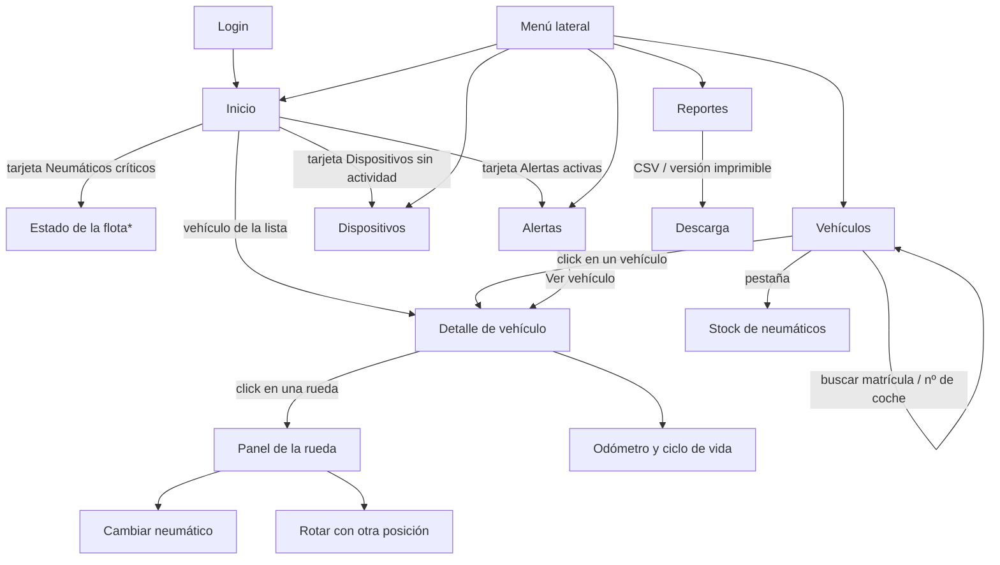
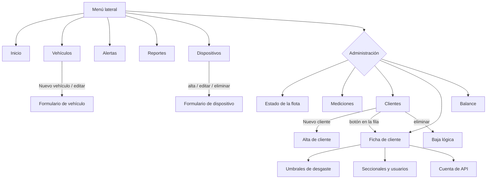

# 12 · Mapa de navegación del panel

Qué ve cada rol, a dónde lleva cada pestaña y qué se puede hacer en cada pantalla. Está sacado del código (`adminpanel/index.html`, `assets/js/core/nav.js`, `assets/js/views/`) a 2026-11-06. Si algo no coincide con lo que ves en el panel, el código manda: corregir este documento.

## 1. Rol cliente (gomero / gestor de flota)

Menú lateral: **Inicio · Vehículos · Alertas · Reportes · Dispositivos**. Con perfil global aparece además el selector **Seccional** (Todas / Montevideo / Salto…), que filtra todas las pantallas; un perfil de seccional no lo ve porque la base ya le limita los datos.

\* "Estado de la flota" hoy es una pantalla de administración; el cliente llega a su contenido desde Inicio. Es uno de los puntos a resolver (sección 4).

| Pantalla | Para qué sirve | Qué puede hacer el cliente |
|---|---|---|
| Inicio | Ver qué neumáticos o dispositivos necesitan atención | Ir a Alertas, Dispositivos o a un vehículo |
| Vehículos | Encontrar un camión | Buscar por matrícula o número de coche, abrir el detalle, ver el stock (solo lectura) |
| Detalle de vehículo | Ver el estado de cada rueda | Elegir una rueda, ver mediciones y gráfico, cambiar neumático, rotar, registrar odómetro |
| Alertas | Lista de problemas activos | Filtrar por severidad y tipo, abrir el vehículo |
| Reportes | Sacar informes | Exportar CSV o versión imprimible por vehículo |
| Dispositivos | Saber si los calibres envían datos | Ver estado y última actividad (solo lectura) |

## 2. Rol administrador (NEUMET)

Menú lateral: lo del cliente más la sección **Administración**: Estado de la flota · Mediciones · Clientes · Ficha de cliente · Balance.

| Pantalla | Qué hace el administrador además |
|---|---|
| Vehículos | Alta, edición y baja de vehículos; filtro por cliente; stock con alta y edición |
| Dispositivos | Alta, edición, eliminación y asignación a cliente |
| Clientes | Alta (con invitación o contraseña), baja lógica, ir a la ficha |
| Ficha de cliente | Editar umbrales; crear seccionales, asignar vehículos y dispositivos, crear usuarios de seccional; crear cuentas de API |
| Estado de la flota | Resumen por vehículo con prioridades, filtrable por cliente |
| Mediciones | Historial de mediciones por vehículo y dispositivo |
| Balance | Gastos y valor del inventario |

## 3. De dónde sale cada dato (para entender qué rompe qué)

- Inicio, Estado de la flota y Alertas usan las vistas `v_estado_neumaticos`, `v_alertas` y `v_resumen_flota_cliente`.
- Dispositivos usa `v_salud_dispositivos`.
- Detalle de vehículo usa `v_estado_neumaticos`, `v_ultima_medicion`, `mediciones` y `eventos_neumatico`.
- Todas las escrituras del cliente pasan por operaciones acotadas (`neumatico_cambiar`, `neumatico_rotar`, `vehiculo_registrar_odometro`); el cliente no escribe tablas directamente.

## 4. Problemas de navegación detectados (a resolver)

1. **Inicio no orienta.** Muestra poco y casi todo en rojo; no ofrece el camino más corto a la tarea principal (buscar un camión, ver lo urgente).
2. **El buscador debería estar a un paso desde cualquier pantalla**, no solo dentro de Vehículos.
3. **Stock vive como pestaña dentro de Vehículos**; no se encuentra por el menú y, para el cliente, mezcla un inventario con la búsqueda de camiones.
4. **"Estado de la flota" duplica a Inicio** para el cliente y solo está en Administración.
5. **Ficha de cliente y Clientes son dos pasos** para algo que el administrador hace junto.
6. **Hay textos de relleno y tonos informales** que no ayudan a decidir (ver `docs/13-checklist-revision-prs.md`, apartado de copy).

Propuesta de menú del cliente tras resolverlos: **Inicio (con buscador) · Vehículos · Alertas · Reportes · Dispositivos**, sin pantallas duplicadas, y con el detalle de vehículo como destino de todo (búsqueda, Inicio y Alertas).
