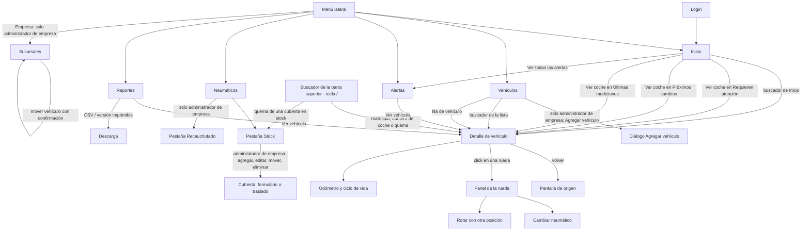
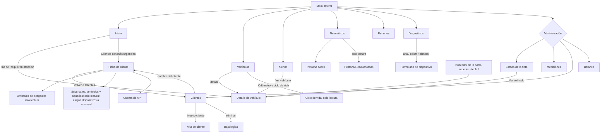

# 12 · Mapa de navegación del panel

Qué ve cada rol, a dónde lleva cada elemento y qué se puede hacer en cada pantalla. Está sacado del código (`adminpanel/index.html`, `assets/js/core/nav.js`, `assets/js/core/buscador.js`, `assets/js/views/`). Si algo no coincide con lo que se ve en el panel, el código manda: corregir este documento.

**Fuente de verdad del menú.** Este mapa (en especial la sección 4, «Tabla de destinos del menú») es la fuente de verdad de qué ítems tiene el menú, a dónde lleva cada uno y dónde se busca cada tarea. Un PR que agrega, mueve, renombra o duplica un ítem o una pestaña actualiza este mapa en el mismo PR, y el revisor lo comprueba con la pregunta fija de [docs/13](13-checklist-revision-prs.md) sección 3. Una tarea frecuente no se ofrece en dos lugares sin justificarlo aquí.

## 1. Cambios respecto al mapa anterior

| Problema detectado | Resolución |
|---|---|
| Inicio no orientaba y mostraba casi todo en rojo | Inicio es un panel de decisión: buscador, proporciones de la flota, vehículos que requieren atención, próximos cambios. El rojo queda solo como punto o chip de neumáticos críticos |
| El buscador solo existía dentro de Vehículos | Buscador en la barra superior de todas las pantallas (atajo `/`). En Inicio y en Vehículos lo reemplaza el buscador propio de la pantalla |
| Stock era una pestaña escondida en Vehículos | Pestaña **Stock** del ítem **Neumáticos** del menú. El administrador de empresa agrega y gestiona sus propias cubiertas (una por una, con quema, condición y sucursal); los lotes anteriores quedan como bloque de solo lectura |
| «Estado de la flota» duplicaba a Inicio para el cliente | El cliente no la ve: su equivalente es **Vehículos**, ordenado por urgencia con el estado de cada uno. El administrador la conserva en Administración como vista entre clientes |
| Clientes y Ficha de cliente eran dos entradas | Una sola entrada, **Clientes**. El nombre de un cliente abre su ficha, con «Volver a Clientes» y migas «Clientes › Nombre» |
| Vehículos mencionados sin enlace al detalle | Todo vehículo de Inicio, Alertas, Estado de la flota y Reportes abre el detalle |
| Dispositivos no aporta al cliente (no gestiona hardware) | La vista es solo de administración: sin ítem de menú para el cliente y el router la rechaza (`registerView(..., { soloAdmin: true })`: `switchView` devuelve a Inicio al cliente que la pida por menú, enlace o acción). El estado de sus equipos queda en Inicio como dato, sin enlace |
| Inicio no mostraba qué se midió últimamente | Bloque «Últimas mediciones»: los 8 vehículos medidos más recientemente con la comparativa de desgaste de cada neumático respecto de su medición anterior |
| Inicio mostraba las posiciones como «P1, P2…», sin significado a la vista | Mini vehículo (SVG liviano, vista desde arriba) con las ruedas coloreadas por desgaste y la rueda en cuestión resaltada, más el nombre de la posición en texto («Delantera izquierda», «Eje 2 derecha exterior»; convención en `assets/js/domain/posicion.js`). Se usa en Requieren atención, Próximos cambios, Últimas mediciones, Alertas y la tabla de km del ciclo de vida |
| El buscador de Inicio no se distinguía de las tarjetas y el resumen de proporciones iba antes de las decisiones | El buscador es un bloque propio, centrado y alto, sobre las tarjetas. El resumen «N de M neumáticos en buen estado» va después de Próximos cambios |
| Migas y menú activo incoherentes | `registerView(..., { menu })` define qué ítem queda resaltado; las migas muestran «Padre › Actual». Las dos pestañas de Neumáticos llevan la misma miga («Neumáticos › Stock» / «Neumáticos › Recauchutado») y sin título repetido bajo las pestañas; el detalle de vehículo no repite «Vehículos ›» junto a «Volver» (`sinMigas`) |
| El selector «Sucursal» de la barra superior aparecía en todas las vistas aunque no filtrara | Solo se muestra donde filtra (`selectorEnVista` en `domain/seccional.js`: Inicio, Vehículos, Alertas, Reportes, calidad, flota, mediciones y dispositivos); Stock lo toma como valor inicial de su filtro de sucursal. En 390 px baja a su propia fila a todo el ancho |

## 2. Rol cliente (gomero / gestor de flota)

Nomenclatura (plan de [docs/17](17-plan-roles-admin.md), F10 en curso): el perfil global es el «Administrador de empresa» y el perfil de sucursal el «Usuario de sucursal»; la base conserva los valores `cliente` y `admin`. Esta sección usa ambos nombres: «perfil global» equivale a «administrador de empresa».

Menú lateral: **Inicio · Vehículos · Neumáticos · Alertas · Reportes**. «Neumáticos» agrupa dos pestañas, **Stock** y **Recauchutado** (esta última solo para el administrador de empresa y el equipo Neumet, este en solo lectura). El administrador de empresa ve además **Sucursales** dentro de la sección **Empresa** (con Usuarios, Umbrales y Dispositivos); el perfil de sucursal y el equipo Neumet no la ven. Con perfil global aparece además el selector **Sucursal** (Todas / Montevideo / Salto…) que filtra todas las pantallas; un perfil de sucursal no lo ve porque la base ya le limita los datos.

Orden de Inicio (de arriba abajo): buscador (bloque destacado) · Requieren atención y Próximos cambios (dos columnas en escritorio) · resumen «N de M neumáticos en buen estado» · Últimas mediciones · Clientes con más urgencias (solo administración) · línea de dispositivos.

Cada fila de vehículo trae un mini vehículo y el botón «Ver coche 106», que abre el detalle y deja seleccionada la rueda señalada (`verVehiculo` acepta la posición como segundo argumento; si el vehículo no tiene datos de esa posición, abre sin selección). Las posiciones se nombran así: eje 1 «Delantera izquierda/derecha»; ejes siguientes «Eje N izquierda/derecha» y, si son duales, «exterior» o «interior» (la más cercana al chasis); posición 99 «Auxilio». En las listas compactas, más de tres posiciones se resumen como «N posiciones».

Inicio incluye una línea con los dispositivos activos y los que llevan días sin actividad (solo informativa en el cliente; sin enlace ni gestión).

### Últimas mediciones (Inicio)

Una visita es el conjunto de mediciones de un vehículo en el mismo día (hora de Montevideo). El bloque lista los 8 vehículos medidos más recientemente (de la sucursal elegida, si hay selector) con número de coche, matrícula, fecha y, por neumático, «mm anterior → mm última» y la diferencia. La comparativa solo existe si ese mismo neumático (`idneumatico`) tiene una medición anterior a la visita; si no, muestra los mm y «Sin previa». Un desgaste mayor a 1 mm entre visitas se destaca en ámbar; una lectura mayor que la anterior por más de 0,3 mm se muestra con signo «+». El estado nunca se comunica solo con color: la diferencia siempre va escrita. Los datos salen de la función `ultimas_mediciones` (migración `20261110020000_ultimas_mediciones.sql`, security invoker: la RLS decide qué ve cada rol). Si la función falla, solo ese bloque muestra el error.

### Dónde lleva cada click (cliente)

| Pantalla | Elemento | Destino | Menú resaltado |
|---|---|---|---|
| Barra superior (todas menos Inicio y Vehículos) | Buscador: Enter con una coincidencia, o elegir un resultado | Detalle de vehículo | Vehículos |
| Barra superior e Inicio | Buscador con la quema de una cubierta que está en stock (resultado «Quema S-001 · En stock · …») | Stock filtrado por esa quema | Neumáticos (pestaña Stock) |
| Cambio de neumático | «Cubierta del stock» (opción por defecto si hay) o «Lote del stock»; destino «Almacenar» con la sucursal donde queda | Detalle del vehículo (se refresca) | Vehículos |
| Inicio | Buscador | Detalle (una coincidencia) o lista de resultados | Inicio → Vehículos |
| Inicio | «Ver coche N» de «Requieren atención» | Detalle de vehículo (rueda señalada seleccionada) | Vehículos |
| Inicio | «Ver coche N» de «Próximos cambios» | Detalle de vehículo (rueda seleccionada) | Vehículos |
| Inicio | «Ver todas las alertas» | Alertas | Alertas |
| Inicio | «Ver coche N» de «Últimas mediciones» | Detalle de vehículo | Vehículos |
| Alertas | «Ver vehículo» | Detalle de vehículo (rueda de la alerta seleccionada) | Vehículos |
| Vehículos | Fila de vehículo | Detalle de vehículo | Vehículos |
| Vehículos | «Agregar vehículo» (solo administrador de empresa) | Diálogo de alta; al guardar, la lista se recarga | Vehículos |
| Reportes | «Ver vehículo» (con un vehículo elegido) | Detalle de vehículo | Vehículos |
| Detalle | «Volver a …» | Pantalla desde la que se abrió | La de esa pantalla |
| Detalle | Miga «Vehículos» | Vehículos | Vehículos |
| Detalle | Rueda | Panel de la rueda (cambiar, rotar) | Vehículos |
| Sucursales | Alta, nombre, «Eliminar», selector de sucursal de cada vehículo. «Agregar vehículo» vive ahora en Vehículos | La misma pantalla (aviso y recarga) | Sucursales |

| Pantalla | Para qué sirve | Qué puede hacer el cliente |
|---|---|---|
| Inicio | Ver el estado de la flota, qué requiere atención y cómo cambió el desgaste en las últimas visitas | Buscar un vehículo, abrir uno de las listas, ir a Alertas |
| Vehículos | Encontrar un camión | Buscar por matrícula o número de coche, abrir el detalle |
| Detalle de vehículo | Ver el estado de cada rueda | Elegir una rueda, ver mediciones y gráfico, cambiar neumático, rotar, registrar odómetro |
| Alertas | Lista de problemas activos | Filtrar por estado con los chips (un solo mecanismo; otro clic quita el filtro), abrir el vehículo. «Abierta» va en naranja con ▲, el estado siempre en texto y símbolo |
| Neumáticos › Stock (administrador de empresa) | Cubiertas disponibles, su condición y dónde están | Buscar por quema, marca o modelo; filtrar por sucursal y condición; agregar, editar, mover entre sucursales y eliminar cubiertas que nunca se usaron. Debajo, los lotes anteriores (solo lectura) |
| Neumáticos › Stock (usuario de sucursal) | No ve el stock | Pantalla vacía: el stock lo gestiona el administrador de empresa. Es la única pestaña que ve: Recauchutado no se le muestra y, si se intenta abrir, vuelve a Stock |
| Reportes | Sacar informes | Exportar CSV o versión imprimible; abrir el vehículo elegido |
| Sucursales (solo administrador de empresa) | Organizar la flota por sucursal | Crear, renombrar y eliminar sucursales (solo vacías); mover un vehículo a otra sucursal o a «Sin sucursal», con confirmación |

## 3. Rol administrador (NEUMET)

> **Nomenclatura** ([docs/17](17-plan-roles-admin.md), F10 en curso): este rol es el «Equipo Neumet» (el valor `admin` de la base no cambia) y el cliente con perfil global (sección 2) es el «Administrador de empresa»; el perfil de sucursal es el «Usuario de sucursal». Dentro de una empresa el equipo Neumet solo mira (C2); esta sección describe lo que sigue pudiendo hacer.

Menú lateral: lo del cliente, **Dispositivos** (solo administración) y la sección **Administración**: Estado de la flota · Mediciones · Clientes · Balance · Uso.

| Pantalla | Qué hace el administrador además | Menú resaltado |
|---|---|---|
| Vehículos | Filtro por cliente; ver detalle y ciclo de vida, ambos en solo lectura (sin alta, edición, baja ni acciones sobre neumáticos o costos) | Vehículos |
| Neumáticos › Stock | Filtro por cliente; cubiertas y lotes anteriores en solo lectura (sin alta ni edición) | Neumáticos |
| Neumáticos › Recauchutado | Procesos de recauchutado en solo lectura (sin acciones) | Neumáticos |
| Dispositivos | Alta, edición, eliminación y asignación a cliente | Dispositivos |
| Clientes | Alta (con invitación o contraseña), baja lógica; el nombre abre la ficha | Clientes |
| Ficha de cliente | Umbrales, sucursales y usuarios en solo lectura (crearlos es del administrador de empresa; Neumet solo asigna dispositivos a una sucursal); crear cuentas de API | Clientes |
| Estado de la flota | Resumen por vehículo con prioridades, filtrable por cliente; abre el detalle | Estado de la flota |
| Mediciones | Historial de mediciones por vehículo y dispositivo | Mediciones |
| Balance | Gastos y valor del inventario | Balance |
| Uso | Consumo mensual por cliente (llamadas API, vehículos, dispositivos, usuarios); solo meses cerrados, meses UTC | Uso |

Inicio para el administrador añade el bloque «Clientes con más urgencias» (solo los que tienen neumáticos o alertas críticas); cada fila abre la ficha del cliente.

## 4. Tabla de destinos del menú

| Ítem | Vista (`data-view`) | Vista que cuelga de él |
|---|---|---|
| Inicio | `inicio` | |
| Vehículos | `vehiculos` | `vehiculo-detalle` (con «Agregar vehículo» para el administrador de empresa) |
| Alertas | `alertas` | |
| Neumáticos | `stock` | `recauchutado` (segunda pestaña) |
| Reportes | `reportes` | |
| Sucursales (Empresa, administrador de empresa) | `sucursales` | |
| Dispositivos (admin) | `dispositivos` | |
| Estado de la flota (admin) | `flota` | |
| Mediciones (admin) | `mediciones` | |
| Clientes (admin) | `clientes` | `ficha` |
| Balance (admin) | `balance` | |
| Uso (admin) | `uso` | |

Las RPC de sucursales (`sucursal_crear`, `sucursal_renombrar`, `sucursal_eliminar`) aceptan solo al administrador de empresa, sobre su propio cliente; desde la migración C2 el equipo Neumet recibe «permiso denegado» (`42501`), igual que el usuario de sucursal, otro cliente, el rol `api`, una sesión sin perfil y `anon`. La ficha de cliente es de solo lectura: las sucursales se administran en Empresa > Sucursales.

La prueba `tests/smoke/inicio.flow.js` recorre todos los ítems visibles de cada rol y comprueba que cargan sin errores de consola ni recursos sin cargar, que solo un ítem queda resaltado y que cada vista tiene título. Las pruebas `salud.flow.js`, `flota.flow.js` y `vehiculo.flow.js` comprueban la ficha, los enlaces al detalle y el botón «Volver».

## 5. De dónde sale cada dato (para entender qué rompe qué)

- Inicio, Estado de la flota y Alertas usan las vistas `v_estado_neumaticos`, `v_alertas` y `v_resumen_flota_cliente`.
- Inicio añade `v_salud_dispositivos`, la cuenta de vehículos activos y la función `ultimas_mediciones`.
- Dispositivos (solo administración) usa `v_salud_dispositivos`.
- El buscador usa su propio catálogo: tabla `vehiculos` (`id`, `nombre`, `patente`, `numero`, `activo`, `cliente_id`, `sucursal_id`), paginada. No depende de `v_estado_neumaticos`.
- Vehículos escribe con `vehiculo_crear` (diálogo «Agregar vehículo», solo administrador de empresa).
- Detalle de vehículo usa `v_estado_neumaticos`, `v_ultima_medicion`, `mediciones` y `eventos_neumatico`.
- Sucursales usa las tablas `sucursales` y `vehiculos` (lectura, filtradas por cliente) y escribe solo con `sucursal_crear`, `sucursal_renombrar`, `sucursal_eliminar` y `vehiculo_mover_sucursal`. Mover un vehículo solo cambia `vehiculos.sucursal_id`: mediciones, neumáticos y eventos siguen asociados al vehículo y el movimiento queda en `audit_log` (acción `MOVER_SUCURSAL`).
- Todas las escrituras del cliente pasan por operaciones acotadas (`neumatico_cambiar`, `neumatico_rotar`, `vehiculo_registrar_odometro` y las de sucursales); el cliente no escribe tablas directamente.

## 6. Reglas de navegación

1. Todo vehículo que aparece en una pantalla enlaza a su detalle.
2. El detalle recuerda la pantalla de origen: «Volver a Inicio», «Volver a Alertas», etc.
3. Una vista que cuelga de otra (detalle, ficha) resalta el ítem de su padre y muestra «Padre › Actual» en la barra superior.
4. El rojo se reserva a neumáticos críticos y siempre acompaña a un texto.
5. Un elemento de administración nunca se muestra al cliente (`data-admin-only`; la base lo impide igual por RLS). Las vistas de administración se registran con `soloAdmin` y el router las rechaza aunque se fuerce el cambio de vista.
