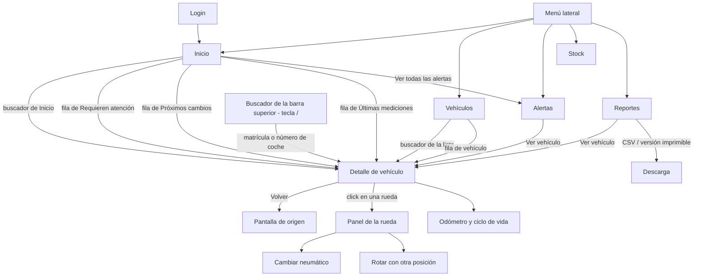
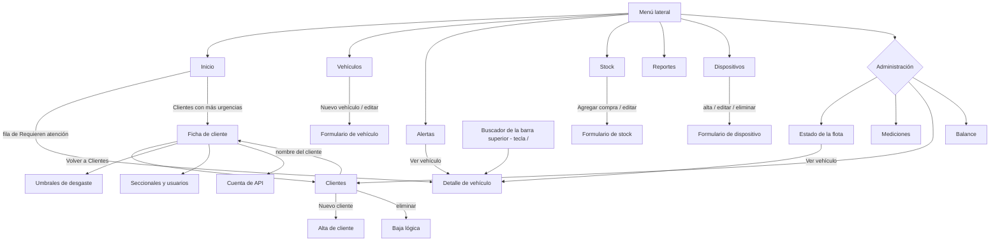

# 12 · Mapa de navegación del panel

Qué ve cada rol, a dónde lleva cada elemento y qué se puede hacer en cada pantalla. Está sacado del código (`adminpanel/index.html`, `assets/js/core/nav.js`, `assets/js/core/buscador.js`, `assets/js/views/`). Si algo no coincide con lo que se ve en el panel, el código manda: corregir este documento.

## 1. Cambios respecto al mapa anterior

| Problema detectado | Resolución |
|---|---|
| Inicio no orientaba y mostraba casi todo en rojo | Inicio es un panel de decisión: buscador, proporciones de la flota, vehículos que requieren atención, próximos cambios. El rojo queda solo como punto o chip de neumáticos críticos |
| El buscador solo existía dentro de Vehículos | Buscador en la barra superior de todas las pantallas (atajo `/`). En Inicio y en Vehículos lo reemplaza el buscador propio de la pantalla |
| Stock era una pestaña escondida en Vehículos | Entrada propia del menú: **Stock** (solo lectura para el cliente) |
| «Estado de la flota» duplicaba a Inicio para el cliente | El cliente no la ve: su equivalente es **Vehículos**, ordenado por urgencia con el estado de cada uno. El administrador la conserva en Administración como vista entre clientes |
| Clientes y Ficha de cliente eran dos entradas | Una sola entrada, **Clientes**. El nombre de un cliente abre su ficha, con «Volver a Clientes» y migas «Clientes › Nombre» |
| Vehículos mencionados sin enlace al detalle | Todo vehículo de Inicio, Alertas, Estado de la flota y Reportes abre el detalle |
| Dispositivos no aporta al cliente (no gestiona hardware) | La vista es solo de administración: sin ítem de menú para el cliente y el router la rechaza (`registerView(..., { soloAdmin: true })`: `switchView` devuelve a Inicio al cliente que la pida por menú, enlace o acción). El estado de sus equipos queda en Inicio como dato, sin enlace |
| Inicio no mostraba qué se midió últimamente | Bloque «Últimas mediciones»: los 8 vehículos medidos más recientemente con la comparativa de desgaste de cada neumático respecto de su medición anterior |
| Migas y menú activo incoherentes | `registerView(..., { menu })` define qué ítem queda resaltado; las migas muestran «Padre › Actual» |

## 2. Rol cliente (gomero / gestor de flota)

Menú lateral: **Inicio · Vehículos · Alertas · Stock · Reportes**. Con perfil global aparece además el selector **Seccional** (Todas / Montevideo / Salto…) que filtra todas las pantallas; un perfil de seccional no lo ve porque la base ya le limita los datos.

Inicio incluye una línea con los dispositivos activos y los que llevan días sin actividad (solo informativa en el cliente; sin enlace ni gestión).

### Últimas mediciones (Inicio)

Una visita es el conjunto de mediciones de un vehículo en el mismo día (hora de Montevideo). El bloque lista los 8 vehículos medidos más recientemente (de la seccional elegida, si hay selector) con número de coche, matrícula, fecha y, por neumático, «mm anterior → mm última» y la diferencia. La comparativa solo existe si ese mismo neumático (`idneumatico`) tiene una medición anterior a la visita; si no, muestra los mm y «Sin previa». Un desgaste mayor a 1 mm entre visitas se destaca en ámbar; una lectura mayor que la anterior por más de 0,3 mm se muestra con signo «+». El estado nunca se comunica solo con color: la diferencia siempre va escrita. Los datos salen de la función `ultimas_mediciones` (migración `20261110020000_ultimas_mediciones.sql`, security invoker: la RLS decide qué ve cada rol). Si la función falla, solo ese bloque muestra el error.

### Dónde lleva cada click (cliente)

| Pantalla | Elemento | Destino | Menú resaltado |
|---|---|---|---|
| Barra superior (todas menos Inicio y Vehículos) | Buscador: Enter con una coincidencia, o elegir un resultado | Detalle de vehículo | Vehículos |
| Inicio | Buscador | Detalle (una coincidencia) o lista de resultados | Inicio → Vehículos |
| Inicio | Fila de «Requieren atención» | Detalle de vehículo | Vehículos |
| Inicio | Fila de «Próximos cambios» | Detalle de vehículo | Vehículos |
| Inicio | «Ver todas las alertas» | Alertas | Alertas |
| Inicio | Fila de «Últimas mediciones» | Detalle de vehículo | Vehículos |
| Vehículos | Fila de vehículo | Detalle de vehículo | Vehículos |
| Alertas | «Ver vehículo» | Detalle de vehículo | Vehículos |
| Reportes | «Ver vehículo» (con un vehículo elegido) | Detalle de vehículo | Vehículos |
| Detalle | «Volver a …» | Pantalla desde la que se abrió | La de esa pantalla |
| Detalle | Miga «Vehículos» | Vehículos | Vehículos |
| Detalle | Rueda | Panel de la rueda (cambiar, rotar) | Vehículos |

| Pantalla | Para qué sirve | Qué puede hacer el cliente |
|---|---|---|
| Inicio | Ver el estado de la flota, qué requiere atención y cómo cambió el desgaste en las últimas visitas | Buscar un vehículo, abrir uno de las listas, ir a Alertas |
| Vehículos | Encontrar un camión | Buscar por matrícula o número de coche, abrir el detalle |
| Detalle de vehículo | Ver el estado de cada rueda | Elegir una rueda, ver mediciones y gráfico, cambiar neumático, rotar, registrar odómetro |
| Alertas | Lista de problemas activos | Filtrar por severidad y tipo, abrir el vehículo |
| Stock | Inventario de neumáticos | Solo lectura |
| Reportes | Sacar informes | Exportar CSV o versión imprimible; abrir el vehículo elegido |

## 3. Rol administrador (NEUMET)

Menú lateral: lo del cliente, **Dispositivos** (solo administración) y la sección **Administración**: Estado de la flota · Mediciones · Clientes · Balance.

| Pantalla | Qué hace el administrador además | Menú resaltado |
|---|---|---|
| Vehículos | Alta, edición y baja de vehículos; filtro por cliente; ver detalle | Vehículos |
| Stock | Alta y edición de compras; filtro por cliente | Stock |
| Dispositivos | Alta, edición, eliminación y asignación a cliente | Dispositivos |
| Clientes | Alta (con invitación o contraseña), baja lógica; el nombre abre la ficha | Clientes |
| Ficha de cliente | Editar umbrales; crear seccionales, asignar vehículos y dispositivos, crear usuarios de seccional; crear cuentas de API | Clientes |
| Estado de la flota | Resumen por vehículo con prioridades, filtrable por cliente; abre el detalle | Estado de la flota |
| Mediciones | Historial de mediciones por vehículo y dispositivo | Mediciones |
| Balance | Gastos y valor del inventario | Balance |

Inicio para el administrador añade el bloque «Clientes con más urgencias» (solo los que tienen neumáticos o alertas críticas); cada fila abre la ficha del cliente.

## 4. Tabla de destinos del menú

| Ítem | Vista (`data-view`) | Vista que cuelga de él |
|---|---|---|
| Inicio | `inicio` | |
| Vehículos | `vehiculos` | `vehiculo-detalle` |
| Alertas | `alertas` | |
| Stock | `stock` | |
| Reportes | `reportes` | |
| Dispositivos (admin) | `dispositivos` | |
| Estado de la flota (admin) | `flota` | |
| Mediciones (admin) | `mediciones` | |
| Clientes (admin) | `clientes` | `ficha` |
| Balance (admin) | `balance` | |

La prueba `tests/smoke/inicio.flow.js` recorre todos los ítems visibles de cada rol y comprueba que cargan sin errores de consola ni recursos sin cargar, que solo un ítem queda resaltado y que cada vista tiene título. Las pruebas `salud.flow.js`, `flota.flow.js` y `vehiculo.flow.js` comprueban la ficha, los enlaces al detalle y el botón «Volver».

## 5. De dónde sale cada dato (para entender qué rompe qué)

- Inicio, Estado de la flota y Alertas usan las vistas `v_estado_neumaticos`, `v_alertas` y `v_resumen_flota_cliente`.
- Inicio añade `v_salud_dispositivos`, la cuenta de vehículos activos y la función `ultimas_mediciones`.
- Dispositivos (solo administración) usa `v_salud_dispositivos`.
- El buscador usa su propio catálogo: tabla `vehiculos` (`id`, `nombre`, `patente`, `numero`, `activo`, `cliente_id`, `sucursal_id`), paginada. No depende de `v_estado_neumaticos`.
- Detalle de vehículo usa `v_estado_neumaticos`, `v_ultima_medicion`, `mediciones` y `eventos_neumatico`.
- Todas las escrituras del cliente pasan por operaciones acotadas (`neumatico_cambiar`, `neumatico_rotar`, `vehiculo_registrar_odometro`); el cliente no escribe tablas directamente.

## 6. Reglas de navegación

1. Todo vehículo que aparece en una pantalla enlaza a su detalle.
2. El detalle recuerda la pantalla de origen: «Volver a Inicio», «Volver a Alertas», etc.
3. Una vista que cuelga de otra (detalle, ficha) resalta el ítem de su padre y muestra «Padre › Actual» en la barra superior.
4. El rojo se reserva a neumáticos críticos y siempre acompaña a un texto.
5. Un elemento de administración nunca se muestra al cliente (`data-admin-only`; la base lo impide igual por RLS). Las vistas de administración se registran con `soloAdmin` y el router las rechaza aunque se fuerce el cambio de vista.
